# Domain model

Entities for a booking system for conferences + food & drink. Phasing: **MVP**, **Phase 2**, **Phase 3**. ★ = differentiator against Lega and the others.

Interactive view: [artifacts/domain-model.html](artifacts/domain-model.html).

The model is configurable (see [ADR 0021](decisions/0021-configurable-items.md)). The code contains no domain words such as dish, allergen, room or kitchen order. Each organization sets up its own types, fields, vocabularies, setups, ticket phases, item states, sheets and responsibilities. The code only owns generic behaviors and flags.

## Core flow

Ticket (moves through the organization's phases) → Lines with states (prebooked → booked …) → Quote → Signing (later) → Requirements → Sheets → Delivery → Invoice → Fortnox / Visma

## ER diagram (MVP)

```mermaid
erDiagram
  Customer ||--o{ Contact : "has"
  Customer ||--o{ Ticket : "sends"
  Contact ||--o{ Ticket : "is contact for"
  Customer }o--o| PriceList : "uses"
  PriceList ||--o{ PriceListItem : "contains"
  PriceListItem }o--o| Item : "refers to"
  Ticket ||--o{ Quote : "is answered by"
  Quote |o--o{ Quote : "is revised as"
  Quote ||--o{ OrderLine : "contains"
  Ticket ||--o{ ProgramItem : "has lines"
  Ticket ||--o{ Requirement : "has"
  ProgramItem ||--o{ Requirement : "adjusts"
  Requirement }o--|| VocabularyValue : "refers to"
  Ticket }o--|| CancellationTerms : "follows"
  Ticket ||--o{ Deposit : "requires"
  Ticket ||--o{ Invoice : "is invoiced via"
  Ticket ||--o{ Sheet : "produces"
  Ticket ||--o{ Assignment : "is assigned via"
  Item ||--o{ Assignment : "is assigned via"
  Responsibility ||--o{ Assignment : "scopes"
  Assignment ||--o{ AssignmentFollower : "has"
  User ||--o{ Assignment : "answers for"
  User ||--o{ AssignmentFollower : "follows"
  Customer ||--o{ Item : "owns packages"
  Ticket ||--o{ InboundEmail : "receives replies as"
  Ticket ||--o{ Payment : "is paid with"
  EntityType ||--o{ FieldDefinition : "has"
  EntityType ||--o{ Item : "classifies"
  Vocabulary ||--o{ VocabularyValue : "has"
  FieldDefinition }o--o| Vocabulary : "selects from"
  FieldDefinition }o--o| EntityType : "links to records of"
  ProgramItem ||--o{ OrderLine : "is charged via"
  ProgramItem ||--o| Occupancy : "holds"
  Venue ||--o{ Item : "has"
  Item ||--o{ ItemComponent : "contains"
  Item ||--o{ ItemComponent : "is part of"
  Item ||--o{ ItemChoiceGroup : "has"
  ItemChoiceGroup ||--o{ ItemComponent : "groups"
  Item ||--o{ Occupancy : "has"
  Item ||--o{ ItemSetup : "has"
  Setup ||--o{ ItemSetup : "is used in"
  Item }o--o{ VocabularyValue : "is tagged with"
  OrderLine }o--|| Item : "refers to"
  SheetDefinition ||--o{ Sheet : "produces version"
  SheetDefinition }o--|| Responsibility : "goes to"
  Responsibility }o--o{ EntityType : "covers"
  User ||--o{ Invitation : "invites"
  User ||--o{ UserPreference : "saves"
  Deposit ||--o{ Payment : "is paid with"
  Invoice ||--o{ Payment : "is settled with"
  Invoice ||--o{ OrderLine : "invoices"
  Invoice ||--o{ Deposit : "offsets"
  Ticket }o--|| TicketPhase : "is in"
  TicketPhase ||--o{ TicketPhaseTransition : "from"
  TicketPhase ||--o{ TicketPhaseTransition : "to"
  EntityType ||--o{ ItemState : "has"
  ItemState ||--o{ ItemStateTransition : "from"
  ItemState ||--o{ ItemStateTransition : "to"
  ProgramItem }o--|| ItemState : "is in"
  TicketPhase ||--o{ PhaseStateRule : "sets"
  EntityType ||--o{ PhaseStateRule : "is set by"
  ItemState ||--o{ PhaseStateRule : "is the result of"
  TicketTemplate }o--|| TicketPhase : "starts in"
  TicketTemplate ||--o{ ProgramItem : "prepares lines like"
```

## Configuration

*MVP* · What the organization sets up itself. Everything is data per organization and is created through regular operations ([ADR 0021](decisions/0021-configurable-items.md)).

A new organization starts with the fixed access roles (`viewer`, `member`, `admin`, `owner`; [ADR 0034](decisions/0034-fixed-access-roles-and-responsibilities.md)) and no responsibilities. Nothing else is preinstalled, except the default ticket phases, item states and grid so that tickets work right away (ADR 0044). Templates can be imported, for example the vocabulary "EU's 14 allergens" or the starter pack "Conference venue" (`configuration.importTemplate`: lists, setups, and types with behaviours and fields; idempotent, existing names are skipped). A template is only data and can be changed freely afterwards. The AI assistant can propose a configuration, and the user approves.

### EntityType (`EntityType`)

*MVP* · The organization's own type for a base entity: item, customer, contact, ticket, requirement or program item.

**Attributes**
- base entity (`ITEM | CUSTOMER | CONTACT | TICKET | REQUIREMENT | PROGRAM_ITEM`)
- name (e.g. Conference room, Dish, Boat, Package, Company, Conference) — unique per base entity
- behaviors (`ITEM` only): `PRICED`, `COMPOSABLE`, `CHOICES`, `BOOKABLE`, `SETUPS` — `CHOICES` requires `COMPOSABLE`, `SETUPS` requires `BOOKABLE` (otherwise `VALIDATION`)

**Relations**
- `1:N` has → FieldDefinition
- `1:N` classifies → Item (and customer, ticket, etc.)

> Archiving is denied (`CONFLICT`) as long as active items of the type exist. A behavior cannot be turned off as long as any active item of the type has data for it (`CONFLICT`).

### FieldDefinition (`FieldDefinition`)

*MVP* · A custom field on a type.

**Attributes**
- name
- key (`key`) — generated from the name (e.g. "Area m²" → `area_m2`), never changes, unique per type even among archived
- field type (`TEXT | NUMBER | BOOLEAN | DATE | CHOICE | MULTI_CHOICE | LINK`)
- required
- vocabulary OR own options (`options`) for choice/multi-choice — exactly one source
- target type (`linkTypeId`) for LINK — an item, customer, contact or ticket type; the value is the id of an active record of that type in the same organization
- order (`position`)

**Relations**
- `N:1` EntityType has this
- `N:0..1` selects from → Vocabulary
- `N:0..1` links to records of → EntityType (LINK fields)

> Values are stored as JSON on the row. Rules (`CONFLICT` when data exists): the field type or vocabulary cannot be changed, options in use cannot be removed, the field cannot become required as long as records (items, customers, contacts) lack a value, the field cannot be archived as long as records have a value. The same holds for list values in use and for archiving the type. A LINK field's target type cannot change while records have a value, and a linked record (or a type a LINK field targets) cannot be archived while a LINK points to it.

### Vocabulary (`Vocabulary`) and VocabularyValue (`VocabularyValue`)

*MVP* · The organization's own word lists, e.g. Allergens, Diet, Accessibility or Dress code. The template "EU's 14 allergens" can be imported via `vocabulary.importTemplate`.

**Attributes**
- vocabulary: name — unique
- value: name, order, archived

**Relations**
- `1:N` Vocabulary has → VocabularyValue
- `N:M` Item is tagged with → VocabularyValue (via fields that select from the vocabulary)
- `1:N` Requirement refers to ← VocabularyValue

> Tags = values in fields that select from a vocabulary (no separate tag rows). A value cannot be archived as long as an item carries it or a requirement counts it. A vocabulary cannot be archived as long as a field uses it or a requirement counts one of its values.

### Setup (`Setup`)

*MVP* · The organization's own setups, e.g. Cinema, U-shape and Mingle.

**Attributes**
- name — unique
- changeover time (`changeoverMinutes`)

**Relations**
- `1:N` is used in → ItemSetup

> Cannot be archived as long as an active item has capacity for it.

### ItemSetup (`ItemSetup`)

*MVP* · Capacity per bookable item and setup, unique per pair.

**Attributes**
- item
- setup
- capacity

**Relations**
- `N:1` Item has this
- `N:1` Setup is used in this

> Replaced as a set by `item.create/update` (`setups`).

### SheetDefinition (`SheetDefinition`)

*MVP* · What a sheet looks like, e.g. "Kitchen order" or "Brewing order".

**Attributes**
- name (unique)
- item types (`entityTypeIds`, types of base `ITEM`) and fields of those types (`fieldIds`) that are included
- vocabularies whose requirements are included (`vocabularyIds`)
- receiving responsibility (`responsibilityId`)
- status (active / archived)

**Relations**
- `N:1` goes to → Responsibility
- `N:M` includes → EntityType, FieldDefinition, Vocabulary
- `1:N` produces → Sheet

> Operations: `sheetDefinition.*` under the resource `configuration`. Core checks that every id is an active row of the organization (`VALIDATION`). Archiving a type, field, vocabulary or responsibility that an active sheet definition uses is refused with `CONFLICT` (ADR 0026, ADR 0034).

### TicketPhase (`TicketPhase`) with flags and transitions

*MVP* · The organization's own pipeline column for a ticket ([ADR 0043](decisions/0043-ticket-and-configurable-phases.md)). Nothing about phases is fixed in code: not their number, names or order.

**Attributes**
- name (unique among the organization's active phases), color, order (`position`)
- flags: `entry` (new tickets start here, exactly one default), `terminal` (nothing leaves it; all lines are released on entry), `requiresReason`, `requiresAssignee`, `invoiceable` (only after the last line has ended), `event` (`QUOTE_SENT` / `QUOTE_ACCEPTED`, at most one phase per event; such a phase is entered by the quote event, not by hand)
- archived (a phase that holds tickets is archived only with a chosen target phase)

**Relations**
- `1:N` Ticket is in this
- `1:N` is from/to in → Transition (`TicketPhaseTransition`, from → to)
- `1:N` sets states in → PhaseStateRule

> Minimum configuration, checked on every change (`CONFLICT`): one `entry` and one `terminal` phase. The default transitions are every forward move and a move to any terminal phase. Reports group by flag, never by phase name.

> Operations (`ticketPhase:admin` to change, `ticketPhase:read` to read): `ticketPhase.list|get|create|update|archive|reorder|setTransitions|importTemplate`. Settings page `/settings/pipeline`; first-time setup is the guided wizard `/onboarding/pipeline` ([ADR 0044](decisions/0044-line-states-and-the-phase-grid.md)).

### ItemState (`ItemState`) with flags and transitions

*MVP* · The organization's own states for the lines of one item type, e.g. Prebooked, Booked and Released for a room, or Estimated, Ordered, Locked for food ([ADR 0044](decisions/0044-line-states-and-the-phase-grid.md)).

**Attributes**
- type (`entityTypeId`, an item type), name, color, order
- initial (exactly one initial state per type; every type has at least one state)
- flags: `hold` (`NONE` / `SOFT` / `HARD`, only for `BOOKABLE` types), `inSheets`, `released` (final, drops the hold), `expires` (lines in this state fall to the type's `expiryStateId` when the ticket's `holdsUntil` passes)

**Relations**
- `N:1` EntityType has this
- `1:N` ProgramItem is in this
- `1:N` is from/to in → Transition (`ItemStateTransition`)
- `1:N` is the result of → PhaseStateRule

> A new item type starts with one initial state, "Active" (`HARD` for a `BOOKABLE` type, in sheets), which the organization renames or replaces. A state in use is archived only with a chosen target state of the same type; the type's expiry state follows it. Changing `hold` or `released` re-derives the holds of every line in the state, all or nothing. `hold = SOFT` reserves the item without blocking others, with no queue: overlapping soft holds are listed by `heldAt` and staff decide who gets the item; `HARD` blocks the item. Operations (`itemState:admin|read`): `itemState.list|get|create|update|archive|reorder|setTransitions`; settings page `/settings/item-states`.

### PhaseStateRule (`PhaseStateRule`) – the phase grid

*MVP* · One cell of the grid phases × item types: when a ticket enters the phase, its lines of that type move to the state ([ADR 0044](decisions/0044-line-states-and-the-phase-grid.md)).

**Attributes**
- phase (`phaseId`), item type (`entityTypeId`), state (`stateId`, of that type)

**Relations**
- `N:1` TicketPhase sets this; `N:1` EntityType is set by this; `N:1` ItemState is the result

> Cells are optional: no cell means "keep the state". A new line gets the cell for the ticket's current phase, else the type's initial state. Terminal phases ignore the grid and release every line. Entering a phase is atomic: any blocker (a hard-hold collision, a disallowed state transition, a missing assignee) refuses the move and lists every blocking line. A line set by hand (`stateOverridden`) is skipped by phase moves until `line.followPhase`. A phase move never changes `holdsUntil`. Terminal phases have no cells (`setCell` refuses them). Archiving a state moves its cells to the target state (or clears them); archiving a phase clears its cells. Operations (`phaseGrid:read|admin`): `phaseGrid.get` (the set cells with names, optionally of one phase) and `phaseGrid.setCell({ phaseId, entityTypeId, stateId | null })` (null clears the cell), audited per cell; `phaseGrid.importTemplate({ template })` (`default`, `conference-estate`) fills the empty cells by state name and keeps cells that are set; planned: `pipelineSetup.preview|activate`.

### TicketTemplate (`TicketTemplate`) – predefined ticket

*MVP* · A ticket the organization has prepared, so a small repeatable request is created in one step ([ADR 0043](decisions/0043-ticket-and-configurable-phases.md)).

**Attributes**
- name (unique among the organization's active templates), ticket type, start phase (`phaseId`), default own-field values
- lines: item, optional setup, offset and duration from the ticket start, quantity (fixed or per headcount)
- status (active / archived)

**Relations**
- `N:1` TicketType (EntityType), `N:1` TicketPhase; `N:M` Item through its lines

> Operations (`ticketTemplate:admin` to change, `ticketTemplate:read` to read): `ticketTemplate.list|get|create|update|archive` and `ticket.createFromTemplate({ templateId, customerId, startsAt, quantity })`. The new ticket's lines get their states from the grid for the template's phase; a hard-hold collision refuses the whole creation and lists the blocking lines.

### Responsibility (`Responsibility`)

*MVP* · Decided in [ADR 0034](decisions/0034-fixed-access-roles-and-responsibilities.md). What someone answers for, e.g. "Head of kitchen" or "Head of exhibits". Organization data managed by admins. It carries no permissions: access comes from the fixed member roles (see User).

**Attributes**
- name (unique among the organization's active responsibilities)
- covered item entity types (`entityTypeIds`: the item types it covers, e.g. "Food & drink")
- default assignee (`defaultAssigneeId`: a member, by user id)
- default followers (`defaultFollowerIds`: members by user id, optional)
- status (active / archived)

**Relations**
- `N:M` covers → EntityType
- `1:N` scopes → Assignment
- `1:N` SheetDefinition goes to this

> Operations: `responsibility.list|get|create|update|archive` under the resource `configuration` (`configuration:write`, held by `admin` and `owner`, to change). The covered types and people are stored as id lists and checked by core: every covered type must be an active item type of the organization and the default assignee and followers must be members (`VALIDATION`); the assignee is not repeated among the followers. Names are unique among active responsibilities (`CONFLICT`). Settings page: `/settings/responsibilities`. The "Conference venue" template ships Sales (Package), Coordinator (Conference room, Equipment) and Head of kitchen (Dish, Drink, Meal) as optional data; `configuration.importTemplate` makes the importing member their default assignee and creates none when the caller is not a member (e.g. SYSTEM). Archiving is refused with `CONFLICT` while an active sheet definition uses the responsibility, once sheets go to a responsibility.

### Assignment (`Assignment`)

*MVP* · [ADR 0034](decisions/0034-fixed-access-roles-and-responsibilities.md). Says who answers for a subject: one assignee plus followers.

**Attributes**
- subject (`subjectType` `TICKET` / `ITEM` and `subjectId`, the same pattern as `Occupancy.sourceType` / `sourceId`; core checks that the subject belongs to the organization)
- responsibility (`responsibilityId`, optional; none = the subject's main assignment)
- assignee (`assigneeId`, one member; null while the subject only has followers)
- followers (`AssignmentFollower`, any number of members; need-to-know: they see the subject under "Following" and are included where the assignee is, e.g. sheets)

**Relations**
- `N:1` Ticket or Item is answered for by this
- `N:0..1` is scoped by → Responsibility
- `N:1` User is the assignee
- `1:N` has → AssignmentFollower

> Unique on (subject, responsibility); a partial index keeps the main assignment unique per subject. Planned (#250): a ticket gets one assignment per responsibility derived from its lines' item entity types, with the default assignee and followers; an existing assignment is never overwritten, and it is archived when no line of the covered types remains. Operations (resource `assignment`, written by `member` and up), all audited, AI needs approval, on every surface: `assignment.assign` (null removes the assignee, refused for the main assignee while the ticket is in a phase with `requiresAssignee`), `assignment.follow`, `assignment.unfollow`, `assignment.list({ subjectType, subjectId })` and `assignment.listMine({ kind: ASSIGNED | FOLLOWING })`. Assignee and followers must be members (`VALIDATION`); a subject of another organization is `NOT_FOUND`. `ticket.list` filters by `assigneeId` and `followerId`; the web list shows All, Assigned to me and Following. `ticket.create` and `ticket.createFromTemplate` take an optional `assigneeId`, which defaults to the creating member.

## Sales & customer

### Customer (`Customer`)

*MVP* · The company, agency, association or private person that buys. Has a type (base `CUSTOMER`) with custom fields, e.g. Company or Government agency.

**Attributes**
- type and custom fields (`fields` as JSON, e.g. org number, Peppol ID, framework agreement)
- name
- email, phone
- invoice address (`invoiceStreetAddress`, `invoicePostalCode`, `invoiceCity`, `invoiceCountry`, default `SE`)
- price lists (`PriceList.customerId`; archiving the customer is denied while it has an active price list)
- payment terms in days (`paymentTermsDays`, null = the organization's default)
- credit limit (`creditLimitMinor` in minor units, null = no limit set)
- ticket count (`ticketCount`, derived: the customer's tickets that are not archived)

**Relations**
- `1:N` has → Contact
- `1:N` sends → Ticket
- `N:0..1` uses → PriceList
- - `1:N` owns packages → Item (customer-specific items, "Save as package")

### Contact (`Contact`)

*MVP* · Orderer, invoice recipient or organizer at a customer.

**Attributes**
- type (base `CONTACT`) and custom fields (`fields` as JSON), e.g. the person's role (orderer / invoice recipient) as a choice field
- name
- email
- phone
- GDPR consent (not built yet)

**Relations**
- `N:1` Customer (organization) has this
- `1:N` is contact for → Ticket

> `customer.*` and `contact.*` (list, get, create, update, archive; resources `customer` and `contact`). The type and, for a contact, the customer are set on create and cannot be changed. A customer cannot be archived while it has active contacts or active price lists (`CONFLICT`; archive the price lists first), and a contact can only be created at an active customer. Every ticket of the customer that is not archived also blocks archiving it, whatever its phase, terminal phases included (`CONFLICT` naming the number of tickets, issue path `archiveTickets`). With `archiveTickets: true` (needs `ticket:write` as well) `customer.archive` archives those tickets and the customer in one transaction, with one audit row per ticket plus the customer; the approval text names the number of tickets. That number is bound to the input as `expectedTicketCount`: for an assistant proposal the MCP server reads it from the database before signing (replacing any value the assistant sent, and refusing the proposal if the customer cannot be read), and the web dialog sends the count it shows. Unless exactly that many tickets are archived, `customer.archive` is refused with `CONFLICT` (issue path `expectedTicketCount`) and nothing is archived (#144). Archiving a ticket this way goes through one shared `archiveTicket`: its lines are archived and the occupancy they hold is released, so no room stays blocked. The customer's own packages (items with its `customerId`) are archived with it (needs `item:write`). `item.archive` and `setup.archive` are refused (`CONFLICT`) while an active program item uses them.

### Ticket ★

*MVP* · One customer request from first contact to the delivered event ([ADR 0043](decisions/0043-ticket-and-configurable-phases.md)). It lives in the organization's phases and never turns into another record. Lines, quotes, requirements, sheets, payments and mail attach to it.

**Attributes**
- reference number (`reference`, sequential per organization)
- type (the organization's own, base `TICKET`) and custom fields
- customer and contact person (optional; must work at the customer)
- desired period (`desiredStartsAt`, `desiredEndsAt`, optional) – what the customer asked for; each line has its own time
- holds until (`holdsUntil`, optional): one date for the whole ticket ("we hold this until 28 Feb"). When it passes, every line in an `expires` state falls to its type's expiry state; other lines and the phase are unchanged ([ADR 0044](decisions/0044-line-states-and-the-phase-grid.md))
- quantity (e.g. the number of guests), estimated and guaranteed headcount, budget (`budgetMinor`, minor units)
- phase (`phaseId`), `phaseChangedAt`, reason of the last phase change (required by phases with `requiresReason`)
- main assignment and responsibility assignments (see Assignment; the main assignee is required by phases with `requiresAssignee`)
- inbound address (`inboundAddress`, derived: `ticket-<id>@<MAIL_INBOUND_DOMAIN>`, null when inbound mail is not configured)
- channel (form, email, phone, Venuu) – *later*

**Relations**
- `N:1` Customer (organization) sends this
- `N:1` Contact is contact for this
- `N:1` is in → TicketPhase
- `1:N` has → Quote, ProgramItem (lines), Requirement, Sheet, Payment, Deposit, Invoice
- `1:N` InboundEmail is a reply on this
- `1:N` is answered for by → Assignment
- `N:1` follows → CancellationTerms
- `0..1:N` Communication & log concerns this

> ★ A pipeline the organization draws itself, with line states that follow it. Phase changes only through `ticket.changePhase({ ticketId, phaseId, reason? })`, never through `update`; `quote.send` and `quote.accept` move the ticket into the phase with the matching `event`; payments and invoices never move a ticket.

> Operations (`ticket:write` to change, `ticket:read` to read): `ticket.list|get|create|createFromTemplate|update|changePhase|export|expireHolds`. `ticket.expireHolds` runs every 15 minutes in the worker (and by hand from the ticket list): lines in an `expires` state on tickets whose `holdsUntil` has passed move to their type's expiry state, each audited. `create` gives the next reference number and puts the ticket in the default `entry` phase; `createFromTemplate` creates it in the predefined ticket's phase with its lines in one step (the customer pays through a Swish or card link or against invoice; the customer never uses the app). `ticket.export` gives json, pdf or csv ([ADR 0024](decisions/0024-ticket-export-instead-of-partner.md)); today it gives a versioned json document with the ticket and its phase, the full schema and csv follow (#63). Every change is audited; phase history comes from `AuditLog`.

### Quote ★

*MVP* · A versioned proposal with lines and terms. Fixed state machine; `quote.send` and `quote.accept` fire phase events on the ticket (ADR 0043).

**Attributes**
- version number (`version`, 1 for the ticket's first quote, then +1) and the version it was made from (`previousId`)
- valid until (`validUntil`, required to send)
- status (`quoteStatus`): `DRAFT → SENT → ACCEPTED`, `DECLINED` or `EXPIRED`; only a `DRAFT` can be edited
- lines (order lines, snapshots)
- total excl. and incl. VAT (`totalExclVatMinor`, `totalInclVatMinor`, the sums of the lines)
- terms text
- assignment (the ticket's; the quote has none of its own)
- statusChangedAt
- acceptedBy, acceptedAt, acceptanceMethod (`MANUAL` now, later `BANKID` and `LINK`) – *with `quote.accept`*

**Relations**
- `N:1` Ticket is answered by this
- `N:0..1` is a new version of → Quote
- fires on accept → the `QUOTE_ACCEPTED` phase event (no second record is created)
- `1:N` contains → OrderLine

> ★ Versions with change markers against the previous one: each line is `ADDED`, `CHANGED` (with the changed properties) or `UNCHANGED`, paired with the previous version's lines by item in order, and the lines the version dropped are listed as removed. `quote.accept` stores the acceptance and fires the `QUOTE_ACCEPTED` phase event. A quote can also be built directly from items, and "Save as package" then creates a customer-specific item.

> Operations (`quote:write` to change, `quote:read` to read): `quote.list|get`, `quote.create` (version 1 of an open ticket that has no quote), `quote.update` (validity, terms and lines of a `DRAFT`; lines replace the set, `lineId` keeps a line's snapshot), `quote.revise` (a new `DRAFT` version of the latest, non-draft, non-accepted version), `quote.send` (needs lines and a future validity; the ticket moves into the phase with the `QUOTE_SENT` event, if there is one, and older `SENT` versions expire), `quote.decline` and `quote.expire` (from `SENT`). The transition table lives in `features/quote/transitions.ts`; a disallowed move is `CONFLICT`.

### Agreement & signing

*Phase 2* · Binding acceptance of the quote with BankID or a signing link. Signing is postponed. Until then the quote only stores `acceptedBy`, `acceptedAt` and `acceptanceMethod`.

**Attributes**
- method (BankID / signing link)
- signed by
- time
- document hash
- attached terms

**Relations**
- `0..1:1` Quote is signed via this

## Lines & program

### ProgramItem (the ticket's line)

*MVP* · A line on a ticket: a room, a meal, an activity or a break, with its own time and state ([ADR 0044](decisions/0044-line-states-and-the-phase-grid.md)). Created, among other cases, when a composite item is added to the ticket.

**Attributes**
- name and type (the organization's own, base `PROGRAM_ITEM`) and custom fields
- start – end (`startsAt`, `endsAt`; `[start, end)`)
- item (`itemId`, optional; any active item, e.g. a venue space or a dish; only a `BOOKABLE` item is held)
- setup (`setupId`, optional; one of the item's setups, requires the item)
- quantity (`quantity`, e.g. the headcount)
- state (`stateId`, an `ItemState` of the item's type; null for a line without an item), `stateOverridden` (set by hand, skipped by phase moves)
- held since (`heldAt`, when the line entered its current state; shown oldest first where soft holds overlap, no queue or rank); the line has no expiry of its own, see Ticket `holdsUntil`
- internal note

**Relations**
- `N:1` Ticket has this
- `N:1` is in → ItemState
- `N:0..1` is held in → Item (bookable)
- `N:0..1` is set up as → Setup
- `1:N` adjusts → Requirement
- `1:N` is charged via → OrderLine
- `1:0..1` holds → Occupancy (derived from the state's `hold`)
- `1:N` requires → Task
- `1:N` AccessCode opens for this

> Operations (resource `programItem`): `programItem.list|get|create|update|archive` and `line.changeState({ lineId, stateId })` (an allowed transition of the type; marks the line `stateOverridden`) and `line.followPhase({ lineId })` (clears the override and applies the current phase's grid cell). A new line starts in the grid cell of the ticket's phase for its item type, else in the type's initial state; a line moved to an item of another type starts over the same way. `ticket.changePhase` moves the lines that are not overridden to the target phase's cells, atomically: a disallowed transition or a hard-hold collision refuses the whole move with `CONFLICT` and one issue per blocking line (`path` `lines.<id>`). A terminal phase moves every line to its type's released state. Who answers for a program item comes from the ticket's assignment of the responsibility that covers its item type ([ADR 0034](decisions/0034-fixed-access-roles-and-responsibilities.md)). With a bookable item the line holds an occupancy for its period (soft or hard, from its state; none in a `NONE` or released state), and with a setup and a hard hold also a `SETUP` occupancy for the setup's changeover time right before (both `sourceType = programItem`). An overlap with a hard hold, setup time or block is refused (`CONFLICT`) and nothing is saved; soft holds may overlap. `update` moves the occupancy when item, setup or time change; `archive` releases it. Every change is audited.

### Requirement ★ (`Requirement`)

*MVP* · A count per vocabulary value on a ticket or a program item, e.g. Gluten × 3 or Wheelchair × 2. Never tied to a person. There is no personal data about individual guests ([ADR 0021](decisions/0021-configurable-items.md)).

**Attributes**
- ticket (`ticketId`) and optionally one of its program items (`programItemId`; null = the whole ticket)
- vocabulary value (`vocabularyValueId`; an active value of an active list in the organization)
- count (`quantity`, 0 or more; 0 on a program item means "none here")
- type (the organization's own, base `REQUIREMENT`) and custom fields (e.g. severity); a requirement type's LINK fields never point to a customer or contact type

**Relations**
- `N:1` Ticket has this
- `N:0..1` ProgramItem adjusts with this
- `N:1` refers to → VocabularyValue

> Operations (resource `requirement`): `requirement.list|get|create|update|archive` ([ADR 0021](decisions/0021-configurable-items.md)). One active count per vocabulary value and level (the ticket, or one program item); a second is refused (`CONFLICT`). `update` changes only the count and fields. The program item must belong to the ticket (`VALIDATION`). A vocabulary value, or a whole vocabulary, cannot be archived while a requirement counts it (`CONFLICT`). Every change is audited.

> ★ A row on the program item replaces the ticket's count there, value by value; the core helper `effectiveRequirements` (`resolveEffective`) computes the effective count per program item. Matching: the requirement is compared with the items on the ticket that are tagged with the same vocabulary value. A hit on a required component without an alternative is flagged and blocks the sheet. `item.resolve` computes inherited tags and is the only place for that.

### CancellationTerms

*MVP* · Rules for cancellation and reduced headcount.

**Attributes**
- time limits (e.g. 30 / 14 / 7 days)
- charge rate per limit
- allowed headcount reduction (%)
- applies to customer or venue

**Relations**
- `1:N` Ticket follows this

## Spaces & resources

### Venue

*MVP* · A building or site. Bookable items belong to a venue.

**Attributes**
- name
- address
- opening hours
- default VAT
- contact details

**Relations**
- `1:N` has → Item

> Archiving a venue archives its items.

### Occupancy ★

*MVP* · A time block on a bookable item. The basis for conflict checking.

**Attributes**
- item (with the `BOOKABLE` behavior)
- start – end (`startsAt`, `endsAt`; the period is `[start, end)`, so back-to-back blocks do not overlap)
- type (`HOLD`, `SETUP`, `MAINTENANCE`, `INTERNAL`); a `HOLD` has a kind, `SOFT` or `HARD`, derived from the line's state (ADR 0044)
- source (`sourceType`, `sourceId`: the record that caused it; null for manual blocks)
- note
- status (active / archived = released; released rows no longer block)

**Relations**
- `1:1` ProgramItem reserves this
- `N:1` Item has this

> ★ Active rows of all types except soft holds may not overlap on the same item. This is enforced with an exclusion constraint in Postgres (`btree_gist`), so it also holds for concurrent transactions; core maps a violation to `CONFLICT`. Staff block items by hand with `occupancy.list|get|create|update|archive` (resource `occupancy`), which only create and change the types `MAINTENANCE` and `INTERNAL`; the other types follow their source. Changeover time is added as `SETUP` right before the start, based on the setup's changeover time (`changeoverMinutes`).

## Items

### Item (`Item`)

*MVP* · Everything that can be sold or booked: dish, drink, venue space, equipment, guide, package.

**Attributes**
- type (the organization's own) and custom fields (`fields` as JSON)
- name
- description
- behavior columns (values only if the type has the behavior, otherwise `VALIDATION`):
  - `PRICED`: `priceMinor` (minor units), `priceUnit` (`PER_PERSON`, `PER_UNIT`, `PER_HOUR`, `FLAT`), `vatRatePercent` (null = the venue's default)
  - `COMPOSABLE`: contains other items with count, `offsetMinutes`, `durationMinutes`
  - `CHOICES`: choice groups among the components (requires `COMPOSABLE`)
  - `BOOKABLE`: occupancy in time, conflict protection, `defaultDurationMinutes`
  - `SETUPS`: capacity per setup (requires `BOOKABLE`)
- venue (optional)
- customerId (`null` = catalog item; set = a customer-specific package, created by `item.saveAsPackage` and listed by `item.list` only together with its customer)

**Relations**
- `N:1` is classified by → EntityType
- `N:0..1` belongs to → Venue
- `N:0..1` is a package of → Customer (a package's parts are catalog items or the same customer's packages)
- `1:N` contains → ItemComponent
- `1:N` is part of → ItemComponent
- `1:N` has → ItemChoiceGroup
- `1:N` has → Occupancy
- `1:N` has → ItemSetup
- Tagged via fields that select from a vocabulary
- `1:N` OrderLine refers to this
- `1:N` PriceListItem refers to this

> Room = item with `BOOKABLE` + `SETUPS` (often also `PRICED`). A behavior cannot be turned off on the type as long as any active item of the type has data for it (`CONFLICT`). Inherited tags (`item.resolve`, the only place they are computed): the item and required components at every level give "contains"; optional components and choice-group options give "may contain" per alternative. An option in a group that must pick all of its options has no alternative and counts as required. On expansion onto a ticket: core creates program items, occupancy and order lines, which copy name, price, VAT and tags (snapshot).

### ItemComponent (`ItemComponent`)

*MVP* · A part of a composite item.

**Attributes**
- parent item
- item (the component), unique per parent
- quantity (default 1)
- offsetMinutes from the parent's start (default 0)
- durationMinutes (null = the parent's length)
- required (default) or optional
- choice group (`choiceGroupId`, with `CHOICES`; null = not an option)
- position (order on the item, from the input order; sorts parts with the same offset)

**Relations**
- `N:1` Item contains this
- `N:1` refers to → Item
- `N:0..1` is part of → ItemChoiceGroup

> Replaced as a set by `item.create`/`item.update` (`components`), only for types with `COMPOSABLE` (otherwise `VALIDATION`). The graph is acyclic. Core rejects cycles and depth beyond 5 levels (the top item included, parents above counted) with `VALIDATION`. In a package, the package price is charged. VAT is distributed over the components in proportion to the components' list prices.

### ItemChoiceGroup (`ItemChoiceGroup`)

*MVP* · Selectable alternatives among the components of a composite item.

**Attributes**
- name, unique per item
- minPick
- maxPick
- position (order on the item)

**Relations**
- `N:1` Item has this
- `1:N` groups → ItemComponent

> Replaced as a set by `item.create`/`item.update` (`choiceGroups`: name, `minPick`, `maxPick`, `itemIds`), only for types with `CHOICES` (otherwise `VALIDATION`). `0 ≤ minPick ≤ maxPick ≤ number of options`; every option is a component of the item and in at most one group (`VALIDATION`). When only `components` change, the groups are kept and checked again. `CHOICES` cannot be turned off while an active item of the type has groups (`CONFLICT`).

### Sheet ★ (`Sheet`)

*MVP* · A compilation for a responsibility, e.g. kitchen order, brewing order or guide brief. Created from a sheet definition.

**Attributes**
- ticket
- sheet definition
- version (1, 2, 3, … per ticket and sheet definition)
- content: a snapshot of the ticket's rows (`TICKET`, `ITEM`, `REQUIREMENT`) as the definition includes them: the ticket itself, the program items that use an item of an included type with the included fields, and the counts of the included lists (never names)
- changes (★): the rows added, changed or removed since the last sent version (`baseVersion`)
- receiving responsibility (a copy of the definition's responsibility at generation; the sheet goes to that responsibility's assignee and followers on the ticket)
- sent (`sentAt`, `sentBy`)
- matches: the counts that hit the ticket's items (program items whose item is of an included type): the count, the list value, the program item, the carrying items and `CONTAINS` (carried by the item or a mandatory part) or `MAY_CONTAIN` (only optional parts or choice options)
- blocked (yes/no): true when a match is `CONTAINS`

**Relations**
- `N:1` Ticket produces this
- `N:1` SheetDefinition produces this version

> Operations (resource `sheet`): `sheet.list|get|generate|send`. `sheet.generate` snapshots the ticket for a definition; a changed ticket gives the next version with the changed rows marked ★ against the last *sent* version, an unchanged ticket returns the latest version. `sheet.send` marks a version as sent: only from the `CONFIRMED` phase (`CONFLICT` otherwise), only the latest version, and a version once. A `blocked` sheet is refused with `CONFLICT`. A version is never edited or removed. The core function `diffContent` is the only place the markers are computed; `matchRequirements` (over `item.resolve`) is the only place matches are computed. A change in matches gives a new version.

> ★ Versioned, with changes marked since the last dispatch. Cannot be sent in the `TENTATIVE` phase. `sheet.export` gives a single sheet as json, pdf or csv, always with the latest version and the version number. This is how a sheet is handed to someone outside the system.

## Finance

### PriceList

*MVP* · Customer prices ([ADR 0023](decisions/0023-customer-pricing.md)). Built: `priceList.list/get/create/update/setItems/archive` (resource `priceList`; admins manage price lists, members read).

**Attributes**
- name
- customer (optional, `customerId`; null = a general price list)
- validity (`validFrom`, `validTo`: inclusive dates, null = open-ended; `validTo` before `validFrom` is VALIDATION)
- general discount in percent (`discountPercent`, up to two decimals) **or** item prices, never both (VALIDATION)
- season / weekday (not built yet)

**Relations**
- `N:0..1` Customer (organization) uses this
- `1:N` contains → PriceListItem

### PriceListItem (`PriceListItem`)

*MVP* · Price per item in a price list.

**Attributes**
- price list
- item (active, with the `PRICED` behaviour; at most once per list)
- price (`priceMinor`, minor units, in the item's own price unit)

Replaced as a set by `priceList.setItems`; refused while the list has a general discount.

**Relations**
- `N:1` PriceList contains this
- `N:1` refers to → Item

> Order lines copy the price when they are created. A changed price list only affects new lines.

### OrderLine

*MVP* · What is actually charged. Copies (snapshot) of the item's name, price, VAT and tags.

**Attributes**
- item
- position
- name (copied)
- count (`quantity`)
- unit price (`unitPriceMinor`, the item's price unless given) and price unit (copied)
- discount (`discountPercent`)
- VAT (`vatRatePercent`, the item's rate, else its venue's default)
- tags (the list values the item contains per `item.resolve`, copied)
- total excl. VAT and VAT (`totalExclVatMinor`, `vatMinor`)
- program item – *later*
- status (quoted / confirmed / delivered) – *later*
- invoiced (yes/no) – *later*

**Relations**
- `N:1` Quote contains this
- `N:1` ProgramItem is charged via this
- `N:1` refers to → Item
- `N:1` Invoice invoices this

> Lines of a `DRAFT` quote are replaced as a set and audited on the quote. A later change to the item never touches an existing line.

### Deposit

*MVP* · A partial payment at confirmation. Can be sent only in the `CONFIRMED` phase.

**Attributes**
- amount
- due date
- status
- linked agreement

**Relations**
- `N:1` Ticket requires this
- `1:N` is paid with → Payment
- `N:1` Invoice offsets this

### Payment ★ (`Payment`)

*MVP* · A payment requested from the ticket's customer: a card checkout or a Stripe invoice ([ADR 0028](decisions/0028-payments-with-stripe.md), [ADR 0029](decisions/0029-invoicing-via-stripe.md)). Every payment is a direct charge on the organization's connected account (`PaymentAccount`), so the venue is the merchant and Okazi never holds its funds.

**Attributes**
- method: `CARD` (hosted checkout link) or `INVOICE` (Stripe invoice emailed to the customer); Swish comes later through Stripe
- status: `PENDING`, `SUCCEEDED`, `FAILED`, `CANCELLED` or `REFUNDED`
- amount and currency (`amountMinor` in minor units, ISO 4217)
- application fee (`applicationFeeMinor`, null = none; from `STRIPE_APPLICATION_FEE_BPS`)
- PSP reference (`providerReference`: the Checkout Session or Invoice id, unique)
- payment link (`paymentUrl`) and, for a checkout, when it expires
- public token (`publicToken`, unique, 256 random bits): addresses the customer's payment page `/pay/<token>`; never in the DTO
- paid at
- refunded so far (`refundedMinor`)

**Relations**
- `N:1` Ticket is paid with this
- `N:1` Deposit is paid with this (not built yet)
- `N:1` Invoice is settled with this (not built yet)

> Operations: `payment.list` (per ticket, newest first) and `payment.get` (permission `payment:read`), and `payment.create({ ticketId, method, amountMinor, currency?, description? })` (`payment:write`), on every surface (GraphQL also as `Ticket.payments`; web on the ticket page). `create` needs an `ACTIVE` payment account (`CONFLICT` otherwise), a ticket that is not in a `terminal` phase unless that phase is `invoiceable`, and for `INVOICE` a customer email (due after the customer's payment terms, default 30 days). Stripe is reached through the `PaymentProvider` interface (`createCheckout`, `createInvoice`), like `MailProvider`; the Stripe adapter sends `Stripe-Account` on every call and uses the payment id as idempotency key. The status is updated by the Stripe webhook `POST /api/webhooks/stripe` (signature verified with `STRIPE_WEBHOOK_SECRET`), which runs the SYSTEM-only `payment.applySignal` (no user, AI or API surface): `paid` -> `SUCCEEDED` (a payment never moves a ticket's phase), expired -> `CANCELLED`, failed checkout -> `FAILED`, refunds update `refundedMinor` (`REFUNDED` when full). A payment never moves backwards. Events are deduplicated on the Stripe event id in the platform table `StripeWebhookEvent`. The customer's payment page `/pay/<token>` (no sign-in) is read through the SYSTEM-only `payment.getPublic`, which has no adapters and returns no personal data (organization name, ticket reference, amount, status, pay link); an unknown or malformed token is `NOT_FOUND`.

> ★ Swish and card directly in the ticket. Lega shows no online payment.

### Invoice

*MVP* · The final invoice after delivery. A ticket can be invoiced only in a phase with the `invoiceable` flag.

**Attributes**
- invoice number
- due date
- status
- offset deposit
- export status (Fortnox / Visma)
- e-invoice

**Relations**
- `N:1` Ticket is invoiced via this
- `1:N` is settled with → Payment
- `1:N` invoices → OrderLine
- `1:N` offsets → Deposit

## Operations & system

### User

*MVP* · A member of the organization. Access comes from one of the fixed roles ([ADR 0034](decisions/0034-fixed-access-roles-and-responsibilities.md)).

**Attributes**
- name
- role (one of `viewer < member < admin < owner`, see the table below)
- venues
- platform role (`user` / `admin`): Okazi's own staff only, gives `/admin` ([ADR 0015](decisions/0015-platform-admin.md))

**Relations**
- `1:N` is assignee of → Assignment
- `1:N` follows → Assignment (`AssignmentFollower`)
- `1:N` is responsible for → Task
- `1:N` saves → UserPreference

| Role | Can |
|---|---|
| `viewer` | read everything |
| `member` | read everything, write operational data (customers, tickets, quotes, program items, requirements, payments, sheets) |
| `admin` | everything a member can, plus configuration (types, fields, lists, setups, statuses, responsibilities, sheet definitions, price lists), members and API keys |
| `owner` | everything, incl. other owners and the organization itself |

> Core does not look up permissions per role; it only compares role ranks (nobody gives a role above their own, only an owner changes an owner, the last owner stays). `packages/auth` resolves the member's role to permissions once per call with a constant role → permission map (`<resource>:read|write|admin`); there is no role table. `member.assignRole` takes one of the fixed roles. API keys are issued with a fixed role, never `owner`, and never above the member's own.

> Members join only by invitation and leave with `member.remove`. The organization always keeps an owner: the last owner cannot be removed, and only an owner removes another owner.

### Invitation

*MVP* · An emailed invitation to join the organization as staff (ADR 0004). Created with `member.invite`, revoked with `member.cancelInvitation`; the invitee accepts through the link (Better Auth) and becomes a member with the invited role.

**Attributes**
- email
- role (one of the fixed roles, never `owner`)
- status (pending / accepted / rejected / canceled)
- inviter
- expires (48 hours after it was sent)

**Relations**
- `N:1` is sent by → User

> No one can invite with more access than they have themselves. An email that is already a member or has a pending invitation cannot be invited again.

### ApiKey

*MVP* · A key for the REST API, for another system such as a CRM ([ADR 0005](decisions/0005-authentication.md)). Created, listed and revoked in `/settings/integrations` by admins and owners (`integration:admin`). Only a signed-in web session can create one, and the assistant never can. The secret is shown once; only its hash is stored.

**Attributes**
- name
- role (one fixed role: `viewer`, `member` or `admin`; never `owner` and never above the creating member's own)
- owner (the member who created it)
- expiry (optional)
- last used

**Relations**
- `N:1` User owns this

> The key acts with the weaker of its role and its owner's live role ([ADR 0034](decisions/0034-fixed-access-roles-and-responsibilities.md)). A revoked or expired key is rejected at once, and removing the owner from the organization revokes their keys.

### OauthGrant

*MVP* · An app (e.g. an MCP client) a user has connected to the organization with OAuth. Each user sees and disconnects only their own, on their profile page.

**Attributes**
- app (OAuth client)
- access (scopes)
- connected

**Relations**
- `N:1` User has connected this

> Disconnecting revokes the app's tokens at once; it has to ask for access again. A grant belongs to the organization the user approved it for.

### UserPreference (`UserPreference`)

*MVP* · One saved UI choice of one user, e.g. the column order of a data table ([ADR 0039](decisions/0039-user-preferences.md)). Generic key/value: the UI that owns a key gives it meaning. User-scoped, not organization data: it follows the user across organizations, and nobody else can read or change it.

**Attributes**
- key (`^[a-z0-9][a-z0-9._-]*$`, max 200 characters, e.g. `table.columns.<tableId>`), unique per user
- value (any JSON, max 10 KB, e.g. an array of column ids)
- updated

**Relations**
- `N:1` belongs to → User

> Operations (`self:read|write`, which every member has): `userPreference.list({ prefix? })` lists the caller's own preferences, `userPreference.set({ key, value })` saves one (upsert, audited). The data layer pins every row to the acting user (`USER_SCOPED_MODELS`).

### Task

*Phase 2* · Set up room, AV test, cleaning.

**Attributes**
- linked program item
- type
- responsible
- deadline
- status

**Relations**
- `N:1` User is responsible for this
- `N:1` ProgramItem requires this

### InboundEmail (`InboundEmail`)

*MVP* · A mail received on a ticket's own inbound address, `ticket-<ticketId>@<MAIL_INBOUND_DOMAIN>` (a customer reply, [ADR 0012](decisions/0012-email-provider.md)). Append-only. Stored only by the inbound webhook, as SYSTEM, in the ticket's organization.

**Attributes**
- provider email id (unique per organization: a redelivered webhook is stored once)
- Message-ID
- sender, recipients
- subject, text body, HTML body (stored, never rendered in the web app)
- attachments as metadata (id, file name, content type, size); the bytes stay at the provider
- received at

**Relations**
- `N:1` is a reply on → Ticket

> Operations: `inboundEmail.list` (per ticket, newest first) and `inboundEmail.get`, permission `ticket:read`, on every surface (GraphQL also as `Ticket.inboundEmails`). `inboundEmail.receive` is SYSTEM only and deliberately has no web, GraphQL, REST or MCP surface: no user or AI can fabricate a received mail.

### PaymentAccount (`PaymentAccount`)

*MVP* · The organization's Stripe Connect payout account ([ADR 0028](decisions/0028-payments-with-stripe.md)): one connected account per organization, created with Stripe's Accounts v2 API, so venues are paid directly and Okazi never holds their funds. No row means "not connected". Created by `paymentAccount.startOnboarding`, which also returns a short-lived Stripe onboarding link.

**Attributes**
- Stripe account id (unique)
- status: onboarding, active or restricted (mirrors the card payments capability; shown as not connected when there is no row)

> Operations: `paymentAccount.get` (permission `payment:read`), `paymentAccount.startOnboarding` (`payment:admin`) and `paymentAccount.sync` (`payment:write`, refreshes the status from Stripe), on every surface. The webhook also refreshes the status on `account.updated` through the SYSTEM-only `paymentAccount.applySignal`, which reads the status back from Stripe instead of trusting the payload. The web app offers them under Settings, Payments. The platform account id and secret key come from `@okazi/config` (`STRIPE_PLATFORM_ACCOUNT_ID`, `STRIPE_SECRET_KEY`).

### Communication & log

*Phase 2* · Email, notes and change history. Status history comes from `AuditLog`.

**Attributes**
- channel
- direction (in / out)
- subject
- linked ticket
- change log

**Relations**
- `N:0..1` concerns → Ticket

### AuditLog

*MVP* · Organization data. One row per change made by a command, written by core in the same transaction ([ADR 0006](decisions/0006-database-conventions.md), [ADR 0014](decisions/0014-system-logging.md)). Read with `auditLog.list|get` (permission `audit:read`) on every surface and shown as the history tab on detail pages. Changes to private entities (conversations, messages, skills) are only visible to the user who made them; `conversation:admin` also sees conversation changes. After `AUDIT_LOG_PSEUDONYMISE_AFTER_DAYS` (default 365) a nightly worker job replaces personal values in the before and after images with `[redacted]`; rows are kept ([ADR 0032](decisions/0032-audit-log-retention.md)).

**Attributes**
- actor (user / AI / system) and, for AI proposals, who approved
- assistant conversation the change was proposed in
- operation, entity type and entity id
- before and after image
- request id and surface (links to the system log)
- time
- pseudonymised at (when personal values in the images were redacted, ADR 0032)

**Relations**
- `N:0..1` made by → User
- shares request id with the system log (`SystemLog`)

### SystemLog

*MVP* · Platform data, not customer data. Every event in the system (operation, request, login, email, error), stored for platform admins ([ADR 0014](decisions/0014-system-logging.md), [ADR 0015](decisions/0015-platform-admin.md)).

**Attributes**
- time, level, event (`event`)
- service and surface (web, REST, GraphQL, MCP, AI, auth)
- request id (links rows and the audit log)
- organization, user, operation, status, duration, error code
- the whole row as JSON (never input or output)

**Relations**
- `N:0..1` concerns → User
- shares request id with the audit log (`AuditLog`)

### AiSetting

*MVP* · Platform data. Which model each AI function uses, chosen by a platform admin. No default models: without a choice the function does not work.

**Attributes**
- AI function (`assistant.chat`, `search.embedding`)
- model (from Vercel AI Gateway, must be possible for the function)
- changed by, changed

**Relations**
- `N:1` changed by → User

### Sign

*Phase 3* · A screen at a bookable item (e.g. a room) showing the day's program.

**Attributes**
- item (with the `BOOKABLE` behavior)
- device
- displayed program items

**Relations**
- `N:1` is placed at → Item

### AccessCode

*Phase 3* · A digital lock tied to the booked time.

**Attributes**
- program item / item
- code or mobile key
- valid from – to

**Relations**
- `N:1` opens for → ProgramItem

## Glossary

English is used everywhere in code and docs. Swedish appears only in UI translations (`packages/i18n/messages`, see [ADR 0009](decisions/0009-language-in-code-and-ui.md)). The table gives translators the Swedish UI term for each entity.

| English term | Swedish UI term |
|---|---|
| Venue | Anläggning |
| EntityType | Typ |
| FieldDefinition | Fältdefinition |
| Vocabulary | Lista |
| VocabularyValue | Listvärde |
| Setup | Uppställning |
| ItemSetup | Item-uppställning |
| Item | Artikel |
| ItemComponent | Artikeldel |
| ItemChoiceGroup | Valgrupp |
| Customer | Kund |
| Contact | Kontaktperson |
| Ticket | Ärende |
| TicketPhase | Fas |
| TicketPhaseTransition | Fasövergång |
| ItemState | Radstatus |
| ItemStateTransition | Radövergång |
| PhaseStateRule | Fasregel |
| TicketTemplate | Färdigt ärende |
| Quote | Offert |
| Agreement | Avtal |
| ProgramItem | Programpunkt |
| Requirement | Behov |
| Sheet | Blad |
| SheetDefinition | Blad-definition |
| Occupancy | Beläggning |
| Sign | Skylt |
| AccessCode | Passerkod |
| Task | Uppgift |
| Responsibility | Ansvar |
| Assignment | Tilldelning |
| AssignmentFollower | Följare |
| Invoice | Faktura |
| Deposit | Förskott |
| Payment | Betalning |
| PriceList | Prislista |
| PriceListItem | Prislisterad |
| CancellationTerms | Avbokningsvillkor |
| OrderLine | Orderrad |
| User | Användare |
| Invitation | Inbjudan |
| UserPreference | Användarinställning |
| SystemLog | Systemlogg |
| AiSetting | AI-inställning |
