# Domain model

Entities for a booking system for conferences + food & drink. Phasing: **MVP**, **Status 2**, **Status 3**. ★ = differentiator against Lega and the others.

Interactive view: [artifacts/domain-model.html](artifacts/domain-model.html).

The model is configurable (see [ADR 0021](decisions/0021-configurable-items.md)). The code contains no domain words such as dish, allergen, room or kitchen order. Each organization sets up its own types, fields, vocabularies, setups, order statuses, item states, run sheets and responsibilities. The code only owns generic capabilities and flags.

## Core flow

Order (moves through the organization's statuses) → Lines with states (prebooked → booked …) → Quote → Signing (later) → Requirements → Run sheets → Delivery → Invoice → Fortnox / Visma

## Target model: single source of truth (ADR 0051–0057)

*Accepted, not built yet.* The entity sections below describe the model as built; a **Target** note on an entity says how it changes. Every attribute is one of four kinds ([ADR 0051](decisions/0051-single-source-of-truth.md)):

| Kind | Meaning | Examples in the target model |
|---|---|---|
| Owned | The fact itself, in one place | `Line` price overrides, `OrderStatusChange`, `OrderEstimate`, manual `Occupancy` blocks, explicit `Assignment` |
| Derived | Computed on read, never stored | a draft quote, balances, which responsibilities apply, effective price and VAT |
| Projection | Stored for a constraint or index, written only by the database | line holds and allocation holds in `Occupancy` (ADR 0053, 0059), `Order.statusId` and `Line.stateId` (ADR 0054) |
| Snapshot | Frozen copy at a moment that matters | sent quote lines, invoices, sent run sheets and their recipients |

**Ownership line.** Once the order for an entity lands, its section gets one line right under the heading, in this format (a projection names its reconciliation check in `packages/core/src/seed/demo/reconcile-checks.ts`):

> **Ownership:** owned `name`, `startsAt`; derived `effectiveVatPercent`; projection `holdKind` (check `line-holds`); snapshot `unitPrice` (from the item, taken at send).

What changes:
- **The line is the booking** ([ADR 0052](decisions/0052-the-line-is-the-booking.md)). `Line` (formerly the program item, renamed in the first slice) may be untimed and carries price, discount and VAT overrides (`null` = inherit). Lines can form an `AlternativeGroup` (fourth slice, done). A draft quote is a live view of the lines; `quote.send` snapshots them as `OrderLine` with `lineId`; an accepted quote shows how the order's lines differ from it (third slice, done). `Order.quantity` is gone; lines inherit the headcount (second slice, done).
- **Holds are a projection** ([ADR 0053](decisions/0053-holds-are-a-projection.md)), written by triggers through `sync_line_occupancy`. Only lines that have not ended are re-derived.
- **History is owned data** ([ADR 0054](decisions/0054-domain-history-and-facts-vs-workflow.md), done): `OrderStatusChange` and `LineStateChange`, append-only. `Order.statusId` and `Line.stateId` are projections, set by the trigger on insert (`domain_history.sql`); `statusChangedAt`, `statusReason` and `heldAt` are gone and read from the newest change. Transitions may require facts (the `ACCEPTED_QUOTE` gate, ADR 0067) but never store them; a status that contradicts a fact is a derived warning (`order.statusHistory`).
- **Assignments store only choices** ([ADR 0055](decisions/0055-assignments-store-only-choices.md)); the rest is derived from responsibilities and lines.
- **One `Record` table** ([ADR 0056](decisions/0056-records-and-relations.md)) for every entity with a type and fields, with `fields` JSON behind a GIN index. *Done:* `Record` (`id`, `entityTypeId`, `base`, `fields`, `status`) is the supertable of `Item`, `Customer`, `Contact`, `Order`, `OrderTemplate`, `Line` and `Requirement`, which share its id (composite foreign key with `organizationId`); core writes both rows in one transaction (`packages/core/src/records/`). `base` is the entity base, or `ORDER_TEMPLATE` for a predefined order. *Done:* `LINK` values are `RecordLink` rows (`recordId`, `fieldId`, `targetRecordId`, `position`; composite foreign keys, several rows for several targets), never ids in `fields` JSON; core merges them into `fields` on read. Id lists are join tables. *Target:* polymorphic pairs point at `Record`.
- **Money is derived** ([ADR 0057](decisions/0057-money-balance-is-derived.md)): a payment settles one receivable (sent quote, deposit or invoice); no balance is stored. External calls run after commit (ADR 0058).
- **Capabilities, demands and buffers** ([ADR 0059](decisions/0059-capabilities-demands-and-buffers.md), accepted, partly built): the keys are renamed end to end (`capabilities`, `BUNDLE`, `CUSTOMISATIONS`, `ItemPart`, `ItemCustomisationGroup`); customisations work on any item, each option an item with a price effect (`ItemCustomisationOption`, `line.chooseOptions`); setup and teardown minutes on type, item, layout and line are built (soft and hard buffers, `TEARDOWN`; first set wins line → layout → item → type since ADR 0103, which replaced the larger-of rule); the pool target selector is built as a derived read, `item.freeUnits` (a specific item, or an item type plus required list values; free units in name order, the first is the prepick); the type editor shows one section per capability with a plain-language switch (Pricing, Availability, Room layouts, Bundle, Customisations; sections for Resources and Staffing land with their slices); item types are Equipment or Person (`resourceKind`), items ask pools for units (`ItemDemand`, `itemDemand.*`) and lines get them as `LineAllocation` rows (prepicked, `lineAllocation.*`), held for the demand's windows by the line holds trigger, with the chained pool check (an AV unit needs a free technician); line reads carry derived `warnings` (an id and a kind, `UNFILLED_OPTIONAL_DEMAND` for an open slot of an optional demand; nothing stored, shown as a badge on the program line); still to come are the allocation UI (#384), working hours, and `item:write` for managers.

## ER diagram (MVP)

```mermaid
erDiagram
  Customer ||--o{ Contact : "has"
  Customer ||--o{ Order : "sends"
  Contact ||--o{ Order : "is contact for"
  Customer }o--o| PriceList : "uses"
  PriceList ||--o{ PriceListItem : "contains"
  PriceListItem }o--o| Item : "refers to"
  Order ||--o{ Quote : "is answered by"
  Quote |o--o{ Quote : "is revised as"
  Quote ||--o{ OrderLine : "contains"
  Order ||--o{ Line : "has lines"
  Order ||--o{ AlternativeGroup : "has"
  AlternativeGroup ||--o{ Line : "groups"
  Order ||--o{ Requirement : "has"
  Line ||--o{ Requirement : "adjusts"
  Requirement }o--|| VocabularyValue : "refers to"
  Order }o--|| CancellationTerms : "follows"
  Order ||--o{ Deposit : "requires"
  Order ||--o{ Invoice : "is invoiced via"
  Order ||--o{ RunSheet : "produces"
  Order ||--o{ Assignment : "is assigned via"
  Item ||--o{ Assignment : "is assigned via"
  Responsibility ||--o{ Assignment : "scopes"
  Assignment ||--o{ AssignmentFollower : "has"
  User ||--o{ Assignment : "answers for"
  User ||--o{ AssignmentFollower : "follows"
  Customer ||--o{ Item : "owns bundles"
  Order ||--o{ InboundEmail : "receives replies as (legacy)"
  Order |o--o{ InboundMessage : "is created from or receives"
  InboundEndpoint ||--o{ InboundMessage : "receives"
  Order ||--o{ Payment : "is paid with"
  EntityType ||--o{ FieldDefinition : "has"
  EntityType ||--o{ Item : "classifies"
  ItemTypeGroup |o--o{ EntityType : "groups"
  Vocabulary ||--o{ VocabularyValue : "has"
  FieldDefinition }o--o| Vocabulary : "selects from"
  FieldDefinition }o--o| EntityType : "links to records of"
  Line ||--o{ OrderLine : "is charged via"
  Line ||--o| Occupancy : "holds"
  Venue ||--o{ Item : "has"
  Item ||--o{ ItemPart : "contains"
  Item ||--o{ ItemPart : "is part of"
  Item ||--o{ ItemCustomisationGroup : "has"
  ItemCustomisationGroup ||--o{ ItemCustomisationOption : "offers"
  Item ||--o{ ItemCustomisationOption : "is an option in"
  Item ||--o{ Occupancy : "has"
  Item ||--o{ ItemDemand : "asks"
  ItemDemand }o--o| EntityType : "targets the pool of"
  ItemDemand }o--o| Item : "targets"
  ItemDemand }o--o{ VocabularyValue : "requires"
  Line ||--o{ LineAllocation : "gets"
  ItemDemand ||--o{ LineAllocation : "is filled by"
  LineAllocation }o--o| Item : "allocates"
  LineAllocation ||--o{ Occupancy : "holds"
  Item ||--o| FloorPlan : "is drawn as"
  Item ||--o{ SetupLayout : "is laid out as"
  SetupLayout ||--o{ Line : "is booked by"
  SetupLayout ||--o{ OrderTemplateLine : "is booked by"
  FloorPlan ||--o{ FloorElement : "has fixed"
  SetupLayout ||--o{ FloorElement : "has"
  FloorElementKind ||--o{ FloorElement : "is placed as"
  Item }o--o{ VocabularyValue : "is tagged with"
  OrderLine }o--|| Item : "refers to"
  RunSheetDefinition ||--o{ RunSheet : "produces version"
  RunSheetDefinition }o--|| Responsibility : "goes to"
  Responsibility }o--o{ EntityType : "covers"
  User ||--o{ Invitation : "invites"
  User ||--o{ UserPreference : "saves"
  User ||--o| UserProfile : "has"
  User ||--o{ UserWorkingHours : "works"
  Venue ||--o{ HoursDay : "is open"
  Venue ||--o{ HoursException : "is open"
  Item ||--o{ HoursDay : "works"
  Item ||--o{ HoursException : "works"
  User ||--o| UserSettings : "sets"
  Member ||--o| MemberProfile : "has"
  MemberProfile ||--o{ MemberProfileItem : "is staffed as"
  Item ||--o| MemberProfileItem : "stands for a member"
  Deposit ||--o{ Payment : "is paid with"
  Quote ||--o{ Payment : "is paid with"
  Invoice ||--o{ Payment : "is settled with"
  Invoice ||--o{ OrderLine : "invoices"
  Invoice ||--o{ Deposit : "offsets"
  Payment ||--o{ PaymentRefund : "is refunded with"
  Payment ||--o{ PaymentAttempt : "is tried with"
  Invoice ||--o{ CreditNote : "is credited with"
  ProviderConnection ||--o{ Payment : "took"
  ProviderConnection ||--o{ Invoice : "raised"
  CreditNote |o--o{ AccountingExportEntry : "is exported as"
  AccountingExport ||--o{ AccountingExportEntry : "contains"
  Invoice |o--o{ AccountingExportEntry : "is exported as"
  Payment |o--o{ AccountingExportEntry : "is exported as"
  PaymentRefund |o--o{ AccountingExportEntry : "is exported as"
  EntityType |o--o| RevenueAccount : "maps revenue via"
  Item |o--o| RevenueAccount : "maps revenue via"
  Order }o--|| OrderStatus : "is in"
  OrderStatus ||--o{ OrderStatusTransition : "from"
  OrderStatus ||--o{ OrderStatusTransition : "to"
  OrderStatus ||--o{ OrderStatusGate : "is guarded by"
  Board ||--o{ BoardPhase : "has"
  BoardPhase ||--o{ BoardPhaseStatus : "shows"
  OrderStatus ||--o{ BoardPhaseStatus : "is shown in"
  EntityType |o--o{ Board : "filters"
  EntityType ||--o{ ItemState : "has"
  ItemState ||--o{ ItemStateTransition : "from"
  ItemState ||--o{ ItemStateTransition : "to"
  Line }o--|| ItemState : "is in"
  OrderStatus ||--o{ StatusStateRule : "sets"
  EntityType ||--o{ StatusStateRule : "is set by"
  ItemState ||--o{ StatusStateRule : "is the result of"
  OrderTemplate }o--|| OrderStatus : "starts in"
  OrderTemplate ||--o{ Line : "prepares lines like"
```

## Configuration

*MVP* · What the organization sets up itself. Everything is data per organization and is created through regular operations ([ADR 0021](decisions/0021-configurable-items.md)).

A new organization starts with the fixed access roles (`member`, `manager`, `admin`; [ADR 0034](decisions/0034-fixed-access-roles-and-responsibilities.md)) and no responsibilities. Nothing else is preinstalled, except the default order statuses, item states and grid so that orders work right away (ADR 0044). Templates can be imported, for example the vocabulary "EU's 14 allergens" or the starter pack "Conference venue" (`configuration.importTemplate`: lists and types with capabilities and fields; idempotent, existing names are skipped). A template is only data and can be changed freely afterwards. The AI assistant can propose a configuration, and the user approves.

### ItemTypeGroup (`ItemTypeGroup`)

*MVP* · A heading the organization browses its item types under, e.g. Spaces, Food & drink or Extras ([ADR 0101](decisions/0101-item-type-groups.md)). It carries no behaviour; `/items` shows one tab per active group.

**Attributes** (all owned)
- name — unique per organization, ignoring case
- position — order among the groups (0 = first)
- status (`ACTIVE | ARCHIVED`)

**Relations**
- `1:N` groups → EntityType (item types only, through `EntityType.groupId`)

> Archiving a group moves its types to ungrouped (`groupId = null`). The welcome flow creates one group per step that has a chosen type; the demo seed creates them the same way. Operations `itemTypeGroup.list|get|create|update|reorder|archive` under `configuration:read|write|delete`.

### EntityType (`EntityType`)

*MVP* · The organization's own type for a base entity: item, customer, contact, order, requirement or line.

> **Done (ADR 0059):** customisations no longer need a bundle (`CUSTOMISATIONS` stands alone; only `SETUPS` requires `BOOKABLE`).

> **Done (ADR 0059):** an item type is Equipment or Person (`resourceKind`, owned, `EQUIPMENT` by default, null on other bases, a database check keeps it so); it decides whether a demand on the type is listed under Resources or Staffing.

> **Done (ADR 0059):** item types have nullable `setupMinutes` and `teardownMinutes` (owned): the default buffers of their items, null = none (`VALIDATION` on other bases). Changing them re-derives the holds of lines that have not ended (by trigger; a collision is `CONFLICT`).

**Attributes**
- base entity (`ITEM | CUSTOMER | CONTACT | ORDER | REQUIREMENT | LINE`)
- name (e.g. Conference room, Dish, Boat, Bundle, Company, Conference) — unique per base entity
- capabilities (`ITEM` only): `PRICED`, `BUNDLE`, `CUSTOMISATIONS`, `BOOKABLE`, `SETUPS` — `SETUPS` requires `BOOKABLE` (otherwise `VALIDATION`)
- group (`groupId`, owned, `ITEM` only, nullable foreign key to ItemTypeGroup; `null` = ungrouped, `VALIDATION` on other bases): where `/items` lists the type's items (ADR 0101). An item's group is read through its type, never copied.

**Relations**
- `N:0..1` belongs to → ItemTypeGroup (item types)
- `1:N` has → FieldDefinition
- `1:N` classifies → Item (and customer, order, etc.)

> Archiving is denied (`CONFLICT`) as long as active items of the type exist. A capability cannot be turned off as long as any active item of the type has data for it (`CONFLICT`).

### FieldDefinition (`FieldDefinition`)

*MVP* · A custom field on a type.

> **Stored (ADR 0056):** values are mirrored on the `Record` supertable (`Record.fields`, GIN index), so every "in use" rule is one indexed query (`fields ? key`, `fields @> {key: value}`) and each `CONFLICT` lists the blocking records in `issues` (`records.<id>`; records the caller may not read are only counted). `LINK` values are `RecordLink` rows with foreign keys (source record, field, target record), replaced on every write of the record's fields and merged into `fields` on read; "has a value" and "linked from" rules for links are indexed `EXISTS` queries on it.

**Attributes**
- name
- key (`key`) — generated from the name (e.g. "Area m²" → `area_m2`), never changes, unique per type even among archived
- field type (`TEXT | NUMBER | BOOLEAN | DATE | CHOICE | MULTI_CHOICE | LINK`)
- required
- vocabulary OR own options (`options`) for choice/multi-choice — exactly one source
- target type (`linkTypeId`) for LINK — an item, customer, contact or order type; the value is the id of an active record of that type in the same organization
- order (`position`)

**Relations**
- `N:1` EntityType has this
- `N:0..1` selects from → Vocabulary
- `N:0..1` links to records of → EntityType (LINK fields)

> Scalar and choice values are stored as JSON on the row (and its `Record` row); `LINK` values as `RecordLink` rows. Rules (`CONFLICT` when data exists): the field type or vocabulary cannot be changed, options in use cannot be removed, the field cannot become required as long as records (items, customers, contacts) lack a value, the field cannot be archived as long as records have a value. The same holds for list values in use and for archiving the type. A LINK field's target type cannot change while records have a value, and a linked record (or a type a LINK field targets) cannot be archived while a LINK points to it.

### Vocabulary (`Vocabulary`) and VocabularyValue (`VocabularyValue`)

*MVP* · The organization's own word lists, e.g. Allergens, Diet, Accessibility or Dress code. The template "EU's 14 allergens" can be imported via `vocabulary.importTemplate`.

**Attributes**
- vocabulary: name — unique
- value: name, order, archived

**Relations**
- `1:N` Vocabulary has → VocabularyValue
- `N:M` Item is tagged with → VocabularyValue (via fields that select from the vocabulary)
- `1:N` Requirement refers to ← VocabularyValue

> Tags = values in fields that select from a vocabulary (no separate tag rows). A value cannot be archived as long as an item carries it or a requirement counts it. A vocabulary cannot be archived as long as a field uses it or a requirement counts one of its values.

### Setup (`Setup`) and ItemSetup (`ItemSetup`), retired

*Deprecated (ADR 0103)* · The shared setup list and the per-room capacity rows are no longer read or written; a room's arrangements are its `SetupLayout` rows. The tables, `Line.setupId` and `SetupLayout.setupId` stay until the next release, which drops them (expand, then contract, ADR 0013). `setup.*` and `item.*` `setups` are gone.

### FloorElementKind (`FloorElementKind`)

*ADR 0099, 0102* · The organization's furniture library, e.g. Round table Ø180, Row of chairs, Door, Window.

**Attributes**
- name (unique among active), shape (`RECT`, `ROUND`, `SEAT_ROW`, `ZONE`, `DOOR`, `WINDOW`)
- width and depth in cm
- chairs: `seats` (ROUND around, SEAT_ROW along) and `seatsTop`, `seatsRight`, `seatsBottom`, `seatsLeft` (RECT, the piece's own frame)
- fixed (floor plan only), keepClearCm (nullable)
- swingDeg (DOOR, WINDOW: how far it opens, 0–180; nullable). Doors and windows are always fixed and never seated.

> `floorElementKind.list|get|create|update|archive|importTemplate` (`configuration:*`). Archiving is refused while a piece uses it.

### FloorPlan (`FloorPlan`)

*ADR 0099* · The drawing of one item with `SETUPS`: size, walls and fixed elements, shared by every layout of the item.

**Attributes**
- item (one plan per item), width and depth in cm, outline (points in cm), minAisleCm (nullable), version

> `floorPlan.get|save` (`item:read|write`); saved as a whole with `expectedVersion`.

### SetupLayout (`SetupLayout`)

*ADR 0099, 0102, 0103* · One way of furnishing a room, called a Layout in the UI (Banquet 60, Theatre 120, Standing reception). A room has several; an order line books room + layout.

**Attributes**
- item (the room), name (unique among the room's active layouts), description (what it suits), note, version, status
- capacity (owned, nullable; null = its seats; never above the room's `maxPeople`)
- setup and teardown minutes (`setupMinutes`, `teardownMinutes`, owned, null = inherit: layout → item → type, ADR 0059 as amended by 0103)
- drawing (`FloorElement` rows, optional; a layout with no pieces is fine)

**Relations**
- `N:1` Item is laid out as this
- `1:N` has → FloorElement
- `1:N` Line books this
- `1:N` OrderTemplateLine books this

> `layout.get|create|save|archive` (`item:read|write`) by id; the read carries its seats, `capacity`, `effectiveCapacity` (typed, else seats, else null), the buffer minutes, the room's `maxPeople` and `issues`. Two hard limits refuse a save (ADR 0103): a capacity above `Item.maxPeople` is `VALIDATION`, and a piece inside an emergency exit's no-block zone is `VALIDATION` (`EXIT_BLOCKED`, naming the pieces). Every other drawing issue is a warning. Changing a layout's minutes re-derives the holds of its lines that have not ended (trigger, ADR 0053). `floorPlan.get` returns `maxPeople` and every layout of the room.

### FloorElement (`FloorElement`)

*ADR 0099* · One piece placed in a floor plan (fixed) or a setup layout.

**Attributes**
- floor plan xor setup layout, kind, position
- centre (xCm, yCm), rotationDeg
- own width, depth, `seats`, chairs per side and swingDeg (each null = the kind's), label
- doors and windows are snapped onto the nearest wall by `floorPlan.save` (ADR 0102)
- `emergencyExit` (owned, door or window in a floor plan, ADR 0103): a hard limit. The no-block zone in front of it is at least 150 cm deep and as wide as the opening plus 20 cm on each side; a layout piece inside it is refused (`EXIT_BLOCKED`), and marking or moving an exit so an existing layout blocks it is `CONFLICT`, naming the layouts

> Replaced as a set by its parent's save; audited on the parent.

### RunSheetDefinition (`RunSheetDefinition`)

*MVP* · What a run sheet looks like, e.g. "Kitchen order" or "Brewing order".

> Stored (ADR 0056) as join rows with composite foreign keys (`RunSheetDefinitionEntityType`, `RunSheetDefinitionField`, `RunSheetDefinitionVocabulary`, in the given order) and `responsibilityId` with a foreign key; the API keeps the id lists. Archiving an included type, field or list, or the receiving responsibility, is refused (`CONFLICT`, naming the run sheets) while an active definition uses it.

**Attributes**
- name (unique)
- item types (`entityTypeIds`, types of base `ITEM`) and fields of those types (`fieldIds`) that are included
- vocabularies whose requirements are included (`vocabularyIds`)
- receiving responsibility (`responsibilityId`)
- status (active / archived)

**Relations**
- `N:1` goes to → Responsibility
- `N:M` includes → EntityType, FieldDefinition, Vocabulary
- `1:N` produces → Run sheet

> Operations: `runSheetDefinition.*` under the resource `configuration`. Core checks that every id is an active row of the organization (`VALIDATION`). Archiving a type, field, vocabulary or responsibility that an active run sheet definition uses is refused with `CONFLICT` (ADR 0026, ADR 0034).

### OrderStatus (`OrderStatus`) with flags, Allowed next and gates

*MVP* · The organization's own pipeline column for an order ([ADR 0043](decisions/0043-order-and-configurable-statuses.md)). Nothing about statuses is fixed in code: not their number, names or order.

**Attributes**
- name (unique among the organization's active statuses), color, order (`position`)
- flags: `entry` (new orders start here, exactly one default), `closes` (nothing leaves it; all lines are released on entry), `invoiceable` (only after the last line has ended), `event` (`QUOTE_SENT` / `QUOTE_ACCEPTED`, at most one status per event; such a status is entered by the quote event, not by hand)
- `restrictsNext` (default false): false means an order may move from this status to any status (except out of a `closes` status, and into a status with an `event`); true means only to the rows of `OrderStatusTransition` (from → to). A free status keeps no transition rows ([ADR 0076](decisions/0076-free-status-movement-and-admin-only-flow.md))
- gates into this status (`OrderStatusGate`: `REASON`, `ASSIGNEE`, `ACCEPTED_QUOTE`, each from a specific status or from any status; a gate guards a fact, the record owns it, [ADR 0054](decisions/0054-domain-history-and-facts-vs-workflow.md), [ADR 0067](decisions/0067-order-statuses-boards-and-gates.md))
- archived (a status that holds orders is archived only with a chosen target status)

**Relations**
- `1:N` Order is in this
- `1:N` is from/to in → OrderStatusChange
- `1:N` is from/to in → Transition (`OrderStatusTransition`, from → to; only while `restrictsNext`)
- `1:N` is the target of → Gate (`OrderStatusGate`, optional source status)
- `1:N` sets states in → StatusStateRule

> Minimum configuration, checked on every change (`CONFLICT`): one `entry` and one `closes` status. Movement is free by default. Reports group by flag, never by status name.

> Operations (`pipeline:write|delete` to change, `pipeline:read` to read; `pipeline:write` is the admin-only flow, boards use `board:*`): `orderStatus.list|get|create|update|archive|reorder|setTransitions|setGates|importTemplate`. `setTransitions({ id, allowedNext: "ANY" | "ONLY_THESE", toStatusIds })` sets `restrictsNext` and the targets; `setGates({ id, gates })` replaces all gates into the status. `list|get` return `restrictsNext`, `transitionsTo` (effective targets), `transitionGates` (effective per target) and `gatesInto` (raw, by source). Settings page `/admin/pipeline`; first-time setup is the assistant onboarding at `/onboarding` ([ADR 0045](decisions/0045-soft-landing-onboarding.md), building on [ADR 0044](decisions/0044-line-states-and-the-status-grid.md)).

### Board (`Board`), BoardPhase (`BoardPhase`) and BoardPhaseStatus (`BoardPhaseStatus`)

*MVP* · A board is a saved view of the organization's orders; its phases are its columns and group order statuses ([ADR 0067](decisions/0067-order-statuses-boards-and-gates.md), spec `docs/specs/boards.md`). A board owns no order data.

**Attributes**
- Board: name, order (`position`; the first active board is the default), optional filter on order type (`entityTypeId`) and main assignee (`assigneeId`), archived
- BoardPhase: name, order within its board, archived (no colour: only statuses are colour-coded)
- BoardPhaseStatus: a join row, one status in one phase; unique per board and status, so a status is in at most one phase per board and a status in none is not on that board

**Relations**
- `1:N` Board has → BoardPhase
- `1:N` BoardPhase shows → BoardPhaseStatus; `N:1` BoardPhaseStatus is → OrderStatus
- `N:1` Board filters → EntityType (optional)

> Every organization has at least one board; `orderStatus.create` takes only a name and a colour (flags are set with `orderStatus.update`) and leaves a new status on no board until it is moved onto one, unless given a `phaseId`; a template import gives each imported status its own phase on the default board. Archiving a status removes it from every board and archives a phase it leaves empty; archiving a phase or a board never changes orders or statuses. The last board cannot be archived (`CONFLICT`).

> Operations (`pipeline:read` to read, `pipeline:write|delete` to change): `board.list|get|create|update|reorder|archive`, `boardPhase.create|update|archive|reorder|moveStatus`; `pipeline.board` reads one board's columns and cards. Web: the customize mode of `/pipeline`.

### ItemState (`ItemState`) with flags and transitions

*MVP* · The organization's own states for the lines of one item type, e.g. Prebooked, Booked and Released for a room, or Estimated, Ordered, Locked for food ([ADR 0044](decisions/0044-line-states-and-the-status-grid.md)).

**Attributes**
- type (`entityTypeId`, an item type), name, color, order
- initial (exactly one initial state per type; every type has at least one state)
- flags: `hold` (`NONE` / `SOFT` / `HARD`, only for `BOOKABLE` types), `inRunSheets`, `released` (final, drops the hold), `expires` (lines in this state fall to the type's `expiryStateId` when the order's `holdsUntil` passes)

**Relations**
- `N:1` EntityType has this
- `1:N` Line is in this
- `1:N` is from/to in → LineStateChange
- `1:N` is from/to in → Transition (`ItemStateTransition`)
- `1:N` is the result of → StatusStateRule

> A new item type starts with one initial state, "Active" (`HARD` for a `BOOKABLE` type, in run sheets), which the organization renames or replaces. A state in use is archived only with a chosen target state of the same type; the type's expiry state follows it. Changing `hold` or `released` re-derives the holds of every line in the state that has not ended (by trigger, ADR 0053), all or nothing. `hold = SOFT` reserves the item without blocking others, with no queue: overlapping soft holds are listed by held since (the newest `LineStateChange`) and staff decide who gets the item; `HARD` blocks the item. Operations (`pipeline:read|write|delete`): `itemState.list|get|create|update|archive|reorder|setTransitions`; settings page `/admin/item-states`.

### StatusStateRule (`StatusStateRule`) – the status grid

*MVP* · One cell of the grid statuses × item types: when an order enters the status, its lines of that type move to the state ([ADR 0044](decisions/0044-line-states-and-the-status-grid.md)).

**Attributes**
- status (`statusId`), item type (`entityTypeId`), state (`stateId`, of that type)

**Relations**
- `N:1` OrderStatus sets this; `N:1` EntityType is set by this; `N:1` ItemState is the result

> Cells are optional: no cell means "keep the state". A new line gets the cell for the order's current status, else the type's initial state. Closing statuses ignore the grid and release every line. Entering a status is atomic: any blocker (a hard-hold collision, a disallowed state transition, a missing assignee) refuses the move and lists every blocking line. A line set by hand (`stateOverridden`) is skipped by status moves until `line.followStatus`. A status move never changes `holdsUntil`. Closing statuses have no cells (`setCell` refuses them). Archiving a state moves its cells to the target state (or clears them); archiving a status clears its cells. Operations (`pipeline:read|write`): `statusGrid.get` (the set cells with names, optionally of one status) and `statusGrid.setCell({ statusId, entityTypeId, stateId | null })` (null clears the cell), audited per cell; `statusGrid.importTemplate({ template })` (`default`, `conference-estate`) fills the empty cells by state name and keeps cells that are set. The first setup (the welcome flow at `/:org/welcome/setup`, ADR 0061, started from a venue kind in `@bibi/core/setup-presets`) works on a draft by name (item types with their states, statuses in order, grid cells): `pipelineSetup.presetDraft({ key })` (`pipeline:read`, no writes) returns a whole draft from a preset, keeping the organization's active item types by id (only for a caller with `configuration:read`) and adding the preset's missing ones; `pipelineSetup.preview` (`pipeline:read`, no writes) lists the configuration problems (errors: no or several entry statuses, no closing status, a type without exactly one initial state, contradicting flags, unknown cells, a line the grid cannot move; warning: a state nothing can leave) and steps a simulated order with one line per type through every status; `pipelineSetup.activate` (`pipeline:write`, plus the edit permission on every part it changes) refuses a draft with errors and otherwise runs the normal `entityType.*`, `itemState.*`, `orderStatus.*` and `statusGrid.setCell` commands in one transaction, all audited under `pipelineSetup.activate`: states and statuses are matched by name, the types' other states and the other statuses are archived (lines move to the initial state, orders to the entry status), and the default transitions are set.

### OrderTemplate (`OrderTemplate`) – predefined order

*MVP* · An order the organization has prepared, so a small repeatable request is created in one step ([ADR 0043](decisions/0043-order-and-configurable-statuses.md)).

> **Done ([ADR 0081](decisions/0081-order-intake.md)):** called "package" in the UI; owned guest range `minGuests`, `maxGuests` (optional, 1–100000, a lower limit above the upper is `VALIDATION` on `minGuests`). **Target:** the intake groups packages by availability and range and never uses the package's start status (it starts in the entry status); `order.createFromTemplate` keeps it.

**Attributes**
- name (unique among the organization's active templates), order type, start status (`statusId`), default own-field values
- guest range (`minGuests`, `maxGuests`, optional; the package is made for that many guests, ADR 0081)
- lines (`OrderTemplateLine`, replaced as a set): line type (base `LINE`), name, optional general item and layout (`layoutId`, a layout of the item), offset and duration in minutes from the order start, quantity (null = the order's headcount, ADR 0052)
- default choices (`OrderTemplateLineOption`, owned, ADR 0089): per template line the option items to preselect (foreign key to `Item`, never an option id, since groups get new ids when replaced), replaced with the lines, removed with their line; at most each normal group's maxPick, none in a split group (`VALIDATION` at `lines.<i>.options`). Reads add a derived `stale` for a default that no longer fits the item; a stale default is ignored by the intake and `order.createFromTemplate`, and dropped on the next save.
- status (active / archived)

**Relations**
- `N:1` OrderType (EntityType), `N:1` OrderStatus; `N:M` Item through its lines

> Operations (`template:write|delete` to change, `template:read` to read): `orderTemplate.list|get|create|update|archive` and `order.createFromTemplate({ templateId, customerId, startsAt, headcount, assigneeId? })` (`order:write`; the caller also needs `template:read` and `customer:read`). The start status cannot be closing, the name is unique among the active templates, and an item, a status or a type that an active template uses cannot be archived. The order gets its estimated headcount from `headcount` and a desired period from `startsAt` to the end of the last line; the assignee is required when the start status requires one. The new order's lines get their states from the grid for the template's status; a hard-hold collision refuses the whole creation and lists the blocking lines.

### Responsibility (`Responsibility`)

*MVP* · Decided in [ADR 0034](decisions/0034-fixed-access-roles-and-responsibilities.md). What someone answers for, e.g. "Head of kitchen" or "Head of exhibits". Organization data managed by admins. It carries no permissions: access comes from the fixed member roles (see User).

> Stored (ADR 0056) as join rows (`ResponsibilityEntityType` with a composite foreign key to the type, `ResponsibilityDefaultFollower` by user id, in the given order); the API keeps the id lists.

**Attributes**
- name (unique among the organization's active responsibilities)
- covered item entity types (`entityTypeIds`: the item types it covers, e.g. "Food & drink")
- default assignee (`defaultAssigneeId`: a member, by user id)
- default followers (`defaultFollowerIds`: members by user id, optional)
- status (active / archived)

**Relations**
- `N:M` covers → EntityType
- `1:N` scopes → Assignment
- `1:N` receives → RunSheetDefinition, Run sheet
- `1:N` RunSheetDefinition goes to this

> Operations: `responsibility.list|get|create|update|archive` under the resource `configuration` (`responsibility:write|delete`, held by `admin`, to change). The covered types and people are stored as id lists and checked by core: every covered type must be an active item type of the organization and the default assignee and followers must be members (`VALIDATION`); the assignee is not repeated among the followers. Names are unique among active responsibilities (`CONFLICT`). Settings page: `/admin/responsibilities`. The "Conference venue" template ships Sales (Bundle), Coordinator (Conference room, Equipment) and Head of kitchen (Dish, Drink, Meal) as optional data; `configuration.importTemplate` makes the importing member their default assignee and creates none when the caller is not a member (e.g. SYSTEM). Archiving is refused with `CONFLICT` while an active run sheet definition uses the responsibility, once run sheets go to a responsibility.

### Assignment (`Assignment`)

*MVP* · [ADR 0034](decisions/0034-fixed-access-roles-and-responsibilities.md). Says who answers for a subject: one assignee plus followers.

> **Derived (ADR 0055):** a row means someone chose it, written only by `assignment.assign|follow|unfollow`. Which responsibilities apply to an order comes from its active lines' item types (never stored; nothing is created or archived when lines change). The assignee is the explicit one, else the responsibility's default assignee. Followers are the default followers plus explicit follows (`effect` `FOLLOW`) minus explicit unfollows (`effect` `UNFOLLOW`). `assignment.list` and `listMine` return the derived result with `assigneeSource` and each follower's `source` (`EXPLICIT` or `DEFAULT`); a slot with nothing stored has `id` null. Columns: `assigneeId` and `AssignmentFollower` are owned (a choice); the rest is derived on read.

**Attributes**
- subject (`recordId`, a composite foreign key to the subject's `Record`, ADR 0056; core checks that its base is `ORDER` or `ITEM`. The API keeps `subjectType` / `subjectId`, read from the record)
- responsibility (`responsibilityId`, optional; none = the subject's main assignment)
- assignee (`assigneeId`, one member; null while the subject only has followers, or for a responsibility: no explicit choice, so its default applies)
- followers (`AssignmentFollower`: a member's explicit follow or unfollow with `effect`; need-to-know: they see the subject under "Following" and are included where the assignee is, e.g. run sheets)

**Relations**
- `N:1` Order or Item is answered for by this
- `N:0..1` is scoped by → Responsibility
- `N:1` User is the assignee
- `1:N` has → AssignmentFollower

> Unique on (record, responsibility); a partial index keeps the main assignment unique per record. `assignment.listMine` and the `order.list` filters also cover what a member gets from the defaults of the responsibilities that apply to an order, unless the order has an explicit assignee or the member's explicit unfollow for it; they are computed over the lines and measured before any projection is added. Operations (resource `assignment`, written by `member` and up), all audited, AI needs approval, on every surface: `assignment.assign` (null removes the explicit choice: the main assignee is then empty, a responsibility falls back to its default), `assignment.follow`, `assignment.unfollow`, `assignment.list({ subjectType, subjectId })` and `assignment.listMine({ kind: ASSIGNED | FOLLOWING })`. Assignee and followers must be members (`VALIDATION`); a subject of another organization is `NOT_FOUND`. `order.list` filters by `assigneeId` and `followerId`; the web list shows All, Assigned to me and Following. `order.create` and `order.createFromTemplate` take an optional `assigneeId`, which defaults to the creating member.

## Sales & customer

### Customer (`Customer`)

*MVP* · The company, agency, association or private person that buys. Has a type (base `CUSTOMER`) with custom fields, e.g. Company or Government agency.

**Attributes**
- type and custom fields (`fields` as JSON, e.g. org number, Peppol ID, framework agreement)
- name
- email, phone
- invoice address (`invoiceStreetAddress`, `invoicePostalCode`, `invoiceCity`, `invoiceCountry`, default `SE`)
- price lists (`PriceList.customerId`; archiving the customer is denied while it has an active price list)
- payment terms in days (`paymentTermsDays`, null = the organization's default)
- credit limit (`creditLimitMinor` in minor units, null = no limit set)
- order count (`orderCount`, derived: the customer's orders that are not archived)
- value (`valueMinor`, derived, incl. VAT: billed so far, per active order its sent invoices less credit notes, else its accepted quote, as the order balance counts it; null without `payment:read`)

**Relations**
- `1:N` has → Contact
- `1:N` sends → Order
- `N:0..1` uses → PriceList
- - `1:N` owns bundles → Item (customer-specific items, "Save as bundle")

### Contact (`Contact`)

*MVP* · Orderer, invoice recipient or organizer at a customer.

> **Done ([ADR 0081](decisions/0081-order-intake.md)):** `customer.create` can create the first contact in the same command (`contact`: name and email required; the contact type defaults to the organization's only one), through the same insert as `contact.create`, with its own audit row; a refused contact rolls the customer back. `customer.findSimilar({ name?, email? })` (`customer:read`) suggests at most 5 active customers, each with its `reasons`: `NAME` (names equal, or one a whole-word part of the other, after folding case and punctuation and stripping legal forms such as AB, KB, ek. för., Ltd, GmbH at either end) and `EMAIL_DOMAIN` (an active contact on the email's domain, never a public one). `customer.list` with `recent` (needs `order:read`) orders customers by their latest active order's creation, newest first, and leaves out customers without one.

**Attributes**
- type (base `CONTACT`) and custom fields (`fields` as JSON), e.g. the person's role (orderer / invoice recipient) as a choice field
- name
- email
- phone
- GDPR consent (not built yet)

**Relations**
- `N:1` Customer (organization) has this
- `1:N` is contact for → Order

> `customer.*` and `contact.*` (list, get, create, update, archive; resources `customer` and `contact`). The type and, for a contact, the customer are set on create and cannot be changed. A customer cannot be archived while it has active contacts or active price lists (`CONFLICT`; archive the price lists first), and a contact can only be created at an active customer. Every order of the customer that is not archived also blocks archiving it, whatever its status, closing statuses included (`CONFLICT` naming the number of orders, issue path `archiveOrders`). With `archiveOrders: true` (needs `order:write` as well) `customer.archive` archives those orders and the customer in one transaction, with one audit row per order plus the customer; the approval text names the number of orders. That number is bound to the input as `expectedOrderCount`: for an assistant proposal the MCP server reads it from the database before signing (replacing any value the assistant sent, and refusing the proposal if the customer cannot be read), and the web dialog sends the count it shows. Unless exactly that many orders are archived, `customer.archive` is refused with `CONFLICT` (issue path `expectedOrderCount`) and nothing is archived (#144). Archiving an order this way goes through one shared `archiveOrder`: its lines are archived and the occupancy they hold is released, so no room stays blocked. The customer's own bundles (items with its `customerId`) are archived with it (needs `item:write`). `item.archive` and `setup.archive` are refused (`CONFLICT`) while an active line uses them.

### Order ★

*MVP* · One customer request from first contact to the delivered event ([ADR 0043](decisions/0043-order-and-configurable-statuses.md)). It lives in the organization's statuses and never turns into another record. Lines, quotes, requirements, run sheets, payments and mail attach to it.

> **Done ([ADR 0081](decisions/0081-order-intake.md)):** the contact is required for every new order (`order.create`, `order.createFromTemplate`) and `order.update` cannot clear it (null is `VALIDATION`); owned booking-level `note` (≤ 4000, null clears). Query `order.previewLines` (`order:read`) plans packages (`templateIds`) or draft `lines` for a customer, requested period and headcount without writing anything: per line the effective times, quantity, price and discount, the state it would start in (the entry status's grid cell, else the type's initial state) and its issues (`HARD_CLASH` with the blocker's order reference, period and `refusesCreate`, `SOFT_OVERLAP`, `SELF_OVERLAP`, `SETUP_CAPACITY`, `POOL_SHORT`, `OUTSIDE_HOURS`); per entry its group (`AVAILABLE`, `CLASHES`, `OUTSIDE_RANGE`), `GUESTS_OUTSIDE_RANGE`, `PAST_REQUESTED_END` and `firstFreeStart`. Availability needs `item:read` (else `availabilityHidden`). `order.create` creates the order and its `lines[]` in one command, all or nothing, starting in the entry status: each line takes the `line.create` details plus `note`, `options[{ itemId, quantity? }]` (as `line.chooseOptions`, ADR 0082) and `requirements[]` (as a line-level `requirement.create`); `templateId` is provenance only (the first status change gets trigger `TEMPLATE`, the template's fields and lines are not applied). Each part needs its own permission (`program:write` for lines and needs, `item:read` for items and options, `template:read` for the template), and every referenced id must be in the organization (`VALIDATION` at `lines.<i>.<field>`). Inside the transaction the lines are planned again against the start status: a line whose hard start state clashes is `CONFLICT` at `lines.<index>` naming the blocking order; a soft overlap, or a hard clash of a soft line, is prebooked, and the holds trigger stays the last guard (also `CONFLICT` at `lines.<index>`). `intakeKey` makes it idempotent: the same key returns the first order and creates nothing (a concurrent duplicate waits on a lock of the customer row and then finds it). `order.createFromTemplate` is a thin wrapper on the same path with the template's start status and planned lines (`features/order/plan/`). **Target:** `order.create` takes `inboundMessageId` ([ADR 0085](decisions/0085-inbound-messages-from-any-channel.md)). Spec: `docs/specs/order-intake.md`.

> **Ownership (ADR 0054, done):** projection `statusId` (from the newest `OrderStatusChange`, by trigger; check `order statuses`); derived `statusChangedAt` and `statusReason` (read from the newest change, not stored).

**Attributes**
- reference number (`reference`, sequential per organization)
- type (the organization's own, base `ORDER`) and custom fields
- customer and contact person (the contact must work at the customer; required for new orders and never cleared, ADR 0081; older orders may have none)
- booking note (`note`, optional, ≤ 4000 characters): notes for the whole booking (ADR 0081)
- intake key (`intakeKey`, optional, owned, 1–100 characters, unique per organization): the client key of the `order.create` that made the order, so a repeated submit returns it (ADR 0081). Not on the order DTO: it belongs to the create call, not to the booking.
- desired period (`desiredStartsAt`, `desiredEndsAt`, optional) – what the customer asked for; each line has its own time
- holds until (`holdsUntil`, optional): one date for the whole order ("we hold this until 28 Feb"). When it passes, every line in an `expires` state falls to its type's expiry state; other lines and the status are unchanged ([ADR 0044](decisions/0044-line-states-and-the-status-grid.md))
- estimated and guaranteed headcount (`estimatedHeadcount`, `guaranteedHeadcount`): the order's one headcount; a line without its own quantity counts the guaranteed one if set, else the estimate ([ADR 0052](decisions/0052-the-line-is-the-booking.md)); budget (`budgetMinor`, minor units)
- estimated value (`estimatedValueMinor`, excl. VAT, minor units): read from the newest `OrderEstimate`, not stored on the order ([ADR 0074](decisions/0074-order-value-estimates.md)). The agreed value is the accepted quote's total
- status (`statusId`, projected from the status history), when it entered the status (`statusChangedAt`) and the reason of the last status change (`statusReason`, required by moves into a status with a `REASON` gate), both read from the newest `OrderStatusChange`
- main assignment and responsibility assignments (see Assignment; the main assignee is required by moves into a status with an `ASSIGNEE` gate)
- inbound address (`inboundAddress`, derived: `order-<id>@<MAIL_INBOUND_DOMAIN>`, null when inbound mail is not configured)
- channel (form, email, phone, Venuu) – *later*

**Relations**
- `N:1` Customer (organization) sends this
- `N:1` Contact is contact for this
- `N:1` is in → OrderStatus
- `1:N` has → OrderStatusChange (its status history)
- `1:N` has → OrderEstimate (its value estimates)
- `1:N` has → Quote, Line, Requirement, Run sheet, Payment, Deposit, Invoice
- `1:N` InboundEmail is a reply on this (legacy)
- `1:N` InboundMessage is attached to this (set once)
- `1:N` is answered for by → Assignment
- `N:1` follows → CancellationTerms
- `0..1:N` Communication & log concerns this

> ★ A pipeline the organization draws itself, with line states that follow it. Status changes only through `order.changeStatus({ orderId, statusId, reason? })`, never through `update`; `quote.send` and `quote.accept` move the order into the status with the matching `event`; payments and invoices never move an order.

> Operations (`order:write` to change, `order:read` to read): `order.list|get|create|createFromTemplate|previewLines|update|changeStatus|export|expireHolds|statusHistory|estimateHistory`. `order.expireHolds` runs every 15 minutes in the worker (and by hand from the order list): lines in an `expires` state on orders whose `holdsUntil` has passed move to their type's expiry state, each audited. `create` gives the next reference number and puts the order in the default `entry` status; `createFromTemplate` creates it in the predefined order's status with its lines in one step (the customer pays through a Swish or card link or against invoice; the customer never uses the app). `order.export` gives json, pdf or csv ([ADR 0024](decisions/0024-order-export-instead-of-partner.md)); today it gives a versioned json document with the order and its status, the full schema and csv follow (#63). Every change is audited. Status history comes from `OrderStatusChange`, never from `AuditLog`: `order.statusHistory({ orderId })` (`order:read`) lists it oldest first with the derived `warnings` (an accepted quote while the order is in an open status before the acceptance status, shown only to callers with `quote:read`), on the order page and in the assistant. `order.estimateHistory({ orderId })` (`order:read`) lists the value estimates oldest first (ADR 0074). An order has an owned `title` (≤ 120, null clears), given on `create`, `createFromTemplate` or `update`; when a create gives none, its `external` step (after the commit, ADR 0058) asks the small model of AI feature `order.title` for one from the customer, type, headcount, line names and note, best effort (no model or a misfit answer leaves it null). Lists, boards and the calendar show the title as the order's label; the reference number shows on the order page and run sheet. The title is free text and may hold personal data, so the public payment page, payment provider descriptions and accounting exports (SIE) keep the reference only.

### OrderEstimate (`OrderEstimate`) – value estimates

*MVP* · One estimate of an order's value excl. VAT ([ADR 0074](decisions/0074-order-value-estimates.md)). Append-only, owned by core. The newest row is the current estimate, and `Order` has no column for it. The first row against the accepted quote's total shows how far off the first estimate was. Written by `order.create` and `order.update` (`estimatedValueMinor`) only when the value changes. Read with `order.estimateHistory`.

**Attributes**
- order, value (`valueMinor`, minor units; null clears the estimate)
- changed at, changed by (user id, null for the system), insertion order (`seq`)

**Relations**
- `N:1` Order has this

### OrderStatusChange (`OrderStatusChange`) – status history

*MVP* · One entry of an order's status history ([ADR 0054](decisions/0054-domain-history-and-facts-vs-workflow.md)). Append-only, owned by core; no feature reads status history from `AuditLog`, so pseudonymising the audit log never changes it.

**Attributes**
- order, from status (`fromStatusId`, null for the first entry), to status (`toStatusId`)
- reason (free text; covered by the organization's data retention, not by audit pseudonymisation)
- trigger (`MANUAL`, `QUOTE_EVENT`, `TEMPLATE`, `SYSTEM`), changed at, changed by (user id, null for the system), insertion order (`seq`)

**Relations**
- `N:1` Order has this
- `N:0..1` is from → OrderStatus; `N:1` is to → OrderStatus

> Inserting a row sets `Order.statusId` by trigger (`packages/db/sql/domain_history.sql`), which in turn re-derives the order's holds (ADR 0053) in the same transaction. A row written against a status the order has already left fails (`CONFLICT`); any other write of `statusId` is refused by the database. Every order has a first entry from its creation (`MANUAL`, or `TEMPLATE` from a predefined order). Checked by the `order statuses` reconciliation.

### Quote ★

*MVP* · A versioned proposal with lines and terms. Fixed state machine; `quote.send` and `quote.accept` fire status events on the order (ADR 0043).

> **ADR 0052:** a `DRAFT` stores no lines; it is a live view of the order's priced lines (lines with an effective unit price) with derived totals. `quote.send` freezes them as `OrderLine` rows and stores the totals; a sent quote never changes. Change markers pair by `lineId`. An `ACCEPTED` quote carries `differsFromOrder` and the differences (`orderChanges`, `orderRemovedLines`): the order's lines now against the accepted snapshot, derived and never stored (GraphQL also gives `Order.differsFromAcceptedQuote`). Target (ADR 0054) still open.

**Attributes**
- version number (`version`, 1 for the order's first quote, then +1) and the version it was made from (`previousId`)
- valid until (`validUntil`, required to send)
- status (`quoteStatus`): `DRAFT → SENT → ACCEPTED`, `DECLINED` or `EXPIRED`; only a `DRAFT` can be edited
- lines (a `DRAFT`: the order's priced lines, live; sent: the frozen order lines)
- total excl. and incl. VAT (`totalExclVatMinor`, `totalInclVatMinor`, the sums of the lines that count; stored when sent). Of an alternative group only the chosen option counts, or until then the cheapest; `totalIsFrom` (derived from the lines) then marks the totals as "from" prices (ADR 0052)
- differs from the order (`differsFromOrder`, `ACCEPTED` only, derived) with the changed and removed lines
- terms text
- assignment (the order's; the quote has none of its own)
- statusChangedAt
- acceptedBy, acceptedAt, acceptanceMethod (`MANUAL` now, later `BANKID` and `LINK`) – set by `quote.accept`

**Relations**
- `N:1` Order is answered by this
- `N:0..1` is a new version of → Quote
- fires on accept → the `QUOTE_ACCEPTED` status event (no second record is created)
- `1:N` contains → OrderLine

> ★ Versions with change markers against the previous one: each line is `ADDED`, `CHANGED` (with the changed properties) or `UNCHANGED`, paired with the previous version's lines by the order line they price (`lineId`), and the lines the version dropped are listed as removed. `quote.update` changes validity and terms only; prices and quantities are changed on the lines (`line.update`). `quote.accept` stores the acceptance and fires the `QUOTE_ACCEPTED` status event. A quote can also be built directly from items, and "Save as bundle" then creates a customer-specific item.

> Operations (`quote:write` to change, `quote:read` to read): `quote.list|get`, `quote.create` (version 1 of an open order that has no quote), `quote.update` (validity, terms and lines of a `DRAFT`; lines replace the set, `lineId` keeps a line's snapshot), `quote.revise` (a new `DRAFT` version of the latest, non-draft, non-accepted version), `quote.send` (needs lines and a future validity; the order moves into the status with the `QUOTE_SENT` event, and older `SENT` versions expire), `quote.accept` (from `SENT`; stores `acceptedBy`, `acceptedAt` and `acceptanceMethod` `MANUAL`, creates no other record; `chosenLineIds` records the customer's pick per alternative group first, as `alternativeGroup.choose` does; the order moves into the status with the `QUOTE_ACCEPTED` event), `quote.decline` and `quote.expire` (from `SENT`). The transition table lives in `features/quote/transitions.ts`; a disallowed move is `CONFLICT`. A quote event moves the order as the acting user (`order:write` is needed), only when the organization has an active status with that `event` and allows the move from the order's status; a blocked move (reason, assignee, line collision) fails the send or accept without any change. A status with an `event` cannot be entered by `order.changeStatus` or as the target of a status archive. Archiving a status clears its `event`; importing a template never takes an event from a status that has it.

### Agreement & signing

*Status 2* · Binding acceptance of the quote with BankID or a signing link. Signing is postponed. Until then the quote only stores `acceptedBy`, `acceptedAt` and `acceptanceMethod`.

**Attributes**
- method (BankID / signing link)
- signed by
- time
- document hash
- attached terms

**Relations**
- `0..1:1` Quote is signed via this

## Lines & program

### Line (the order's line)

*MVP* · A line on an order: a room, a meal, an activity or a break, with its own time and state ([ADR 0044](decisions/0044-line-states-and-the-status-grid.md)). Created, among other cases, when a composite item is added to the order.

> **Done (ADR 0059):** `LineAllocation` rows (which unit of a pool the line got). Derived: `warnings` on every line read (`{ id, kind }`, feature scope: names come from `lineAllocation.get`, `itemDemand.get`).

> **Done (ADR 0059):** `parentLineId` (owned, set only by `line.expandBundle`) links a part line to its bundle line. `line.expandBundle` adds a `BUNDLE` item as one bundle line that carries the price plus one part line per part that is not a customisation option: a part starts at the bundle's start plus its `offsetMinutes` and lasts its `durationMinutes`, else to the bundle's end (an untimed bundle has untimed parts); its quantity is the part's quantity per bundle, and a part of one per bundle counts the headcount like its bundle line. Times and quantities are defaults that `line.update` can change per event. Moving a bundle line moves its timed parts by the same delta in one operation; removing it removes them; a bundle line with parts keeps its item. Part lines show their own effective prices but never count in the totals; a quote splits the bundle price's VAT per rate across them (`allocateBundleVat`). Run sheets include part lines (in states with `inRunSheets`) and leave out their bundle line.

> **Done (ADR 0059):** nullable `setupMinutes` and `teardownMinutes` overrides (owned, null = the item's, else its type's). Derived on every read: `effectiveSetupMinutes` (the inherited minutes or the setup's changeover time, whichever is larger, never the sum) and `effectiveTeardownMinutes`, each with its source (`LINE`, `ITEM`, `TYPE`, or `SETUP` when the changeover wins; null = no buffer).

> **Done (ADR 0064):** derived on every read, `timeZone`: the zone its times show and are entered in (its item's venue zone, else the organization's), so no caller needs `venue:read` for it.

> **Done (ADR 0059):** `line.chooseOptions` replaces the customisation options chosen on a line whose item has groups. Each chosen option becomes an option line under it (`parentLineId` = the line; same order, type, fields, time and quantity as the line; its own item and name; `priceEffect` snapshot). A dropped option's line is archived. Each group needs between its `minPick` and `maxPick` options (`VALIDATION`); a group with `minPick` 0 can be skipped, and opting out is choosing another option. An option is chosen once per line while active (partial unique index). A line with part or option lines keeps its item; moving a timed line moves its timed part and option lines by the same delta and archiving it archives them, at every level. Quote derivation: `INCLUDED` never counts, `EXTRA` counts at its own price, `REPLACES` counts and its parent line does not; an option of an unchosen alternative (ADR 0052) is left out with it. Option lines are not bundle parts (no VAT split). The order line has no price effect field of its own; an option line is snapshotted like any line (`parentLineId`, `inTotal`).

> **Done ([ADR 0082](decisions/0082-option-quantities.md)):** an option line's `quantity` is null in a normal group, so its effective quantity is its parent line's (source `PARENT_LINE`); in a split group it is the option's own (1 or more). `line.chooseOptions` takes `options: [{ itemId, quantity? }]`: a quantity is required for an option of a split group and refused for any other (`VALIDATION`); a kept option takes the new quantity. `line.update` refuses a new quantity on an option line whose group is not split. A split group whose option quantities do not add up to the parent's effective quantity gives the parent the derived warning `OPTION_SPLIT_MISMATCH` (`id` = the group, `sum`, `expected`), never stored or refused. Quotes: `EXTRA` counts the option line's effective quantity; `REPLACES` counts the option line, and its parent counts only the quantity no `REPLACES` option covers (at least 0; covered in full it does not count, as before), and that remainder is what the quote and invoice snapshot. Run sheets list option lines with their own quantities.

> **Done ([ADR 0089](decisions/0089-package-choices-step.md)):** a group with no pick is open: `line.chooseOptions` and `order.create` check minPick and maxPick only for a group with a pick, and a required group (`minPick` 1 or more) with no option line gives the active top-level line the derived warning `UNCHOSEN_REQUIRED_GROUP` (`id` = the group), never stored. The intake asks such lines in a Choices step between package and review; what is left for later is an open question with Decide later.

> **Done ([ADR 0088](decisions/0088-add-on-sublines.md), core):** every sub-line says what it is in `role` (`PART`, `OPTION`, `ADD_ON`; null exactly when `parentLineId` is null, a check constraint; `priceEffect` only on `OPTION`; the "option once per line" index filters on `OPTION`). An **add-on** is a line made by `line.create` with `parentLineId`: any item or free text, under a top-level line of the same order (one level: never under a part, option or add-on line; another organization's line is `NOT_FOUND`, other cases `VALIDATION`). Its type defaults to the parent's; without a time it copies the parent's period (an untimed parent gives an untimed add-on). It holds, gets its state and is priced like any line: price line → price list → item, quantity its own else the parent's (`PARENT_LINE`), its own VAT, and never the parent's discount. It always counts in the totals unless its parent is an unchosen alternative; it is not in a bundle's VAT split and not covered by `REPLACES`. It moves (timed) and is archived with its parent; a line with only add-ons may change its item; an add-on is never an alternative option itself and never changes parent. `line.chooseOptions` still refuses more than `maxPick`, pointing to add-ons; the max is always a hard limit (decision 5 amended: no `allowExtras`, the choice controls never take more). The intake takes `addOns` on draft lines (slice 3). Where they show (slice 4): the order page's program nests each add-on under its line with an "Add-on" badge and its own time, quantity and price, and a top-level line's menu has **Add add-on** (the line dialog with the parent's type and period, both changeable). Quotes and invoices list every sub-line right after its parent (`position` follows the parent, ADR 0052 snapshot) and indent it, an add-on marked from `OrderLine.role`; totals keep their shape. On a run sheet an add-on row carries `parentKey` = its parent's row when the parent is on the run sheet (and follows it), else it stands alone; either way `addOnTo` names the parent. The payment page lists the paid quote's or invoice's frozen lines the same way, with its totals.

> **Ownership:** owned `name`, `startsAt`, `endsAt`, `quantity`, `unitPriceMinor`, `discountPercent`, `vatRatePercent`, `alternativeGroupId`, `parentLineId`, `role` (set once at insert); snapshot `priceEffect` (set by `line.chooseOptions`, never changed); derived `effectiveQuantity`, `effectiveUnitPriceMinor`, `effectiveDiscountPercent`, `effectiveVatRatePercent` and their sources; projection `holdKind` (check `line-holds`).

> **Done:** holds are written by triggers (ADR 0053); `stateId` is a projection of `LineStateChange` (ADR 0054; check `line states`) and "held since" is read from the newest change. Alternative groups: `alternativeGroupId` (ADR 0052).

**Attributes**
- name and type (the organization's own, base `LINE`) and custom fields
- start – end (`startsAt`, `endsAt`; `[start, end)`; both or neither: an untimed line, e.g. a fee, never holds and is not on the calendar, [ADR 0052](decisions/0052-the-line-is-the-booking.md))
- item (`itemId`, optional; any active item, e.g. a venue space or a dish; only a `BOOKABLE` item on a timed line is held)
- layout (`layoutId`, optional; one of the item's active layouts, requires the item; replaces `setupId`, ADR 0103)
- buffers (`setupMinutes`, `teardownMinutes`; null = the layout's, else the item's, else its type's; ADR 0059, 0103)
- quantity (`quantity`; null = the order's headcount, guaranteed if set, else estimated; on an option line null = its parent's, and set only in a split group, ADR 0082)
- commercial overrides (`unitPriceMinor`, `discountPercent`, `vatRatePercent`; null = inherit). Derived on every read, never stored: the unit price is the line's own, else the customer's price list valid on the line's day (else the order's desired start, else today; the newest start wins) with an agreed price for the item, else the item's price; the discount is the line's own, else that price list's general discount on the item's price, else 0; VAT is the line's own, else the item's, else the item's venue default. Each effective value comes with its source (`LINE` = own, anything else = inherited), so a changed price list or headcount shows on the line at once
- state (`stateId`, an `ItemState` of the item's type; null for a line without an item), `stateOverridden` (set by hand, skipped by status moves)
- held since (`heldAt`, derived: when the line entered its current state, its newest `LineStateChange`; shown oldest first where soft holds overlap, no queue or rank); the line has no expiry of its own, see Order `holdsUntil`
- alternative group (`alternativeGroupId`, optional): the line is one option of an `AlternativeGroup`
- parent line (`parentLineId`, optional): the line is a part line of that bundle line (`line.expandBundle`), an option line of that line (`line.chooseOptions`; ADR 0059) or an add-on under it (`line.create`; ADR 0088)
- role (`role`, owned, ADR 0088): `PART | OPTION | ADD_ON` on a sub-line, null on a top-level line
- price effect (`priceEffect`, snapshot): `INCLUDED | EXTRA | REPLACES` on an option line, else null; the database allows it only with `role = OPTION`
- internal note

**Relations**
- `N:1` Order has this
- `N:1` is in → ItemState
- `1:N` has → LineStateChange (its state history)
- `N:0..1` is held in → Item (bookable)
- `N:0..1` books → SetupLayout
- `1:N` adjusts → Requirement
- `1:N` is charged via → OrderLine
- `N:0..1` is an option of → AlternativeGroup
- `N:0..1` is a part or option of → Line (its parent line)
- `1:0..1` holds → Occupancy (derived from the state's `hold`)
- `1:N` requires → Task
- `1:N` AccessCode opens for this

> Operations (resource `line`): `line.list|get|create|update|archive`, `line.chooseOptions({ lineId, options: [{ itemId, quantity? }] })` (permission `program:write`, plus `item:read` since the options are items; web, GraphQL, REST `POST /lines/{lineId}/options`, MCP) and `line.changeState({ lineId, stateId })` (an allowed transition of the type; marks the line `stateOverridden`) and `line.followStatus({ lineId })` (clears the override and applies the current status's grid cell). A new line starts in the grid cell of the order's status for its item type, else in the type's initial state; a line moved to an item of another type starts over the same way. `order.changeStatus` moves the lines that are not overridden to the target status's cells, atomically: a disallowed transition or a hard-hold collision refuses the whole move with `CONFLICT` and one issue per blocking line (`path` `lines.<id>`). A closing status moves every line to its type's released state. Who answers for a line comes from the order's assignment of the responsibility that covers its item type ([ADR 0034](decisions/0034-fixed-access-roles-and-responsibilities.md)). With a bookable item the line holds an occupancy for its period (soft or hard, from its state; none in a `NONE` or released state), and with a setup and a hard hold also a `SETUP` occupancy for the setup's changeover time right before (both with the line's `lineId`, written by trigger, ADR 0053). An overlap with a hard hold, setup time or block is refused (`CONFLICT`, issue `lines.<id>`) and nothing is saved; soft holds may overlap. `update` moves the occupancy when item, setup or time change (clearing both times releases it); `archive` releases it; an order that is archived or enters a closing status holds nothing. Every change is audited. Every line read on every surface carries the effective quantity, price, discount and VAT with their sources. A second option of an alternative group going into a hard-hold state (by `line.changeState`, `line.update` or a status move) is `CONFLICT`.

> State history ([ADR 0054](decisions/0054-domain-history-and-facts-vs-workflow.md)): `LineStateChange` (line, from state, to state (null when the line lost its item), trigger `MANUAL` / `STATUS` / `EXPIRY` / `SYSTEM`, changed at, changed by, `seq`), append-only. Inserting a row sets `Line.stateId` by trigger (`domain_history.sql`), which re-derives the line's hold; a stale row fails with `CONFLICT` and any other write of `stateId` is refused by the database. A new line with a state gets a first row (`SYSTEM`); `line.changeState` writes `MANUAL`, status moves, closing releases and `line.followStatus` `STATUS`, `order.expireHolds` `EXPIRY`.

### AlternativeGroup (`AlternativeGroup`)

*MVP* · Lines of one order the customer picks exactly one of, e.g. "Room A or Room B" ([ADR 0052](decisions/0052-the-line-is-the-booking.md)). Same idea as `ItemCustomisationGroup`, applied to an order's lines.

> **Ownership:** owned `orderId`, `name`, `chosenLineId` (set once by the choice); the options are owned by the lines (`Line.alternativeGroupId`); `optionLineIds` is derived.

**Attributes**
- order (`orderId`)
- name
- options (`optionLineIds`, derived: the active lines with this `alternativeGroupId`, in time order)
- chosen option (`chosenLineId`, null until chosen)
- archived (`status`)

**Relations**
- `N:1` Order has this
- `1:N` groups → Line
- `0..1:1` chosen → Line
- `1:N` OrderLine snapshots this

> Operations (feature `program`: `program:read` to read, `program:write` to change): `alternativeGroup.list|get`, `alternativeGroup.create` (two or more active lines of the order, none in another group), `alternativeGroup.update` (name; the options replace the set until one is chosen), `alternativeGroup.archive` (dissolve: the options become ordinary lines and keep their states) and `alternativeGroup.choose({ id, lineId })`. Soft holds on every option are the normal case; at most one option may be in a hard-hold state (`VALIDATION` when grouping, `CONFLICT` on a state change or status move; the group row is locked so two options cannot go hard at once). Choosing happens once (`CONFLICT` after that) and moves every other option to its item type's released state in the same transaction (overridden, so status moves skip it), which releases its hold by trigger (ADR 0053). `quote.accept` with `chosenLineIds` does the same per open group. Archiving the order archives its groups. Every change is audited on the group.

### Requirement ★ (`Requirement`)

*MVP* · A count per vocabulary value on an order or a line, e.g. Gluten × 3 or Wheelchair × 2. Never tied to a person. There is no personal data about individual guests ([ADR 0021](decisions/0021-configurable-items.md)).

**Attributes**
- order (`orderId`) and optionally one of its lines (`lineId`; null = the whole order)
- vocabulary value (`vocabularyValueId`; an active value of an active list in the organization)
- count (`quantity`, 0 or more; 0 on a line means "none here")
- type (the organization's own, base `REQUIREMENT`) and custom fields (e.g. severity); a requirement type's LINK fields never point to a customer or contact type

**Relations**
- `N:1` Order has this
- `N:0..1` Line adjusts with this
- `N:1` refers to → VocabularyValue

> Operations (resource `requirement`): `requirement.list|get|create|update|archive` ([ADR 0021](decisions/0021-configurable-items.md)). One active count per vocabulary value and level (the order, or one line); a second is refused (`CONFLICT`). `update` changes only the count and fields. The line must belong to the order (`VALIDATION`). A vocabulary value, or a whole vocabulary, cannot be archived while a requirement counts it (`CONFLICT`). Every change is audited.

> ★ A row on the line replaces the order's count there, value by value; the core helper `effectiveRequirements` (`resolveEffective`) computes the effective count per line. Matching: the requirement is compared with the items on the order that are tagged with the same vocabulary value. A hit on a required part without an alternative is flagged and blocks the run sheet. `item.resolve` computes inherited tags and is the only place for that.

### CancellationTerms

*MVP* · Rules for cancellation and reduced headcount.

**Attributes**
- time limits (e.g. 30 / 14 / 7 days)
- charge rate per limit
- allowed headcount reduction (%)
- applies to customer or venue

**Relations**
- `1:N` Order follows this

## Spaces & resources

### Venue

*MVP* · A building or site. Bookable items belong to a venue.

> **Done (ADR 0064, #429):** structured opening hours (`HoursDay`, `HoursException`): a weekly pattern with dated exceptions, advisory, the same shape as item working hours. The free-text `openingHours` stays as a note. **Target:** user working hours move to the member profile in the same shape (#449).

**Attributes**
- name
- address
- timeZone (owned, IANA name, nullable, `null` = the organization's; ADR 0064): the zone its lines, occupancy and calendar show and are entered in, read only through `effectiveTimeZone`. Changing it moves no stored time.
- opening hours (`HoursDay`, `HoursException`; owned)
- openingHours (owned, free text): a note kept from before structured hours, not parsed
- default VAT
- contact details

**Relations**
- `1:N` has → Item
- `1:N` is open → HoursDay, HoursException

> Archiving a venue archives its items.

### HoursDay and HoursException (`HoursDay`, `HoursException`)

*MVP* · An hours pattern ([ADR 0064](decisions/0064-time-and-time-zones.md) rules 10–11): a venue's opening hours, an item's working hours or a member's working hours in one organization (#449). Exactly one owner per row (a CHECK). Owned, wall-clock data read in the owner's current zone, so a zone change moves the hours with the owner.

**Attributes**
- `HoursDay`: weekday (0 = Monday … 6 = Sunday, unique per owner), startMinute, endMinute, breakStartMinute and breakEndMinute (both or neither, inside the day). A missing weekday is closed.
- `HoursException`: date (a plain-date column, unique per owner, rule 10a), start and end minutes (both null = closed all day), optional break, note.

**Relations**
- `N:1` belongs to → Venue, Item or MemberProfile

> Operations: `venueHours.get|set` (`venue:read|write`) and `itemHours.get|set` (`item:read|write`); `set` replaces the whole pattern. Advisory only: no constraint or trigger reads it. A line read derives `OUTSIDE_ITEM_HOURS` (id = the item) when its time falls outside the item's hours, else `OUTSIDE_VENUE_HOURS` (id = the venue) outside its venue's, the latter only for callers with `venue:read` (ADR 0050). An owner with exceptions only is closed on every other day. A staff item linked to a member works the member's hours: `itemHours.get` shows them, `itemHours.set` is a `CONFLICT`, and line warnings read them. `workingHours.get|set` (`self:*`) read and write the caller's member profile here. Concurrent `set` calls on one owner run one after the other (the owner row is locked).

### Occupancy ★

*MVP* · A time block on a bookable item. The basis for conflict checking.

> **Done (ADR 0059):** allocation holds: each filled `LineAllocation` of a held line holds its unit for the demand's windows (setup as `SETUP`, booking as `HOLD`, teardown as `TEARDOWN`) with the line's kind and `allocationId`, projected by the same trigger.

> **Ownership (ADR 0053, 0059):** manual blocks (`MAINTENANCE`, `INTERNAL`) are owned; line holds and their buffers (`HOLD`, `SETUP`, `TEARDOWN`) are a projection with `lineId` (FK), written only by the triggers in `packages/db/sql/sync_line_occupancy.sql` (check `line-holds`).

**Attributes**
- item (with the `BOOKABLE` capability)
- start – end (`startsAt`, `endsAt`; the period is `[start, end)`, so back-to-back blocks do not overlap)
- type (`HOLD`, `SETUP`, `TEARDOWN`, `MAINTENANCE`, `INTERNAL`); a line's rows have a kind, `SOFT` or `HARD`, derived from the line's state (ADR 0044); manual blocks have none
- line (`lineId`: the line whose hold or buffer this is; null for manual blocks; one row per line, item and type: the line's own item, and each allocated unit, since a unit fills at most one slot per line)
- allocation (`allocationId`: set on an allocated unit's rows; projection)
- note
- status (active / archived = released; released rows no longer block)

**Relations**
- `1:1` Line reserves this
- `N:1` Item has this

> ★ Active rows of all types except soft ones (soft holds and their buffers) may not overlap on the same item. This is enforced with an exclusion constraint in Postgres (`btree_gist`), so it also holds for concurrent transactions; core maps a violation to `CONFLICT`. Staff block items by hand with `occupancy.list|get|create|update|archive` (resource `occupancy`), which only create and change the types `MAINTENANCE` and `INTERNAL`. `HOLD`, `SETUP` and `TEARDOWN` are written only by database triggers (ADR 0053), in the same transaction as the change to the line, its state, setup, item, item type, order or status: a line holds while it and its order are active, the order's status is not closing, it is timed, its item's type is `BOOKABLE` and its state holds and is not released. A hold of either kind gets a `SETUP` right before and a `TEARDOWN` right after, of its own kind, when their effective minutes are above zero (ADR 0059): setup is the line's, else the item's, else the type's `setupMinutes`, or the setup's changeover time (`changeoverMinutes`) when that is larger; teardown is the line's, else the item's, else the type's `teardownMinutes`. A held line also holds the unit of each active, filled `LineAllocation` of an active demand whose unit's type is `BOOKABLE`, for the demand's non-empty windows, with the line's kind; the unit's own buffers do not apply. Filling, changing or removing an allocation re-derives its line; changing a demand's windows or archiving it re-derives its lines. Changing a state's `hold`/`released`, a setup's changeover time, an item's or a type's buffer minutes, a type's capabilities or a status's `closes` re-derives only lines that have not ended (the past calendar is frozen); an overlap refuses the change with `CONFLICT` and one issue per line (`lines.<id>`). Application code never writes line holds (a test enforces it).

## Items

### Item (`Item`)

*MVP* · Everything that can be sold or booked: dish, drink, venue space, equipment, guide, bundle.

> **Done (ADR 0059):** nullable `setupMinutes` and `teardownMinutes` (owned, an override of the type default, on any item); derived on read `effectiveSetupMinutes` and `effectiveTeardownMinutes` with their source (`ITEM` or `TYPE`). A line's own `layoutId` adds the layout's minutes first (line → layout → item → type, source `LINE`, `LAYOUT`, `ITEM` or `TYPE`; ADR 0103 replaced the "larger of the item's and the setup's changeover" rule).

> **Done (ADR 0064):** derived on every read, `timeZone`: its venue's zone, else the organization's (the zone of its lines and occupancy).

> **Done (ADR 0059):** `ItemDemand` rows (what the item asks of a pool). **Done (ADR 0064, #429):** working hours (`HoursDay`, `HoursException`); without its own the item follows its venue's opening hours. **Target (#388):** the free pool and the prepick read them.

> **Done (ADR 0059):** customisation groups hang on any item whose type has `CUSTOMISATIONS`, not only bundles; each option is another item with a price effect (`ItemCustomisationOption`).

**Attributes**
- type (the organization's own) and custom fields (`fields` as JSON)
- name
- description
- capability columns (values only if the type has the capability, otherwise `VALIDATION`):
  - `PRICED`: `priceMinor` (minor units), `priceUnit` (`PER_PERSON`, `PER_UNIT`, `PER_HOUR`, `FLAT`), `vatRatePercent` (null = the venue's default)
  - `BUNDLE`: contains other items with count, `offsetMinutes`, `durationMinutes`
  - `CUSTOMISATIONS`: customisation groups of options, each another item with a price effect (on any item)
  - `BOOKABLE`: occupancy in time, conflict protection, `defaultDurationMinutes`
  - `SETUPS` (UI: Layouts): the room's layouts and its people limit `maxPeople` (nullable = no limit; a hard limit on layout capacities and on the people of an order line; lowering it below a layout's capacity or an upcoming line's people is `CONFLICT`, naming them; ADR 0103). Requires `BOOKABLE`
- buffers (`setupMinutes`, `teardownMinutes`; any item, null = the type's; ADR 0059)
- venue (optional)
- customerId (`null` = catalog item; set = a customer-specific bundle, created by `item.saveAsBundle` and listed by `item.list` only together with its customer)

**Relations**
- `N:1` is classified by → EntityType
- `N:0..1` belongs to → Venue
- `N:0..1` is a bundle of → Customer (a bundle's parts are catalog items or the same customer's bundles)
- `1:N` contains → ItemPart
- `1:N` is part of → ItemPart
- `1:N` has → ItemCustomisationGroup
- `1:N` is an option in → ItemCustomisationOption
- `1:N` has → Occupancy
- `1:N` asks → ItemDemand
- `1:N` is allocated as a unit in → LineAllocation
- `1:N` is laid out as → SetupLayout
- Tagged via fields that select from a vocabulary
- `1:N` OrderLine refers to this
- `1:N` PriceListItem refers to this

> Room = item with `BOOKABLE` + `SETUPS` (often also `PRICED`). A capability cannot be turned off on the type as long as any active item of the type has data for it (`CONFLICT`). Free units of a pool (`item.freeUnits`, derived on read, nothing stored): a target is one bookable item or a bookable item type plus list values every unit carries; a unit is free when no hard hold, buffer or manual block overlaps the window (soft holds do not count); units come in name order and the first is the prepick. Demands store the same target (`ItemDemand`); the prepick of an allocation also needs the unit's own mandatory demands to be met (the chained check). Inherited tags (`item.resolve`, the only place they are computed): the item and required parts at every level give "contains"; optional parts and customisation-group options give "may contain" per alternative. An option in a group that must pick all of its options has no alternative and counts as required. On expansion onto an order: core creates lines, occupancy and order lines, which copy name, price, VAT and tags (snapshot).

### ItemPart (`ItemPart`)

*MVP* · A part of a bundle.

> **Done (ADR 0059):** parts expand onto an order as part lines linked by `Line.parentLineId` (`line.expandBundle`); `offsetMinutes` and `durationMinutes` are defaults that an event's lines can change.

**Attributes**
- parent item
- item (the part), unique per parent
- quantity (default 1)
- offsetMinutes from the parent's start (default 0)
- durationMinutes (null = until the end of the parent)
- required (default) or optional
- position (order on the item, from the input order; sorts parts with the same offset)

**Relations**
- `N:1` Item contains this
- `N:1` refers to → Item

> Replaced as a set by `item.create`/`item.update` (`parts`), only for types with `BUNDLE` (otherwise `VALIDATION`). The graph is acyclic. Core rejects cycles and depth beyond 5 levels (the top item included, parents above counted) with `VALIDATION`. In a bundle, the bundle price is charged. VAT is distributed over the parts in proportion to the parts' list prices.

### ItemCustomisationGroup (`ItemCustomisationGroup`)

*MVP* · Selectable options on an item, e.g. "Installation": self-install or installed by staff. Hangs on any item whose type has `CUSTOMISATIONS` (ADR 0059).

> **Done ([ADR 0082](decisions/0082-option-quantities.md)):** owned `split` (default false; "Split between guests" in the item form). In a split group each chosen option line carries its own quantity (10 fish, 4 vegetarian); `line.chooseOptions` takes `options[{ itemId, quantity? }]`; a sum different from the parent's effective quantity is the derived warning `OPTION_SPLIT_MISMATCH` (group id, `sum`, `expected`); a split `REPLACES` option leaves the parent counting only the uncovered quantity. Item reads carry each group's `id` (new each time the groups are replaced).

> **Done (ADR 0059):** groups hang on any item, not only bundles, and each option has a price effect (`ItemCustomisationOption`).

**Attributes**
- name, unique per item
- minPick
- maxPick
- split (`split`, owned, default false): each chosen option gets its own quantity (ADR 0082); `minPick` and `maxPick` count distinct options in both kinds
- position (order on the item)

**Relations**
- `N:1` Item has this
- `1:N` offers → ItemCustomisationOption

> Replaced as a set, with their options, by `item.create`/`item.update` (`customisationGroups`: `{ name, minPick, maxPick, split?, options: [{ itemId, priceEffect }] }`), only for types with `CUSTOMISATIONS` (otherwise `VALIDATION`). Core enforces (`VALIDATION`): group names unique per item (case-insensitive), `0 ≤ minPick ≤ maxPick ≤ number of options`, each group has 1 to 100 options (at most 50 groups), an item is an option at most once on the same item (across its groups), an option is never the item itself, and every option is a catalog item or a bundle of the item's own customer. Changing only `parts` leaves the groups untouched. `CUSTOMISATIONS` cannot be turned off while an active item of the type has groups (`CONFLICT`).

### ItemCustomisationOption (`ItemCustomisationOption`)

*MVP* · One item that can be chosen in a customisation group, with what choosing it does to the price (ADR 0059).

> **Ownership:** owned `groupId`, `itemId`, `priceEffect`, `position`; replaced as a set with the groups by `item.create`/`item.update`.

**Attributes**
- group (`groupId`)
- item (`itemId`, another item; the option's name and price come from it)
- price effect (`priceEffect`): `INCLUDED` (in the item's price, adds nothing), `EXTRA` (charged on top at the option's own price), `REPLACES` (the option's price replaces the item's)
- position (order in the group, from 0)

**Relations**
- `N:1` ItemCustomisationGroup offers this (deleted with its group)
- `N:1` refers to → Item

> Unique per group and item; deleted with its group. `line.chooseOptions` only offers options whose item is active. Chosen on a line by `line.chooseOptions`; the choice is a set of option lines (see Line).

### ItemDemand (`ItemDemand`)

*MVP* · What an item asks of a pool (ADR 0059), e.g. a projector needs one technician for its setup and teardown.

> **Ownership (ADR 0051):** owned `itemId`, target (`targetItemId` or `entityTypeId`), `required`, `quantity`, `windows`; the required list values are `ItemDemandTag` join rows (ADR 0056), replaced as a set with the demand.

**Attributes**
- item (`itemId`): the needing item
- target: one bookable item (`targetItemId`) or a pool (`entityTypeId` of a bookable item type plus the list values every unit carries, `tagValueIds`), the selector of `item.freeUnits`; exactly one (a database check)
- required (mandatory, default) or optional
- quantity (units per line, at least 1)
- windows (`SETUP`, `BOOKING`, `TEARDOWN`, at least one): the line's setup buffer, its own time, its teardown buffer
- status (active / archived)

**Relations**
- `N:1` Item asks this
- `N:0..1` targets → Item or → EntityType (the pool)
- `N:M` requires → VocabularyValue (`ItemDemandTag`)
- `1:N` is filled by → LineAllocation

> `itemDemand.list|get|create|update|archive` (feature `item`: reads need `item:read`, changes `item:write`). The target is checked like `item.freeUnits` (bookable, the type's own list fields; another organization's id is `NOT_FOUND`) and is never the item itself; `update` changes `required`, `quantity`, `windows` and the tags, not the target. Every change re-derives the allocations of the lines that have not ended and book the item or hold it as an allocated unit; a mandatory demand with no free unit refuses it with `CONFLICT` naming the pool and window. Archiving removes its allocations on those lines; past lines keep theirs. A refusal names the pool only to callers with `item:read` and the window times only to callers with `program:read`; re-deriving allocations under `item:write` is engine work (ADR 0059 addendum). The target type's `resourceKind` says Resources (Equipment) or Staffing (Person). An item that a demand targets, or that is allocated on a line that has not ended, cannot be archived (`CONFLICT`); neither can `BOOKABLE` be switched off on a type that demands use as a pool, nor a list value a demand's pool requires.

### LineAllocation (`LineAllocation`)

*MVP* · Which unit fills one slot of a demand on a line (ADR 0059). Not a line: never on customer documents.

> **Ownership (ADR 0051):** owned `lineId`, `demandId`, `parentAllocationId`, `slot`, `unitId`; the holds of its unit are a projection in `Occupancy`.

**Attributes**
- line, demand
- parent allocation (`parentAllocationId`): the allocation whose unit has the demand (a chained demand, e.g. the technician of a room's AV unit); null for a demand of the line's own item
- slot (which of the demand's `quantity` units, from 0)
- unit (`unitId`, an item of the demand's target; null while unfilled)
- status (active / archived)

**Relations**
- `N:1` Line gets this
- `N:1` ItemDemand is filled by this
- `N:0..1` allocates → Item (the unit)
- `1:N` holds → Occupancy (projection)

> Core keeps a line's allocations in step whenever the line is added, changed or removed, and when a demand changes: one slot per `quantity` of each active demand of the line's item, then of each allocated unit (at most 3 levels), depth first. An empty slot of a timed line gets the prepick: the first free unit in pool order (no hard hold, buffer or block in the demand's windows; soft holds do not take a unit) whose own mandatory demands its pools can meet (the chained check: an AV unit needs a free technician). A mandatory demand is met only when a unit is allocated: with none, the change is `CONFLICT` naming the pool and windows (`lines.<id>.demands.<id>`); an optional one stays empty. A unit fills at most one active slot per line (a partial unique index). `lineAllocation.list|get` (feature `program`, only ids) and `lineAllocation.assign` (`program:write` plus `item:read`, ADR 0059 decision 17) choose another unit or empty an optional slot; a unit not of the target, already on the line, not free or whose own demands cannot be met is refused. The old unit's chained allocations go and the new unit's come.

### Run sheet ★ (`RunSheet`)

*MVP* · A compilation for a responsibility, e.g. kitchen order, brewing order or guide brief. Created from a run sheet definition.

**Attributes**
- order
- run sheet definition
- version (1, 2, 3, … per order and run sheet definition)
- current (projection, ADR 0051): true on the newest version of its order and definition; written only by core `createVersion`, which takes it from the previous version in the same transaction; reconciliation check `run-sheet-current`
- content: a snapshot of the order's rows (`ORDER`, `ITEM`, `REQUIREMENT`) as the definition includes them: the order itself, the lines that use an item of an included type with the included fields, and the counts of the included lists (never names); an add-on line's row (ADR 0088) follows its parent's row with `parentKey` set when the parent is on the run sheet, else stands alone, and `addOnTo` names the parent either way
- changes (★): the rows added, changed or removed since the last sent version (`baseVersion`)
- receiving responsibility (a copy of the definition's responsibility at generation; the run sheet goes to that responsibility's assignee and followers on the order)
- sent (`sentAt`, `sentBy`)
- recipients (`RunSheetRecipient`, snapshot): the responsibility's derived assignee and followers on the order when the version was sent (ADR 0055, 0051); written once by `runSheet.send`, which needs `order:read`; later changes of defaults or choices do not rewrite it
- matches: the counts that hit the order's items (lines whose item is of an included type): the count, the list value, the line, the carrying items and `CONTAINS` (carried by the item or a mandatory part) or `MAY_CONTAIN` (only optional parts or choice options)
- blocked (yes/no): true when a match is `CONTAINS`

**Relations**
- `N:1` Order produces this
- `N:1` RunSheetDefinition produces this version
- `N:1` goes to → Responsibility

> Operations (resource `runSheet`): `runSheet.list|get|generate|send`. `runSheet.generate` snapshots the order for a definition; a changed order gives the next version with the changed rows marked ★ against the last *sent* version, an unchanged order returns the latest version. `runSheet.send` marks a version as sent: only from the `CONFIRMED` status (`CONFLICT` otherwise), only the latest version, and a version once. A `blocked` run sheet is refused with `CONFLICT`. A version is never edited or removed. The core function `diffContent` is the only place the markers are computed; `matchRequirements` (over `item.resolve`) is the only place matches are computed. A change in matches gives a new version. **Regenerates on change (ADR 0092):** after `order.create|createFromTemplate|update|changeStatus`, `line.create|update|archive|changeState|chooseOptions|expandBundle|followStatus` and `requirement.create|update|archive` commit, core runs `runSheet.generate` as the system for every active definition that already has a version for the order or includes the item type of one of its lines in an `inRunSheets` state (the operation's `followUp`); an unchanged run sheet keeps its latest version. Changes to items, fields or definitions do not regenerate. `runSheet.list` searches GitHub style (`q`; the positive `involves:`, `assignee:` and `follower:` filters are alternatives of each other, as on the order list, the rest all must hold): `involves:me` (assignee or follower of the run sheet's responsibility on its order, stored or by default, ADR 0055), `assignee:`, `follower:`, `definition:`, `responsibility:`, `is:current|sent|unsent|blocked|open|closed` and the order's `status:`, `type:`, `customer:`, `contact:`, `when:`, `created:`, `guests:`; `from`/`to` window the order's period; `page` gives `total`. Web (ADR 0092, decision 8): the sidebar's **Run sheets** opens one page (`/run-sheets`): a table searched like orders, unfiltered by default and listing only each run sheet's latest version (the Assigned to me and Following toggles narrow it); each version has its own page in the app shell, `/run-sheets/{id}`, the full view of that version, with a Current / Not the current version badge and links to every version.

> ★ Versioned, with changes marked since the last dispatch. Cannot be sent in the `TENTATIVE` status. `runSheet.export` gives a single run sheet as json, pdf or csv, always with the latest version and the version number. This is how a run sheet is handed to someone outside the system.

## Finance

### PriceList

*MVP* · Customer prices ([ADR 0023](decisions/0023-customer-pricing.md)). Built: `priceList.list/get/create/update/setItems/archive` (resource `priceList`; admins manage price lists, members read).

**Attributes**
- name
- customer (optional, `customerId`; null = a general price list)
- validity (`validFrom`, `validTo`: inclusive dates, null = open-ended; `validTo` before `validFrom` is VALIDATION)
- general discount in percent (`discountPercent`, up to two decimals) **or** item prices, never both (VALIDATION)
- season / weekday (not built yet)

**Relations**
- `N:0..1` Customer (organization) uses this
- `1:N` contains → PriceListItem

### PriceListItem (`PriceListItem`)

*MVP* · Price per item in a price list.

**Attributes**
- price list
- item (active, with the `PRICED` capability; at most once per list)
- price (`priceMinor`, minor units, in the item's own price unit)

Replaced as a set by `priceList.setItems`; refused while the list has a general discount.

**Relations**
- `N:1` PriceList contains this
- `N:1` refers to → Item

> A draft quote shows the price list in effect now; sending freezes it. A changed price list never touches a sent quote.

### OrderLine

*MVP* · What is actually charged: a frozen snapshot of one priced line ([ADR 0052](decisions/0052-the-line-is-the-booking.md)), written only by `quote.send` and `invoice.create`, with a required `lineId`. It belongs to exactly one quote or invoice (check constraint). No editing path of its own.

**Attributes**
- line (`lineId`, required) and its item (`itemId`, optional)
- position
- name (the line's)
- count (`quantity`, the line's effective quantity)
- unit price (`unitPriceMinor`, the line's effective price) and price unit (the item's)
- discount (`discountPercent`, effective, two decimals)
- VAT (`vatRatePercent`, effective: line, else item, else the venue's default)
- tags (the list values the item contains per `item.resolve`, copied)
- total excl. VAT and VAT (`totalExclVatMinor`, `vatMinor`)
- VAT per rate (`vatRows`, snapshot, ADR 0059): `[{ vatRatePercent, totalExclVatMinor, vatMinor }]`, one row for an ordinary line; for a bundle line one row per rate of its part lines, the bundle price allocated across them in proportion to effective price × quantity with largest-remainder rounding so the rows sum exactly, and `vatMinor` is their sum
- parent line (`parentLineId`, snapshot): set on a part line (never counts, `inTotal` false), an option line or an add-on
- role (`role`, snapshot, ADR 0088): the line's `PART | OPTION | ADD_ON`, null on a top-level line, so documents can indent sub-lines without reading the live line
- alternative group (`alternativeGroupId`, `alternativeGroupName`, `alternativeGroupChosen`; null on an ordinary line) and whether the line counts in the totals (`inTotal`), all snapshots (ADR 0052)
- status (quoted / confirmed / delivered) – *later*
- invoiced (yes/no) – *later*

**Relations**
- `N:1` Quote contains this (or)
- `N:1` Invoice invoices this
- `N:1` Line is charged via this
- `N:1` refers to → Item

> Written once when the quote is sent and audited on the quote. A later change to the line, the item or the price list never touches it; an accepted quote shows the difference instead.

### Deposit (`Deposit`)

*MVP* · A deposit request: a fixed amount the customer pays in advance, with its own description ([ADR 0057](decisions/0057-money-balance-is-derived.md)). A payment for "something else" is a deposit request too.

> **Ownership:** owned `description`, `amountMinor`, `currency`, `dueDate`, `status` (`DRAFT`, `SENT`, `VOID`), `sentAt`, `voidedAt` (ADR 0077); snapshot `vatRows` (ADR 0093); derived `paidMinor`, `openMinor`, `progress` (`OPEN`, `PARTLY_PAID`, `PAID`, `OVERPAID`, from its payments; never stored).

**Attributes**
- description, amount (fixed, set once), currency, due date
- VAT per rate of the amount (`vatRows`, snapshot at create): the order's live priced lines scaled to the amount; empty = no VAT (no priced lines, or created before [ADR 0093](decisions/0093-vat-on-advance-payments.md))
- status: `DRAFT → SENT → VOID` (a DRAFT may be voided too; VOID is final)

**Relations**
- `N:1` Order requires this
- `1:N` is paid with → Payment
- `N:1` Invoice offsets this – *later*

> Operations (`payment:read` to read, `payment:write` to change): `deposit.list` (per order, newest first), `deposit.get`, `deposit.create({ orderId, description, amountMinor, dueDate? })` (a DRAFT; the order must be chargeable: not in a `closes` status unless it is `invoiceable`), `deposit.send` (DRAFT → SENT; only a SENT deposit can be paid) and `deposit.void` (refused with `CONFLICT` while a payment against it is PENDING or anything paid has not been refunded). Every move claims the row on its current status, so a concurrent move or payment request gets `CONFLICT` instead of a lost update. On every surface; web on the order page (create at `/new/deposit?order=<id>`).

### Payment ★ (`Payment`)

*MVP* · A payment requested from the order's customer: the request the customer pays, however they pay ([ADR 0028](decisions/0028-payments-with-stripe.md), [ADR 0100](decisions/0100-payment-providers-as-ports.md)). Each try at a provider is a `PaymentAttempt`. Money goes to the venue's own provider account (a direct charge on its Stripe account, its own Swish number), so Bibi never holds it.

> **Ownership:** owned `method` (`MANUAL` set at create; otherwise set by the attempt that paid), `amountMinor`, `currency`, `applicationFeeMinor` (agreed at charge time), `provider` and `connectionId` (where it was requested, then where it was paid), `note` and the receivable it settles; mirror of the provider: `status` and `paidAt`, written only by the signal path (`payment.applySignal`, `invoice.applySignal`), `payment.cancel` and `payment.recordManual`. Derived: what is refunded (the sum of its `SUCCEEDED` `PaymentRefund` rows, ADR 0057). The link, reference and expiry live on the attempt.

**Attributes**
- method: `CARD` (hosted checkout), `SWISH`, `INVOICE` (paid against a provider invoice: a Stripe invoice, or booked on a Fortnox or Visma invoice) or `MANUAL` (bank transfer or cash recorded by staff)
- status: `PENDING`, `SUCCEEDED`, `FAILED`, `CANCELLED` or `REFUNDED` (paid, then refunded in full)
- amount and currency (`amountMinor` in minor units, ISO 4217)
- provider (`Provider`, null for `MANUAL`) and the connection it was requested on
- application fee (`applicationFeeMinor`, null = none), shown on each payment on the order page
- the receivable it settles: exactly one of `quoteId`, `depositId`, `invoiceId` (check constraint)
- public token (`publicToken`, unique, 256 random bits): addresses the customer's payment page `/pay/<token>`; never in the DTO
- paid at; note (staff's text on a manual payment)

**Relations**
- `N:1` Order is paid with this
- `N:1` Quote is paid with this (a SENT or ACCEPTED one)
- `N:1` Deposit is paid with this
- `N:1` Invoice is settled with this
- `N:0..1` ProviderConnection took this
- `1:N` is tried with → PaymentAttempt
- `1:N` is refunded with → PaymentRefund

> Operations: `payment.list` (per order, newest first), `payment.get` and `payment.balance` (`payment:read`); `payment.create({ quoteId | depositId | invoiceId, method?, amountMinor?, description? })`, `payment.cancel` and `payment.recordManual({ quoteId | depositId | invoiceId, amountMinor, paidAt, note? })` (`payment:write`); `payment.refund({ id, amountMinor?, reason? })` (`payment:refund`, manager and admin), on every surface. `create` takes exactly one receivable and prepares the first routed method at its provider after the commit (ADR 0058); the others start from the pay page (`payment.startAttempt`, SYSTEM only, scoped to the token). An attempt that fails or expires ends only the attempt; `cancel` ends a `PENDING` payment. Behaviour: `docs/specs/payments.md`.

> **Balance (ADR 0057):** `payment.balance({ orderId })` (`payment:read`) derives what the order owes in `packages/core/src/features/payment/settlement.ts` and `order-balance.ts`, the one module that computes money: paid per receivable = SUCCEEDED and REFUNDED payments minus their succeeded refunds; progress `OPEN`, `PARTLY_PAID`, `PAID` or `OVERPAID`; billed = the SENT invoices once invoiced (less credit notes), else the ACCEPTED quote; balance = billed minus everything paid on the order. Nothing is stored. GraphQL `orderBalance`, REST `GET /orders/{orderId}/balance`.

> ★ Swish and card directly in the order. Lega shows no online payment.

### PaymentAttempt (`PaymentAttempt`)

*MVP* · One try to collect a payment at a provider ([ADR 0100](decisions/0100-payment-providers-as-ports.md)): a hosted card checkout, a provider invoice or a Swish request. The first attempt that succeeds settles the payment; an attempt that fails, expires or is cancelled ends only itself. A payment a ledger provider booked on its invoice (Fortnox, Visma) is one `SUCCEEDED` attempt keyed by the provider's payment reference.

> **Ownership:** owned `paymentId`, `method`, `provider`, `connectionId`; mirror of the provider: `providerReference` (null until the call after the commit stored it, unique per provider), `url`, `qrToken`, `expiresAt` and `status`, written by the signal path.

**Attributes**
- method and provider, connection
- provider reference (Stripe Checkout Session or Invoice id; Swish request id)
- link (`url`: the hosted page, or the Swish app link) and QR token (Swish), when it expires (null for invoices)
- status: `PENDING`, `SUCCEEDED`, `FAILED`, `EXPIRED` or `CANCELLED`

**Relations**
- `N:1` Payment is tried with this
- `N:0..1` ProviderConnection took this

> No operation of its own: `payment.create` and `payment.startAttempt` write it, signals move it; its link and QR token show on the payment and the pay page.

### Invoice (`Invoice`)

*MVP* · The invoice after delivery: a snapshot of the order's priced lines, like a sent quote ([ADR 0052](decisions/0052-the-line-is-the-booking.md), [ADR 0057](decisions/0057-money-balance-is-derived.md)). An order can be invoiced only in a status with the `invoiceable` flag.

> **Ownership:** owned `number` (per organization, highest + 1), `dueDate`, `status` (`DRAFT`, `SENT`, `VOID`), `sentAt` and `voidedAt` (set by the move, kept afterwards; the accounting dates, ADR 0077); `voidPendingAt` (a void the provider has not confirmed, cleared by the retry job or the provider's signal, ADR 0100); `provider` and `connectionId` (set by send from the INVOICE route, ADR 0090, 0100) and the mirrors `providerReference` and `providerUrl`; snapshot its `OrderLine` rows and `totalExclVatMinor`, `totalInclVatMinor` (taken at create); derived `paidMinor`, `openMinor`, `progress` (from its payments) and `amountDueMinor` (total less deductions and credit notes).

**Attributes**
- invoice number, due date (given, else after the customer's payment terms, default 30 days)
- status: `DRAFT → SENT → VOID` (VOID is final)
- totals of the frozen lines
- deducted deposits (`InvoiceDeposit`, snapshot at create) and the amount due: total incl. VAT minus them, which payments settle ([ADR 0090](decisions/0090-order-money-through-the-venues-own-providers.md))
- provider (`Provider`, owned) and its connection: where the invoice was raised when it was sent (Stripe, Fortnox or Visma); null = in Bibi only
- the provider's document number (`providerReference`, a mirror, unique per connection; null until raised there) and its page (`providerUrl`)
- e-invoice – *later*

**Relations**
- `N:1` Order is invoiced via this
- `1:N` is settled with → Payment
- `1:N` invoices → OrderLine
- `1:N` deducts → InvoiceDeposit → Deposit
- `1:N` is credited with → CreditNote
- `N:0..1` ProviderConnection raised this

> Operations (`payment:read` to read, `payment:write` to change): `invoice.list` (per order, newest first), `invoice.get`, `invoice.create({ orderId, dueDate? })` (needs `program:read`, since it copies the lines; an `invoiceable` status; at least one priced line with quantity and VAT; and no other invoice of the order that is not VOID, held by a partial unique index so a concurrent second create is `CONFLICT`), `invoice.send` and `invoice.void` (as for a deposit; voiding lets the order be invoiced again), `invoice.credit` and `invoice.sync` (`payment:write`). On every surface; web on the order page. `invoice.send` raises the invoice at the provider the INVOICE route names, after the commit (ADR 0058); `invoice.void` voids it there too and is `CONFLICT` once anything is paid or when a ledger provider booked it (credit it instead); `invoice.sync` raises it again if that failed and mirrors the payments booked on it ([ADR 0100](decisions/0100-payment-providers-as-ports.md)).

### InvoiceDeposit (`InvoiceDeposit`)

*MVP* · A paid deposit a final invoice deducts ([ADR 0090](decisions/0090-order-money-through-the-venues-own-providers.md)). Written by `invoice.create` for every deposit of the order that is not VOID and has something paid, at what is paid on it then; a deposit paid later is not deducted (void and recreate the invoice). Revenue and VAT stay the invoice lines'; the SIE export moves exactly these amounts from customer advances to receivables and reverses the VAT reported when the deposit was paid, split by the deposit's `vatRows` (ADR 0077, 0093).

> **Ownership:** snapshot every column, never changed afterwards.

**Attributes**
- amount paid on the deposit at invoice create, minor units

**Relations**
- `N:1` Invoice deducts this; `N:1` Deposit is deducted by this (at most once per invoice)

### CreditNote (`CreditNote`)

*MVP* · A credit of an invoice ([ADR 0100](decisions/0100-payment-providers-as-ports.md)): the credited lines frozen as order lines like an invoice freezes its lines ([ADR 0052](decisions/0052-the-line-is-the-booking.md)). It lowers the invoice's amount due and the order balance. Money already paid on the invoice is returned with `payment.refund`. Read with `creditNote.list` (by invoice or order) and `creditNote.get` (`payment:read`), created by `invoice.credit`.

> **Ownership:** owned `number` (per organization, highest + 1), `reason`, `status` and where it was raised (`provider`, `connectionId`); snapshot its `OrderLine` rows, `amountMinor` (incl. VAT) and totals; mirror `providerReference` and `providerUrl`, and `issuedAt` (when it was confirmed: the date of its reversal voucher).

**Attributes**
- number, reason, amount incl. VAT and totals of the frozen lines
- status: `PENDING` (waiting for the provider), `ISSUED` or `FAILED` (credits nothing); in Bibi only it is `ISSUED` at once
- provider, connection and the provider's reference and page

**Relations**
- `N:1` Invoice is credited with this
- `1:N` credits → OrderLine
- `N:0..1` ProviderConnection raised this
- `N:0..1` AccountingExportEntry is exported as a CREDIT_NOTE (only when Bibi keeps the books)

> Written only by `invoice.credit({ invoiceId, lineIds? | amountMinor?, reason? })` (`payment:write`), on every surface; at most what is still due.

### PaymentRefund (`PaymentRefund`)

*MVP* · One refund of a payment, one row per refund ([ADR 0077](decisions/0077-financials-and-sie-export.md), [ADR 0100](decisions/0100-payment-providers-as-ports.md)). What a payment has refunded is the sum of its `SUCCEEDED` rows and is never stored (ADR 0057).

> **Ownership:** owned `amountMinor` (this refund), `reason`, `initiatedBy` (null when the provider reported it) and `status` (`payment.refund` writes `PENDING`, the provider's signal completes it; a manual payment's refund is `SUCCEEDED` at once); mirror `providerReference` and `refundedAt` (when it succeeded, the date of its reversal voucher).

**Attributes**
- amount, reason, who started it
- status: `PENDING`, `SUCCEEDED` or `FAILED`
- provider reference (null when only a refunded total was reported); unique per payment
- refunded at

**Relations**
- `N:1` Payment is refunded with this
- `N:0..1` AccountingExportEntry is exported as a REFUND

> Written by `payment.refund` and by `payment.applySignal` (SYSTEM) for a refund the provider reports on its own. The reconciliation check `payment refunds` verifies that a payment is `REFUNDED` exactly when its succeeded refunds cover its amount and never exceed it.

### AccountingSettings (`AccountingSettings`)

*MVP* · The organization's accounts for the SIE export ([ADR 0077](decisions/0077-financials-and-sie-export.md)). One row per organization, created by the first save; until then the BAS defaults apply.

> **Ownership:** owned every account number and `fiscalYearStartMonth`; nothing derived.

**Attributes**
- receivables (1510), payment clearing (1580), customer advances (2420), payment provider fees (6570), rounding (3740) and default revenue (3001)
- output VAT per rate: 25 % (2611), 12 % (2621) and 6 % (2631)
- first month of the fiscal year (1 to 12)

**Relations**
- `1:1` Organization has one (`organizationId`, unique)
- falls back to → RevenueAccount, which names an account per item type or item

> Operations (`finance:read` to read, `finance:write` to change): `accountingSettings.get` (the BAS defaults until saved) and `accountingSettings.update` (omitted fields keep their value; `revenueAccounts`, when given, replaces every mapping). Web: Settings, Accounting.

### RevenueAccount (`RevenueAccount`)

*MVP* · The revenue account of one item type or one item. An item's row wins over its type's, which wins over `AccountingSettings.revenueAccount`. No row means inherit: nothing is copied ([ADR 0051](decisions/0051-single-source-of-truth.md)).

> **Ownership:** owned `account`. The inheritance is derived on read.

**Attributes**
- account number
- item type or item: exactly one of them (check constraint)

**Relations**
- `N:0..1` EntityType maps revenue through this
- `N:0..1` Item maps revenue through this

> Built as its own table; ADR 0077 first named columns on item type and item (see its addendum). Replaced as a set by `accountingSettings.update`.

### AccountingExport (`AccountingExport`)

*MVP* · One SIE 4I file handed to the accounting program ([ADR 0077](decisions/0077-financials-and-sie-export.md)). A snapshot: the bytes are kept as written (codepage 437), so a re-download is identical. Never deleted.

> **Ownership:** owned `number`, `fileName`, `fileBytes`, `voucherCount`, `periodStart` and `periodEnd`. The events it contains are its `AccountingExportEntry` rows.

**Attributes**
- number (per organization, highest + 1) and file name (`bibi-sie-NNNN.si`)
- voucher count
- reported range (`periodStart`, `periodEnd` exclusive; null on files made before ranges)
- created at and by

**Relations**
- `1:N` contains → AccountingExportEntry

> Operations: `accountingExport.preview` and `list|get` (`finance:read`); `accountingExport.create` and `download` (`finance:write`). `preview` and `create` take a range `{ from, to }`. `preview` shows what an export of the range would contain, how many earlier exports overlap it and its blockers (`ORG_NUMBER_MISSING`, `VAT_ACCOUNT_MISSING`, `NOTHING_TO_EXPORT`). `create` writes one voucher per invoice sent or voided, payment, fee and refund dated in the range, also those exported before, so a range can be exported again, with the file. `download` returns the file as base64. Web: Export SIE on the Financials page opens a dialog with the range, with the export history.

### AccountingExportEntry (`AccountingExportEntry`)

*MVP* · One accounting event that an export contained, append-only. Each event is exported once: unique per kind and source, also when two exports run at once.

> **Ownership:** owned `kind` and the one source it points to. Nothing else.

**Attributes**
- kind: `INVOICE_SENT`, `INVOICE_VOID` (the reversal), `PAYMENT`, `FEE` or `REFUND`
- source: exactly one invoice, payment or refund, as the kind says (check constraint)

**Relations**
- `N:1` AccountingExport contains this
- `N:0..1` refers to → Invoice, CreditNote, Payment or PaymentRefund

> Written by `accountingExport.create` with its export. No operation of its own.

### Financials overview (`finance.overview`)

*MVP* · The organization's money for a period, as a read model ([ADR 0077](decisions/0077-financials-and-sie-export.md)). Nothing is stored; every figure is derived on read from invoices, payments, refunds, quotes and status changes.

> **Ownership:** derived throughout.

**Figures**
- invoiced excl. VAT per month (sent invoices, by send date)
- received per month (settled payments by paid date, minus refunds by refund date)
- outstanding and overdue today, aging (not due, 1 to 30, 31 to 60, more than 60 days overdue) and the most overdue invoices
- won and lost orders per month: an order's outcome month is when it entered a closing status; won = it has an accepted quote or a sent invoice ([ADR 0079](decisions/0079-dashboard-summary-and-utilisation.md), moved here by [ADR 0080](decisions/0080-dashboard-ahead-financials-behind.md))
- revenue per item type and VAT per rate

- trends of invoiced and received (sums) and outstanding and overdue (rebuilt at each bucket's end from invoices, payments and refunds), each with the previous range of equal length ([ADR 0086](decisions/0086-one-dashboard-with-tabs-and-trend-cards.md))

> Operation: `finance.overview({ from, to, customerId? })` (`finance:read`; at most 24 months). Invoiced, received, aging, revenue and trends need `payment:read`, won and lost `quote:read`; a part the caller may not read is null. Web: the Financials dashboard, `/data/{dashboard}/{from}/{to}` (ADR 0086).

### Dashboard (`dashboard.summary`)

*MVP* · The Workload tab of the dashboard for a range, as a read model ([ADR 0086](decisions/0086-one-dashboard-with-tabs-and-trend-cards.md)): open orders and their value per open status now with the count's trend over the range (replayed from `OrderStatusChange`), what needs attention now (holds expiring within 7 days, unsent run sheets for orders in the next 28 days, overdue invoices), orders scheduled in the range, utilisation per bookable item type over the range and accepted quotes not invoiced per event month in the range. Nothing is stored. Spec: `docs/specs/dashboard.md`.

> **Ownership:** derived throughout.

> Operation: `dashboard.summary({ from, to })` (`order:read`; at most 24 months). Unsent run sheets need `runSheet:read`, overdue `finance:read` and `payment:read`, utilisation `item:read`, booked ahead `quote:read`, customer names `customer:read`; a part the caller may not read is null. Web: the Workload dashboard, `/data/{dashboard}/{from}/{to}`.

## Operations & system

### User

*MVP* · A member of the organization. Access comes from one of the fixed roles, which are presets, plus the admin's per-member overrides ([ADR 0034](decisions/0034-fixed-access-roles-and-responsibilities.md), [ADR 0050](decisions/0050-permission-presets-and-overrides.md)).

**Attributes**
- name
- role (the preset: one of `member < manager < admin`, see the table below)
- venues
- platform role (`user` / `superadmin`): Bibi's own staff only, gives `/admin` ([ADR 0015](decisions/0015-platform-admin.md))

**Relations**
- `1:N` is assignee of → Assignment
- `1:N` follows → Assignment (`AssignmentFollower`)
- `1:N` is responsible for → Task
- `1:N` saves → UserPreference
- `1:1` has → UserProfile (optional until the welcome flow)
- `1:N` works → UserWorkingHours (one per weekday)
- `1:1` sets → UserSettings (optional: none means the defaults)

| Preset | Can |
|---|---|
| `member` | view every feature except `audit`, `assistant` and `apiKey`; change only their own conversations, personal skills and connections (`self`, always on) |
| `manager` | everything a member can, plus every action on bookings and selling: `order`, `program` (lines), `customer`, `quote`, `payment`, `runSheet`, `finance` (ADR 0077; members do not see it) |
| `admin` | every action on every feature: also catalog, setup (configuration, pipeline, templates, responsibilities), members, API keys, the payment account, audit and the assistant's organization data. The organization always keeps at least one admin |

> Permissions (ADR 0050) are `<feature>:<action>`. Features are defined once in `FEATURE_SPECS` (core) and grouped as bookings (`order`, `program`), selling (`customer`, `quote`, `payment`, `runSheet`), catalog (`item`, `venue`, `priceList`), setup (`configuration`, `pipeline`, `template`, `responsibility`) and organization (`member`, `apiKey`, `paymentAccount`, `audit`, `assistant`). Actions are `read`, `write` and `delete`: `write` covers creating, changing, sending, exporting and moving an order's status, `delete` archives, and both imply `read`. `self` (own conversations, skills, preferences, settings, connected apps) and search are always on.

> The presets are constants in `packages/core` (`PRESET_PERMISSIONS`), not configurable per organization. Core does not look up permissions per role; it compares role ranks for anti-escalation (nobody gives a role above their own or changes or removes a member above them, the last admin stays). `packages/auth` resolves preset plus overrides to `permissions` once per call (`applyOverrides`). `member.assignRole` takes one of the fixed roles. Invitations and API keys can carry any fixed role up to the caller's own. The assistant only sees the commands the user may run.

> Members join only by invitation and leave with `member.remove`, which archives the member's overrides (API keys are not affected). The organization always keeps an admin: the last admin cannot be removed or demoted.

### Notification (`Notification`)

*MVP* · Tells one member that something in the organization concerns them ([ADR 0094](decisions/0094-in-app-notifications.md)). Not the inbox (ADR 0085): that is the organization's shared queue of incoming messages; a notification is internal, personal and read or unread.

**Attributes**
- recipient (owned): the member it is for; every read and write is filtered on the caller, so another member's notification is `NOT_FOUND`
- kind (owned): `ASSIGNED`, `RUN_SHEET_SENT`, `ORDER_STATUS_CHANGED`, `PAYMENT_RECEIVED`
- actor (owned): who caused it; null for the system
- order, run sheet, payment (owned, foreign keys)
- data (snapshot, ADR 0051): the order's number and title, the old and new status, the run sheet and version, the amount and currency at the time
- read (`readAt`, owned by the recipient): the lifecycle; rows are never deleted

**Relations**
- `N:1` is told to → User
- `N:0..1` is about → Order, Run sheet, Payment

> Written only by core's `notify`, in the `followUp` of `assignment.assign` (the new assignee), `runSheet.send` (the stored recipients), `order.changeStatus` and `payment.applySignal` when a payment succeeds (everyone on the order: the main assignee and followers and every responsibility's, stored or by default, ADR 0055). It skips the actor, members who turned the kind off, and members who cannot read the order (and the run sheet or payment the snapshot copies). A trigger (`notify_notification.sql`) sends `pg_notify('notification', …)` on insert and on a change of `readAt`; the web app's `/api/notifications/stream` pushes the unread count over Server-Sent Events. Operations (`self:*`): `notification.list` (search on the order, `kind`, `read`, sort, numbered pages), `notification.unreadCount`, `notification.markRead|markUnread|markAllRead`. Web: the bell in the top bar (red dot, the latest eight) and `/notifications`.

### NotificationPreference (`NotificationPreference`)

*MVP* · A member's choice to turn one kind of notification off or back on in the organization (ADR 0094). No row means on: the default is inherited, never copied. Set on `/profile` with `notificationPreference.set`, read with `notificationPreference.list` (one entry per kind).

### Invitation

*MVP* · An emailed invitation to join the organization as staff (ADR 0004). Created with `member.invite`, revoked with `member.cancelInvitation`; the invitee accepts through the link (Better Auth) and becomes a member with the invited role.

**Attributes**
- email
- role (one of the fixed roles, up to the inviter's own)
- status (pending / accepted / rejected / canceled)
- inviter
- expires (48 hours after it was sent)
- code (owned, 8 characters, unique; [ADR 0078](decisions/0078-domain-join.md)): printed in the invitation mail and typed in on `/welcome/join`; accepted only for the invited email

**Relations**
- `N:1` is sent by → User

> No one can invite with more access than they have themselves. An email that is already a member or has a pending invitation cannot be invited again.

### ApiKey

*MVP* · A key for the REST API, for another system such as a CRM ([ADR 0005](decisions/0005-authentication.md), [ADR 0050](decisions/0050-permission-presets-and-overrides.md)). Created, listed, updated and revoked in `/admin/integrations` and `/admin/api-keys` by admins (`apiKey:*`, admin preset only). Only a signed-in web session can create one, and the assistant never can. The secret is shown once; only its hash is stored.

**Attributes**
- name
- preset (one fixed role: `member`, `manager` or `admin`, stored as `metadata.role`)
- created by (`metadata.createdBy`: the admin who made it, for the record only)
- expiry (optional)
- last used

**Relations**
- `N:1` belongs to → Organization
- `1:N` has → PermissionOverride

> The key belongs to the organization, not to a user, and acts with its own preset plus its own overrides. It keeps working when its creator leaves the organization. A revoked or expired key is rejected at once. A request made with a key has the actor `{ type: "apiKey", userId: null, apiKeyId }` and is audited as `API_KEY`. A key cannot run `self:*` operations. `apiKey.update` changes its name and preset.

### PermissionOverride

*MVP* · Organization data ([ADR 0050](decisions/0050-permission-presets-and-overrides.md)). One `feature:action` that an admin adds to (`ALLOW`) or takes from (`DENY`) the preset of one member or API key. Only the differences are stored, so a change to a preset reaches everyone on it. Read with `permission.get` and changed with `permission.update` (permission `member:write`, admins), edited in `/admin/members/<id>/permissions` and `/admin/api-keys/<id>/permissions`.

**Attributes**
- subject type (`MEMBER` or `API_KEY`) and subject id (`Member.id` or the key id)
- feature and action (e.g. `item` and `write`)
- effect (`ALLOW` or `DENY`)
- status (resetting to the preset archives the row)

**Relations**
- `N:1` fine-tunes → User (as a member) or ApiKey

> Effective permissions = preset, plus `allow`, minus `deny`. `read` can be denied on any feature except shared vocabulary, which hides it (pages, navigation, tools, the assistant). Every action except `read` on `member`, `apiKey` and `paymentAccount` is locked to the `admin` preset: overrides on them are refused (`VALIDATION`) and stale rows are ignored. `permission.update` takes the complete list; anything left out goes back to the preset. Changes are audited.

### OauthGrant

*MVP* · An app (e.g. an MCP client) a user has connected to the organization with OAuth. Each user sees and disconnects only their own, on their profile page.

**Attributes**
- app (OAuth client)
- access (scopes)
- connected

**Relations**
- `N:1` User has connected this

> Disconnecting revokes the app's tokens at once; it has to ask for access again. A grant belongs to the organization the user approved it for.

### UserPreference (`UserPreference`)

*MVP* · One saved UI choice of one user, e.g. the column order of a data table ([ADR 0039](decisions/0039-user-preferences.md)). Generic key/value: the UI that owns a key gives it meaning. User-scoped, not organization data: it follows the user across organizations, and nobody else can read or change it.

**Attributes**
- key (`^[a-z0-9][a-z0-9._-]*$`, max 200 characters, e.g. `table.columns.<tableId>`), unique per user
- value (any JSON, max 10 KB, e.g. an array of column ids)
- updated

**Relations**
- `N:1` belongs to → User

> Operations (`self:read|write`, which every member has): `userPreference.list({ prefix? })` lists the caller's own preferences, `userPreference.set({ key, value })` saves one (upsert, audited). The data layer pins every row to the acting user (`USER_SCOPED_MODELS`).

### UserProfile (`UserProfile`)

*MVP* · The person behind a user ([ADR 0061](decisions/0061-welcome-flow-without-ai.md)): entered once in the welcome flow and shared across organizations, private to the person. User-scoped like `UserPreference`. Phone and avatar are only defaults: each organization owns its own copy on the member profile ([ADR 0072](decisions/0072-member-contact-per-organization.md)).

**Attributes**
- firstName, lastName (owned; `User.name` is their projection, written only by the `sync_user_name.sql` trigger)
- phone (default for new memberships)
- avatarKey (a file in `@bibi/storage`, [ADR 0063](decisions/0063-file-storage.md); default for new memberships)

**Relations**
- `1:1` belongs to → User

> Operations (`self:read|write`): `profile.get` (with `complete`: names, phone and at least one working day) and `profile.update`. The welcome flow (`/:org/welcome/profile`) asks for it until it is complete.

### UserWorkingHours (`UserWorkingHours`)

*Deprecated* · One working day of a user ([ADR 0061](decisions/0061-welcome-flow-without-ai.md)), global. No longer read since #449: working hours are kept per organization on the member profile (`HoursDay` with `memberProfileId`). Dropped in a later release (expand/contract). User-scoped.

**Attributes**
- weekday (0 = Monday … 6 = Sunday), unique per user
- startMinute, endMinute (minutes after midnight)
- breakStartMinute, breakEndMinute (both or neither, inside the day)

**Relations**
- `N:1` belongs to → User

> Operations (`self:read|write`): `workingHours.get` and `workingHours.set({ days })` (replaces the week). Default in the welcome flow: Monday–Friday 08–17 with lunch 12–13.

### UserSettings (`UserSettings`)

*MVP* · How one user wants the app to behave, as typed columns ([ADR 0046](decisions/0046-user-settings.md)): today the date and clock format every date and time in the UI is written in. User-scoped like `UserPreference`; no row means the defaults.

**Attributes**
- dateFormat (owned, nullable = default `D_MMM_YYYY`): `D_MMM_YYYY` (27 Aug 2026), `D_MMMM_YYYY` (27 August 2026), `YYYY_MM_DD` (2026-08-27), `DD_MM_YYYY` (27/08/2026), `MM_DD_YYYY` (08/27/2026), `D_M_YYYY` (27/8 2026); month names follow the UI language
- clockFormat (owned, nullable = default `H24`): `H24` (14:30) or `H12` (2:30 PM)
- numberFormat (owned, nullable = the UI language's style, #482): `SPACE_COMMA` (1 234,50), `COMMA_DOT` (1,234.50), `DOT_COMMA` (1.234,50), `SPACE_DOT` (1 234.50)
- moneyFormat (owned, nullable = `SPACE_SYMBOL`): `CODE_COMMA` (SEK 1,234.50), `COMMA_SYMBOL` (1,234.50 kr), `SPACE_SYMBOL` (1 234,50 kr), `SPACE_CODE` (1 234,50 SEK); separate from numberFormat, it sets both the separators and the currency of every amount
- currencyDisplay (legacy, written alongside moneyFormat for the previous release, read by nothing; dropped in a later release)

**Relations**
- `1:1` belongs to → User

> Operations (`self:read|write`): `userSettings.get` and `userSettings.update({ dateFormat?, clockFormat?, numberFormat?, moneyFormat? })` (omitted keeps, null resets). Set on `/profile`. The web app renders every date and time through `createDateTimeFormat` (core `time/`) with these, the UI language and the zone from `effectiveTimeZone`, and every number and amount through `createNumberFormat` (core `number/`).

### MemberProfile (`MemberProfile`)

*MVP* · A member's work in one organization ([ADR 0068](decisions/0068-member-profiles-positions-and-shifts.md)) and how colleagues there reach them ([ADR 0072](decisions/0072-member-contact-per-organization.md)), next to the global `UserProfile`. One per member, created on the first write, removed with the member. Feature `item`.

**Attributes**
- scheduleKind (owned): `PATTERN` (weekly pattern with exceptions, default), `SHIFTS` (dated shifts only) or `CASUAL` (no schedule, called in when needed). Advisory.
- phone, email, avatarKey (owned): work contact here; prefilled from the person's `UserProfile` when they join or save it, never synced; email null shows the login email. Readable by every member of the organization; the photo through `file.get`.
- status

**Relations**
- `N:1` belongs to → Member (unique per member)
- `1:N` is staffed as → MemberProfileItem

> Positions are derived: the types of the active linked staff items. Operations: `memberProfile.get|list` (`item:read`) and `memberProfile.update|setItems` (`item:write`, the member must be readable). Built: profile, schedule kind and links. Built: working hours per organization (#449, `HoursDay`/`HoursException` with `memberProfileId`). Target, not built: shifts (#450), person-wide collision (#451). Spec: `docs/specs/member-profiles.md`.

### MemberProfileItem (`MemberProfileItem`)

*MVP* · Links a staff item (an item whose type is `PERSON`) to the member it stands for. Owned, foreign keys on both sides; replaced as a set by `memberProfile.setItems`.

**Attributes**
- item, unique: an item is linked to at most one profile

**Relations**
- `N:1` belongs to → MemberProfile
- `N:1` links → Item

> A staff item without a link stays valid (external staff). The link of an archived item is kept but hidden and does not count as a position.

### OrganizationProfile (`OrganizationProfile`)

*MVP* · The organization's own facts and where it is in its first setup ([ADR 0061](decisions/0061-welcome-flow-without-ai.md)). One row per organization, created `PENDING` with it.

**Attributes**
- setupStatus (`PENDING`, `COMPLETED` or `SKIPPED`)
- legalName, orgNumber
- streetAddress, postalCode, city, country (default `SE`)
- website, contactEmail, contactPhone
- timeZone (owned, IANA name, required; existing rows backfilled `Europe/Stockholm`; ADR 0064): the zone of order-level times and the default of every venue, read only through `effectiveTimeZone`. Editable in `/admin/general`.
- emailDomain (owned, lowercase, optional; [ADR 0078](decisions/0078-domain-join.md)): the work email domain whose verified users are offered to join as members. Never typed in: taken from the creator's verified email at creation, and from the admin who turns domain join on (their own domain replaces the stored one). Public mail providers never count.
- domainJoin (owned, default on; ADR 0078): the admin's switch. It takes effect only while emailDomain is set.

> **Target (ADR 0064):** the zone is chosen when the organization is created (`/welcome/new`).

> Operations: `organizationProfile.get` and `organizationProfile.update` (setup feature), `organizationProfile.setSetupStatus` (`pipeline:write`), `organizationProfile.setDomainJoin` (`member:write`, admins only). While the status is `PENDING`, `/:org/welcome` sends members who can do the setup through it and everyone else to a waiting page.

### KnownMember (`KnownMember`)

*MVP* · A user who has been a member of the organization ([ADR 0078](decisions/0078-domain-join.md)). Append-only and owned: written by domain join (with the `Member` row and a SYSTEM audit row `member.joinByDomain`), by Better Auth's `afterAddMember` and `afterAcceptInvitation` (`recordKnownMember`), and by domain join when it finds an existing member; today's members were backfilled.

**Attributes**
- user, unique per organization

**Relations**
- `N:1` belongs to → Organization

> Domain join never offers the organization to a user with a row, so someone removed or who left stays out until invited. A user with a pending invitation is not offered it: the invitation's role wins.
>
> Related (ADR 0078): `Member.primary` (owned, Better Auth's table, at most one per user) marks the user's primary organization, where a new session starts; chosen on `/welcome/organizations`.

### Task

*Status 2* · Set up room, AV test, cleaning.

**Attributes**
- linked line
- type
- responsible
- deadline
- status

**Relations**
- `N:1` User is responsible for this
- `N:1` Line requires this

### InboundMessage (`InboundMessage`)

*MVP* · A message that arrived through a channel ([ADR 0085](decisions/0085-inbound-messages-from-any-channel.md), replaces ADR 0083): a mail to the organization's address or an order's address, or an API submission. WEB_FORM and SMS are designed, not built. Content columns are append-only by rule; only `orderId`, the team's shared read state and the archive status change. Stored only through the SYSTEM-only `inboundMessage.receive` (idempotent per channel and `externalId`) or `inboundMessage.submit`.

**Attributes**
- channel (`InboundChannel`: EMAIL, WEB_FORM, SMS, API)
- endpoint (null for a reply on an order's own address and for backfilled mail)
- sender name, email and phone (all optional)
- subject, text (required, empty when a mail had only HTML)
- form fields (JSON, for a form or API submission)
- attachment metadata (the bytes stay at the provider)
- external id (unique per organization and channel: a redelivery is stored once)
- received at
- channel details (JSON; EMAIL: Message-ID, from, to, HTML body, stored and never rendered in the web app)
- read at, read by (shared by the team; null is unread)
- status (ARCHIVED when deleted)

**Relations**
- `N:1` arrived through → InboundEndpoint
- `N:0..1` is attached to → Order (set once; a message with no order is in the inbox)

> Operations: `inboundMessage.list` (`inbox:read`; by order, which also needs `order:read`, or the inbox: no order; `read` filter, channel filter), `inboundMessage.get`, `inboundMessage.attachToOrder` (`inbox:write` + `order:write`, once, CONFLICT if attached), `inboundMessage.markRead` and `markUnread` (`inbox:write`, shared by the team, opening a message marks it read), `inboundMessage.delete` (`inbox:delete`, archives, CONFLICT for attached messages) and `inboundMessage.submit` (`inbox:submit`; the endpoint must be the organization's active API endpoint; stored as channel API with the caller as sender, no order, AI not allowed), on every surface (GraphQL also as `Order.inboundMessages`). `order.create` takes `inboundMessageId` (needs `inbox:read`) and attaches the message in the same transaction. `inboundMessage.receive` is SYSTEM only and has no web, GraphQL, REST or MCP surface: no user or AI can fabricate a received message. [ADR 0084](decisions/0084-order-draft-from-a-message.md): `orderDraft.fromMessage` reads a draft from any message and writes nothing.

### InboundEndpoint (`InboundEndpoint`)

*MVP* · Where messages come in: organization configuration ([ADR 0085](decisions/0085-inbound-messages-from-any-channel.md)). Every organization gets an EMAIL and an API endpoint at provisioning (`inboundEndpoint.provision`, SYSTEM only). Organization slugs starting with `order-` are reserved.

**Attributes**
- channel (`InboundChannel`)
- address (EMAIL: the local part only, the full address `<local>@MAIL_INBOUND_DOMAIN` is derived in code; null for the API endpoint; unique per channel across organizations)
- name
- active
- default order type, default package (optional)
- status (soft delete)

**Relations**
- `1:N` receives → InboundMessage

> Operations: `inboundEndpoint.list` (`configuration:read`), on every surface. The mail adapter (`deliverInboundEmail`) routes `order-<id>@<domain>` to that order first, else an organization EMAIL endpoint address to that organization's inbox with no order; any other address is dropped (`mail.unmatched`).

### InboundEmail (`InboundEmail`) — legacy

*MVP, legacy* · The pre-ADR 0085 store of a mail received on an order's own address, `order-<orderId>@<MAIL_INBOUND_DOMAIN>` ([ADR 0012](decisions/0012-email-provider.md)). Kept only for the expand phase and dropped in the contract release: a mail stored on an order is also written here with the same id as its `InboundMessage`, and the migration backfilled every old row into `InboundMessage`. `inboundEmail.list|get` are deprecated aliases that read EMAIL messages on an order (permission `order:read`). New code uses `InboundMessage`.

**Relations**
- `N:1` is a reply on → Order

### BillingAccount (`BillingAccount`)

*MVP* · What the organization pays Bibi ([ADR 0091](decisions/0091-bibi-subscription-billing-with-stripe.md), [ADR 0095](decisions/0095-subscription-plan-seats-and-trial-gate.md)): one plan, 9 990 SEK a month excl. VAT or yearly with 10 % off, 10 seats included and 49 SEK a month per extra seat. Stripe Billing on Bibi's own account, never on the venue's connected account. One row per organization, created by the first change; no row means a 14-day trial from the organization's creation, auto-assign on and no extra seats.

> **Ownership:** owned: trial end (null = inherit creation + 14 days) and exempt (superadmin only), auto-assign seats and extra seats (admin), reminded at. Snapshots of Stripe written only by `billing.applySignal`, `billing.sync` and checkout's `external`: customer, subscription, status, interval, period end, cancel at period end. Access (trial, active, past due, required, exempt, unconfigured) is derived on read.

**Attributes**
- trial end (empty = 14 days after the organization was created)
- exempt: never asked to pay
- auto-assign seats: on, an invitation beyond the seats adds a paid seat; off, it is held (`Invitation.status = held`) until an admin approves it
- extra seats: paid seats beyond the included 10, never below the seats in use (members plus pending invitations)
- Stripe customer and subscription ids, subscription status, interval (`BillingInterval`: month or year), current period end, cancel at period end

**Relations**
- `1:1` Organization has one (`organizationId`, unique)

> Operations: `billing.get`, `billing.listSeatRequests` (`billing:read`), `billing.access` (every member), `billing.startCheckout`, `billing.openPortal` (`billing:write`, never the AI), `billing.sync`, `billing.update`, `billing.approveSeat`, `billing.rejectSeat` (`billing:write`) and `billing.remindAdmins` (every member, mails the admins at most once an hour), on every surface. The SYSTEM-only `billing.applySignal` runs from `POST /api/webhooks/stripe-billing`. When access is required, every page leads to `/:org/billing/pay?returnTo=…`. Bibi's Stripe key, webhook secret and price ids are platform data (`BillingConfig`), set by a superadmin in `/mothership/billing`.

### ProviderConnection (`ProviderConnection`)

*MVP* · The organization's connection to one provider ([ADR 0087](decisions/0087-fortnox-connection.md), [ADR 0100](decisions/0100-payment-providers-as-ports.md)): Stripe, Swish, Fortnox or Visma eEkonomi, one row per organization and provider. It replaces `PaymentAccount` and `IntegrationConnection`. No row means "not connected". It connects by OAuth (Fortnox, Visma), hosted onboarding (Stripe Connect, Accounts v2) or credentials (Swish certificate, passphrase and number); payments and invoices go through it, and its `externalAccountId` maps an inbound event to the organization.

> **Ownership:** owned `status` (OAuth providers: written at connect, refresh and disconnect; Stripe: mirrors the account's card payments capability), `disconnectedAt` (an admin disconnected; connecting again clears it, ADR 0090), the sealed secrets and their expiries, and the pending OAuth state; `externalAccountId` (owned: Stripe `acct_`, the Fortnox Topics tenant id, the Swish number); snapshots of the provider's company at connect.

**Attributes**
- provider (`Provider`: `STRIPE`, `FORTNOX`, `SWISH`, `VISMA`)
- status: `PENDING`, `ONBOARDING`, `CONNECTED`, `RESTRICTED`, `EXPIRED` or `DISCONNECTED`
- external account id (unique per provider; null until the call after the commit stored it, ADR 0058), granted scopes
- sealed access and refresh tokens (OAuth) or sealed credentials (Swish), AES-256-GCM under `INTEGRATION_SECRET_KEY`, with expiries; never returned by any operation
- pending OAuth state hash, sealed PKCE verifier, start time (cleared when the callback runs); refresh lease (30 seconds)
- the provider's company name, organization number and tenant id (snapshots at connect)
- connected at, connected by, disconnected at

**Relations**
- `1:N` took → Payment, PaymentAttempt
- `1:N` raised → Invoice, CreditNote

> Operations: `integration.list` (`integration:read`), `integration.connect` and `integration.disconnect` (`integration:write`, admin only), and for Stripe `paymentAccount.get|startOnboarding|sync|disconnect` (`paymentAccount:read|write`), on every surface. `integration.completeConnect` runs only from the web callback and `integration.refreshExpiring` only from the worker; `integration.applySignal` is SYSTEM only. Access tokens come only from `getAccessToken`/`authFor`, outside a transaction. The web app offers them under Settings, Integrations. Behaviour: `docs/specs/integrations.md`.

### PaymentMethodRoute (`PaymentMethodRoute`)

*MVP* · Which provider takes each payment method for the organization ([ADR 0100](decisions/0100-payment-providers-as-ports.md)): `CARD`, `SWISH` or `INVOICE` to one provider, so an organization can offer card and Swish side by side and invoice elsewhere. No row for a method = the connected provider that can take it; a route to a provider that is not connected is `CONFLICT`, never a silent switch.

> **Ownership:** owned every column; written only by `paymentSettings.update`. Unique per organization and method.

**Attributes**
- method, provider

**Relations**
- `N:1` Organization has this

### PaymentSettings (`PaymentSettings`)

*MVP* · How the organization takes order money ([ADR 0090](decisions/0090-order-money-through-the-venues-own-providers.md), [ADR 0100](decisions/0100-payment-providers-as-ports.md)): the deposit rule. Which provider takes each method is a `PaymentMethodRoute`. One row per organization, created by the first save; until then there is no deposit rule.

> **Ownership:** owned every column; nothing derived.

**Attributes**
- deposit percent: 1 to 100 of the order's total incl. VAT (empty = no deposits)
- deposit minimum in minor units: an order whose total incl. VAT is below it is paid in full up front (empty = no minimum)

**Relations**
- `1:1` Organization has one (`organizationId`, unique)

> Operations: `paymentSettings.get` (permission `paymentAccount:read`, with the routes and the providers each method may use) and `paymentSettings.update` (`paymentAccount:write`, deposit rule and routes), on every surface. `deposit.suggest` applies the rule to an order's priced lines, and `deposit.request` uses it when no amount is given. The web app holds them under Settings, Payments.

### Provider (`Provider`)

*MVP* · An enum: the outside companies Bibi connects an organization to ([ADR 0100](decisions/0100-payment-providers-as-ports.md)). Values: `STRIPE` (card payments and Stripe Invoicing), `SWISH` (Swish Handel), `FORTNOX` and `VISMA` (invoices raised and booked in the venue's own accounting program, which keeps the books). Replaces `PaymentOperator`, `InvoiceProvider` and `IntegrationProvider`.

### ProviderEventReceipt (`ProviderEventReceipt`)

*MVP* · Platform data. A provider event that has been handled; `(provider, eventId)` is the dedupe key, so a redelivered event changes nothing ([ADR 0028](decisions/0028-payments-with-stripe.md), [ADR 0100](decisions/0100-payment-providers-as-ports.md)). Bibi's own billing records its Stripe events here too (ADR 0095).

> **Ownership:** owned; claimed before an event is applied and released on failure so the provider's retry is processed. No organization: the event is resolved to one through its connection.

**Attributes**
- provider, event id, type, received at

### ProviderStreamOffset (`ProviderStreamOffset`)

*MVP* · Platform data. Where a provider's event stream stopped, one row per provider and topic; Fortnox's Topics stream replays up to 14 days, so a restart resumes from here ([ADR 0090](decisions/0090-order-money-through-the-venues-own-providers.md), [ADR 0100](decisions/0100-payment-providers-as-ports.md)). It replaces `FortnoxTopicOffset`.

> **Ownership:** owned; written by the worker after each event and read at worker start. No organization: the stream is shared by every organization.

**Attributes**
- provider, topic (`invoices` today), offset (the provider's, as text), updated at

### Communication & log

*Status 2* · Email, notes and change history. Status and line-state history come from `OrderStatusChange` and `LineStateChange` (ADR 0054), never from `AuditLog`.

**Attributes**
- channel
- direction (in / out)
- subject
- linked order
- change log

**Relations**
- `N:0..1` concerns → Order

### AuditLog

*MVP* · Organization data. One row per change made by a command, written by core in the same transaction ([ADR 0006](decisions/0006-database-conventions.md), [ADR 0014](decisions/0014-system-logging.md)). Read with `auditLog.list|get` (permission `audit:read`) on every surface and shown as the history tab on detail pages. Changes to private entities (conversations, messages, skills) are only visible to the user who made them; `assistant:read` also sees conversation changes. After `AUDIT_LOG_PSEUDONYMISE_AFTER_DAYS` (default 365) a nightly worker job replaces personal values in the before and after images with `[redacted]`; rows are kept ([ADR 0032](decisions/0032-audit-log-retention.md)).

> **Target (ADR 0054):** evidence only; no feature reads domain history from it.

**Attributes**
- actor (user / AI / system / API key) and, for AI proposals, who approved
- assistant conversation the change was proposed in
- operation, entity type and entity id
- before and after image
- request id and surface (links to the system log)
- time
- pseudonymised at (when personal values in the images were redacted, ADR 0032)

> The same before and after images feed the approval card ([ADR 0049](decisions/0049-conversational-change-layer.md)): `previewChange` runs a command in a rolled-back transaction and shows its recorded changes field by field, with consequences and the feature group, before the user confirms. `changeSet.apply` runs several commands as one change; each audit row names the step's own operation.

**Relations**
- `N:0..1` made by → User
- shares request id with the system log (`SystemLog`)

### SystemLog

*MVP* · Platform data, not customer data. Every event in the system (operation, request, login, email, error), stored for superadmins ([ADR 0014](decisions/0014-system-logging.md), [ADR 0015](decisions/0015-platform-admin.md)).

**Attributes**
- time, level, event (`event`)
- service and surface (web, REST, GraphQL, MCP, AI, auth)
- request id (links rows and the audit log)
- organization, user, operation, status, duration, error code
- the whole row as JSON (never input or output)

**Relations**
- `N:0..1` concerns → User
- shares request id with the audit log (`AuditLog`)

### AiSetting

*MVP* · Platform data. Which model each AI function uses, chosen by a superadmin. No default models: without a choice the function does not work.

**Attributes**
- AI function (`assistant.chat`, `search.embedding`, `order.intakeDraft` ([ADR 0084](decisions/0084-order-draft-from-a-message.md)))
- model (from Vercel AI Gateway, must be possible for the function)
- changed by, changed

**Relations**
- `N:1` changed by → User

### Sign

*Status 3* · A screen at a bookable item (e.g. a room) showing the day's program.

**Attributes**
- item (with the `BOOKABLE` capability)
- device
- displayed lines

**Relations**
- `N:1` is placed at → Item

### AccessCode

*Status 3* · A digital lock tied to the booked time.

**Attributes**
- line / item
- code or mobile key
- valid from – to

**Relations**
- `N:1` opens for → Line

## Glossary

English is used everywhere in code and docs. Swedish appears only in UI translations (`packages/i18n/messages`, see [ADR 0009](decisions/0009-language-in-code-and-ui.md)). The table gives translators the Swedish UI term for each entity.

| English term | Swedish UI term |
|---|---|
| Venue | Anläggning |
| EntityType | Typ |
| FieldDefinition | Fältdefinition |
| Vocabulary | Lista |
| VocabularyValue | Listvärde |
| Setup (retired, ADR 0103) | Uppställning |
| ItemSetup (retired, ADR 0103) | Item-uppställning |
| FloorElementKind | Möbeltyp |
| FloorPlan | Planritning |
| SetupLayout | Möblering |
| FloorElement | Möbel |
| Item | Artikel |
| ItemPart | Artikeldel |
| MemberProfile | Medlemsprofil |
| MemberProfileItem | Medlemsprofil-artikel |
| ItemCustomisationGroup | Anpassningsgrupp |
| ItemCustomisationOption | Tillval |
| ItemDemand | Resursbehov |
| LineAllocation | Allokering |
| Customer | Kund |
| Contact | Kontaktperson |
| Order | Ärende |
| OrderStatus | Fas |
| OrderStatusTransition | Fasövergång |
| OrderStatusGate | Fasvillkor |
| ItemState | Radstatus |
| ItemStateTransition | Radövergång |
| StatusStateRule | Fasregel |
| OrderTemplate | Färdigt ärende |
| Quote | Offert |
| Agreement | Avtal |
| Line | Programpunkt |
| Requirement | Behov |
| RunSheet | Order |
| RunSheetDefinition | Orderdefinition |
| Occupancy | Beläggning |
| Sign | Skylt |
| AccessCode | Passerkod |
| Task | Uppgift |
| Responsibility | Ansvar |
| Assignment | Tilldelning |
| AssignmentFollower | Följare |
| Invoice | Faktura |
| Deposit | Förskott |
| Payment | Betalning |
| PriceList | Prislista |
| PriceListItem | Prislisterad |
| CancellationTerms | Avbokningsvillkor |
| OrderLine | Orderrad |
| AlternativeGroup | Alternativgrupp |
| User | Användare |
| Invitation | Inbjudan |
| UserPreference | Användarinställning |
| UserProfile | Användarprofil |
| UserWorkingHours | Arbetstider |
| HoursDay | Veckotider |
| HoursException | Avvikande tider |
| UserSettings | Användarinställningar |
| OrganizationProfile | Organisationsprofil |
| SystemLog | Systemlogg |
| AiSetting | AI-inställning |
