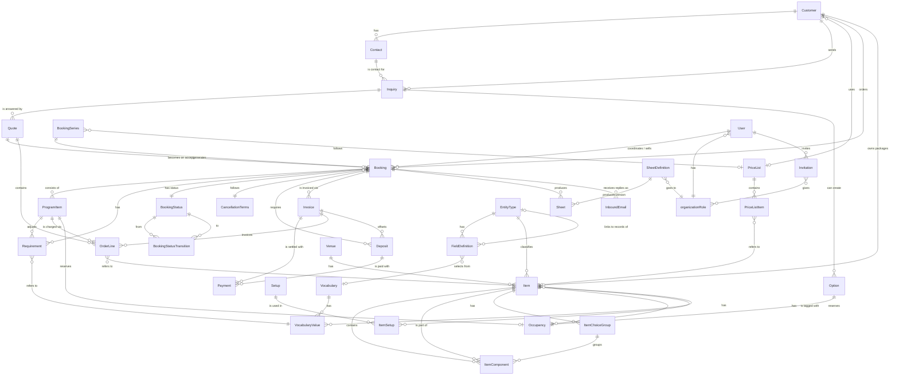

# Domain model

Entities for a booking system for conferences + food & drink. Phasing: **MVP**, **Phase 2**, **Phase 3**. ★ = differentiator against Lega and the others.

Interactive view: [artifacts/domain-model.html](artifacts/domain-model.html).

The model is configurable (see [ADR 0021](decisions/0021-configurable-items.md)). The code contains no domain words such as dish, allergen, room or kitchen order. Each organization sets up its own types, fields, vocabularies, setups, statuses, sheets and roles. The code only owns generic behaviors and fixed phases. See the Configuration section.

## Core flow

Inquiry → Option → Quote → Signing (later) → Booking → Program items → Requirements → Sheets → Delivery → Invoice → Fortnox / Visma

## ER diagram (MVP)

## Configuration

*MVP* · What the organization sets up itself. Everything is data per organization and is created through regular operations ([ADR 0021](decisions/0021-configurable-items.md)).

A new organization starts empty. Nothing is preinstalled, except the `owner` role and one booking status per phase so that bookings work right away. Templates can be imported, for example the vocabulary "EU's 14 allergens" or the starter pack "Conference venue" (`configuration.importTemplate`: lists, setups, and types with behaviours and fields; idempotent, existing names are skipped). A template is only data and can be changed freely afterwards. The AI assistant can propose a configuration, and the user approves.

### EntityType (`EntityType`)

*MVP* · The organization's own type for a base entity: item, customer, contact, inquiry, booking or requirement.

**Attributes**
- base entity (`ITEM | CUSTOMER | CONTACT | INQUIRY | BOOKING | REQUIREMENT`)
- name (e.g. Conference room, Dish, Boat, Package, Company, Conference) — unique per base entity
- behaviors (`ITEM` only): `PRICED`, `COMPOSABLE`, `CHOICES`, `BOOKABLE`, `SETUPS` — `CHOICES` requires `COMPOSABLE`, `SETUPS` requires `BOOKABLE` (otherwise `VALIDATION`)

**Relations**
- `1:N` has → FieldDefinition
- `1:N` classifies → Item (and customer, booking, etc.)

> Archiving is denied (`CONFLICT`) as long as active items of the type exist. A behavior cannot be turned off as long as any active item of the type has data for it (`CONFLICT`).

### FieldDefinition (`FieldDefinition`)

*MVP* · A custom field on a type.

**Attributes**
- name
- key (`key`) — generated from the name (e.g. "Area m²" → `area_m2`), never changes, unique per type even among archived
- field type (`TEXT | NUMBER | BOOLEAN | DATE | CHOICE | MULTI_CHOICE | LINK`)
- required
- vocabulary OR own options (`options`) for choice/multi-choice — exactly one source
- target type (`linkTypeId`) for LINK — an item, customer, contact or booking type; the value is the id of an active record of that type in the same organization
- order (`position`)

**Relations**
- `N:1` EntityType has this
- `N:0..1` selects from → Vocabulary
- `N:0..1` links to records of → EntityType (LINK fields)

> Values are stored as JSON on the row. Rules (`CONFLICT` when data exists): the field type or vocabulary cannot be changed, options in use cannot be removed, the field cannot become required as long as records (items, customers, contacts) lack a value, the field cannot be archived as long as records have a value. The same holds for list values in use and for archiving the type. A LINK field's target type cannot change while records have a value, and a linked record (or a type a LINK field targets) cannot be archived while a LINK points to it.

### Vocabulary (`Vocabulary`) and VocabularyValue (`VocabularyValue`)

*MVP* · The organization's own word lists, e.g. Allergens, Diet, Accessibility or Dress code. The template "EU's 14 allergens" can be imported via `vocabulary.importTemplate`.

**Attributes**
- vocabulary: name — unique
- value: name, order, archived

**Relations**
- `1:N` Vocabulary has → VocabularyValue
- `N:M` Item is tagged with → VocabularyValue (via fields that select from the vocabulary)
- `1:N` Requirement refers to ← VocabularyValue

> Tags = values in fields that select from a vocabulary (no separate tag rows). A value cannot be archived as long as an item carries it. A vocabulary cannot be archived as long as a field uses it.

### Setup (`Setup`)

*MVP* · The organization's own setups, e.g. Cinema, U-shape and Mingle.

**Attributes**
- name — unique
- changeover time (`changeoverMinutes`)

**Relations**
- `1:N` is used in → ItemSetup

> Cannot be archived as long as an active item has capacity for it.

### ItemSetup (`ItemSetup`)

*MVP* · Capacity per bookable item and setup, unique per pair.

**Attributes**
- item
- setup
- capacity

**Relations**
- `N:1` Item has this
- `N:1` Setup is used in this

> Replaced as a set by `item.create/update` (`setups`).

### SheetDefinition (`SheetDefinition`)

*MVP* · What a sheet looks like, e.g. "Kitchen order" or "Brewing order".

**Attributes**
- name (unique)
- item types (`entityTypeIds`, types of base `ITEM`) and fields of those types (`fieldIds`) that are included
- vocabularies whose requirements are included (`vocabularyIds`)
- receiving role (`roleId`, an organizationRole id or `owner`)
- status (active / archived)

**Relations**
- `N:1` goes to → organizationRole
- `N:M` includes → EntityType, FieldDefinition, Vocabulary
- `1:N` produces → Sheet

> Operations: `sheetDefinition.*` under the resource `configuration`. Core checks that every id is an active row of the organization (`VALIDATION`). Archiving a type, field, vocabulary or role that an active sheet definition uses is refused with `CONFLICT` (ADR 0026).

### BookingStatus (`BookingStatus`) with phase and transitions

*MVP* · The organization's own statuses for bookings. Each status belongs to a fixed phase that controls the system's rules ([ADR 0022](decisions/0022-sales-pipeline-and-booking-states.md)).

**Attributes**
- name (unique among the organization's active statuses)
- color (hex, e.g. `#22c55e`)
- order (`position`; phases stay in lifecycle order, and the first status of a phase is its default)
- phase (`TENTATIVE` / `CONFIRMED` / `COMPLETED` / `CANCELLED`; fixed once created)
- archived (a status in use can be archived but not deleted; the last status of a phase cannot be archived)

**Relations**
- `1:N` Booking has this
- `1:N` is from/to in → Transition (`BookingStatusTransition`, from → to)

| Phase | System rules |
|---|---|
| `TENTATIVE` | Bookable items are occupied. Sheets cannot be sent. |
| `CONFIRMED` | Requires a coordinator. Sheets and deposits can be sent. |
| `COMPLETED` | Allowed only after the booking ends. The booking can be invoiced. |
| `CANCELLED` | Requires a reason. The occupancy is released and the cancellation terms apply. |

> The organization defines the allowed transitions. The phase rules cannot be turned off. Reports group by phase, not by status.

> Operations (`bookingStatus:admin` to change, `bookingStatus:read` to read): `bookingStatus.list|get|create|update|archive|reorder`, `bookingStatus.setTransitions` (replaces the targets of one status as a set) and `bookingStatus.importTemplate` (`default`: one status per phase; `conference-venue`: Tentative, Confirmed, Final count locked, Completed, Cancelled with every transition forward and to Cancelled until completed; existing names are skipped). Every new organization gets the `default` template from `provisionOrganization` as SYSTEM, run by Better Auth's `afterCreateOrganization` hook and by the demo seed.

### Role (`organizationRole`)

*MVP* · A named set of permissions per organization ([ADR 0020](decisions/0020-custom-roles-per-organization.md)). Resources per member role: `venue`, `item`, `customer`, `contact`, `occupancy`, `configuration`, `bookingStatus`, `booking`, `search`, `conversation`, `skill`, `role`, `member`.

**Attributes**
- name
- permissions (`<resource>:read|write|admin`, a higher action includes the lower)
- system (`owner` is fixed and cannot be changed or deleted)
- status (active / archived; can only be archived when no member or pending invitation has the role)

**Relations**
- `1:N` User has this
- `1:N` SheetDefinition goes to this

## Sales & customer

### Customer (`Customer`)

*MVP* · The company, agency, association or private person that buys. Has a type (base `CUSTOMER`) with custom fields, e.g. Company or Government agency.

**Attributes**
- type and custom fields (`fields` as JSON, e.g. org number, Peppol ID, framework agreement)
- name
- email, phone
- invoice address (`invoiceStreetAddress`, `invoicePostalCode`, `invoiceCity`, `invoiceCountry`, default `SE`)
- price list (not built yet)
- payment terms in days (`paymentTermsDays`, null = the organization's default)
- credit limit (`creditLimitMinor` in minor units, null = no limit set)
- booking count (`bookingCount`, derived: the customer's bookings that are not archived)

**Relations**
- `1:N` has → Contact
- `1:N` sends → Inquiry
- `N:0..1` uses → PriceList
- `1:N` orders → Booking
- `1:N` owns packages → Item (customer-specific items, "Save as package")

### Contact (`Contact`)

*MVP* · Orderer, invoice recipient or organizer at a customer.

**Attributes**
- type (base `CONTACT`) and custom fields (`fields` as JSON), e.g. the person's role (orderer / invoice recipient) as a choice field
- name
- email
- phone
- GDPR consent (not built yet)

**Relations**
- `N:1` Customer (organization) has this
- `1:N` is contact for → Inquiry

> `customer.*` and `contact.*` (list, get, create, update, archive; resources `customer` and `contact`). The type and, for a contact, the customer are set on create and cannot be changed. A customer cannot be archived while it has active contacts (`CONFLICT`), and a contact can only be created at an active customer. Every booking of the customer that is not archived also blocks archiving it, whatever its status phase, terminal and cancelled included (`CONFLICT` naming the number of bookings, issue path `archiveBookings`). With `archiveBookings: true` (needs `booking:write` as well) `customer.archive` archives those bookings and the customer in one transaction, with one audit row per booking plus the customer; the assistant's approval text names the number of bookings.

### Inquiry ★

*MVP* · Incoming interest before anything is booked. Fixed state machine, separate commands per transition.

**Attributes**
- type and custom fields
- channel (form, email, phone, Venuu)
- desired dates (several alternatives)
- approximate headcount
- budget
- status: `NEW → QUALIFIED → QUOTED → WON`, or `LOST`
- loss reason (required for `LOST`)
- responsible salesperson (`salesOwnerId`, required from `QUALIFIED`)
- statusChangedAt

**Relations**
- `N:1` Customer (organization) sends this
- `N:1` Contact is contact for this
- `1:N` is answered by → Quote
- `1:N` can create → Option
- `1:N` InboundEmail is a reply on this
- `0..1:N` Communication & log concerns this

> ★ Pipeline with loss reason is missing at Lega. Status changes only through commands (`inquiry.qualify`, `inquiry.markLost`), never through `update`.

### Option ★

*MVP* · A preliminary hold on a bookable item with an expiry date.

**Attributes**
- item (with the `BOOKABLE` behavior)
- start – end
- expires (date)
- rank (1st / 2nd option, set automatically)
- reminder before expiry
- status: `ACTIVE → CONVERTED`, `EXPIRED` or `RELEASED`

**Relations**
- `N:1` Inquiry can create this
- `1:1` reserves → Occupancy

> ★ Options are queued per bookable item and time. The rank is the number of active overlapping options + 1. When an option is released or expires, those behind it move up. `option.expireDue` expires options whose date has passed.

### Quote ★

*MVP* · A versioned proposal with lines and terms. Fixed state machine.

**Attributes**
- version number
- valid until
- status: `DRAFT → SENT → ACCEPTED`, `DECLINED` or `EXPIRED`
- lines (copies of order lines)
- total excl. and incl. VAT
- terms text
- salesperson (inherited from the inquiry)
- acceptedBy, acceptedAt, acceptanceMethod (`MANUAL` now, later `BANKID` and `LINK`)

**Relations**
- `N:1` Inquiry is answered by this
- `1:0..1` becomes on accept → Booking
- `1:N` contains → OrderLine

> ★ Versions with change markers against the previous one. `quote.accept` sets the inquiry to `WON`, converts the options (`CONVERTED`) and creates the booking. A quote can cover a whole series. A quote can also be built directly from items, and "Save as package" then creates a customer-specific item.

### Agreement & signing

*Phase 2* · Binding acceptance of the quote with BankID or a signing link. Signing is postponed. Until then the quote only stores `acceptedBy`, `acceptedAt` and `acceptanceMethod`.

**Attributes**
- method (BankID / signing link)
- signed by
- time
- document hash
- attached terms

**Relations**
- `0..1:1` Quote is signed via this

## Booking & program

### Booking

*MVP* · The conference or event as a whole. Each occurrence in a series is a regular booking.

**Attributes**
- reference number (`reference`, sequential per organization)
- booking type (the organization's own type, e.g. Conference or Event) and custom fields
- status (the organization's own `BookingStatus`, with a fixed phase)
- start – end
- estimated headcount
- guaranteed headcount (locked X days before)
- salesperson (`salesOwnerId`, the user id of a member)
- coordinator (`coordinatorId`, the user id of a member, required from the `CONFIRMED` phase)
- cancellation terms (not built yet)
- seriesId and occurrenceIndex (if the booking belongs to a series)
- clash (set when the series could not occupy its items for this occurrence; the user picks another item or time)
- statusChangedAt
- status reason (`statusReason`, the reason given with the last status change; always set in the `CANCELLED` phase)
- inbound address (`inboundAddress`, derived and not stored: `booking-<id>@<MAIL_INBOUND_DOMAIN>`, null when inbound mail is not configured; the reply-to of booking mail)

**Relations**
- `0..1:1` Quote becomes this on accept
- `N:0..1` BookingSeries generates this
- `1:N` consists of → ProgramItem
- `1:N` has → Requirement
- `N:1` has status → BookingStatus
- `N:1` follows → CancellationTerms
- `1:N` requires → Deposit
- `1:N` is invoiced via → Invoice
- `1:N` produces → Sheet
- `N:1` User coordinates and sells this
- `N:1` Customer (organization) orders this
- `0..1:N` Communication & log concerns this

> Operations (resource `booking`): `booking.list|get|create|update`, `booking.assign` and `booking.changeStatus`. `create` gives the next reference number and the organization's default `TENTATIVE` status; the customer must be active. `update` changes customer, time, headcount and own fields, never type, status or owners. `booking.assign` changes the salesperson and/or coordinator: both must be members (`VALIDATION`), and the coordinator cannot be removed from the `CONFIRMED` phase on (`CONFLICT`). `booking.changeStatus({ bookingId, statusId, reason? })` follows only the organization's transitions (`CONFLICT` otherwise), and the phase rules apply to every transition: `CONFIRMED` and `COMPLETED` need a coordinator and `COMPLETED` an ended booking (`CONFLICT`), `CANCELLED` needs a reason (`VALIDATION`), archives the booking's occupancy (`sourceType` `booking`) and runs the cancellation-terms hook. Every change is audited.

> Status changes only with `booking.changeStatus`. A quick booking is created by staff in a `TENTATIVE` status. The customer pays through a Swish or card link (the booking is then confirmed when the payment completes) or against invoice. `booking.export` gives the booking as json, pdf or csv ([ADR 0024](decisions/0024-booking-export-instead-of-partner.md)).

### BookingSeries

*MVP* · A recurring booking, e.g. a meeting room on the first Tuesday of every month ([ADR 0023](decisions/0023-recurring-bookings-and-customer-pricing.md)).

**Attributes**
- booking type (base `BOOKING`, every occurrence gets it)
- customer
- template (bookable items, setup, estimated headcount, owners and own field values)
- rule (subset of RFC 5545 RRULE: `FREQ`, `INTERVAL`, `BYDAY`, `BYMONTHDAY`, `COUNT` or `UNTIL`)
- first start, length in minutes and time zone (every occurrence keeps the wall time)
- truncated (the rule continues past the generated horizon)
- cancelledAt and cancellationReason (set by `bookingSeries.cancel`)
- price list (not built yet)

**Relations**
- `1:N` generates → Booking
- `N:0..1` follows → PriceList

> Occurrences are created when the series is created, at most 12 months or 52 occurrences ahead. Conflicting occurrences are flagged and returned so the user can pick another item or time. Changes apply to "this occurrence only" or "this and following". Cancelling the series cancels all upcoming occurrences.

> Operations (resource `booking`): `bookingSeries.list|get|create`. `create({ entityTypeId, customerId, rule, startsAt, durationMinutes, timeZone?, itemIds, setupId?, … })` takes the rule as an RRULE string and, in one transaction, creates every occurrence as an ordinary `TENTATIVE` booking with `seriesId` and `occurrenceIndex` and consecutive reference numbers. Each occurrence occupies the template's items (`BOOKING`, plus the setup's changeover as `SETUP`). When another booking, setup time or block already holds an item, the occurrence is still created but without occupancy, flagged `clash` and listed in `clashes`; the series is never aborted. `get` and `list` return the series with its occurrences. The series and every occurrence are audited.

> `updateOccurrences({ seriesId, fromIndex, scope: "THIS" | "FOLLOWING", patch })` changes the occurrence at `fromIndex` alone (`THIS`) or it and every later one (`FOLLOWING`). The patch can set `startsAt` (with `FOLLOWING` every later occurrence moves by the same offset), `durationMinutes`, `itemIds`, `setupId`, `estimatedHeadcount` and `fields` (merged by key). A moved occurrence releases its occupancy and occupies the items again; with `THIS` taken items give `CONFLICT`, with `FOLLOWING` the occurrence is flagged `clash` as on create. `FOLLOWING` also updates the template, the length and (by the offset) the anchor `startsAt` going forward. Cancelled and completed occurrences are never changed. `cancel({ id, reason, statusId? })` moves every upcoming occurrence (not started, not cancelled or completed) to a `CANCELLED`-phase status (default the phase's first) through the organization's transitions, which releases its occupancy; past occurrences are untouched and the series gets `cancelledAt`. A cancelled series refuses further changes. Every affected booking is audited.

### ProgramItem

*MVP* · A row in the day's run sheet: meeting, coffee break, lunch, activity. Created, among other cases, when a composite item is added to the booking.

**Attributes**
- name and type (the organization's own)
- start – end
- bookable item (e.g. a venue space)
- setup
- headcount
- responsible (`responsibleId`, optional)
- internal note

**Relations**
- `N:1` Booking consists of this
- `N:0..1` is held in → Item (bookable)
- `N:0..1` is set up as → Setup
- `1:N` adjusts → Requirement
- `1:N` is charged via → OrderLine
- `1:0..1` reserves → Occupancy
- `1:N` requires → Task
- `1:N` AccessCode opens for this

### Requirement ★ (`Requirement`)

*MVP* · A count per vocabulary value on a booking or a program item, e.g. Gluten × 3 or Wheelchair × 2. Never tied to a person. There is no personal data about individual guests ([ADR 0021](decisions/0021-configurable-items.md)).

**Attributes**
- booking or program item
- vocabulary value
- count
- type and custom fields (e.g. severity)

**Relations**
- `N:1` Booking has this
- `N:0..1` ProgramItem adjusts with this
- `N:1` refers to → VocabularyValue

> ★ A row on the program item replaces the booking's count there. Matching: the requirement is compared with the items on the booking that are tagged with the same vocabulary value. A hit on a required component without an alternative is flagged and blocks the sheet. `item.resolve` computes inherited tags and is the only place for that.

### CancellationTerms

*MVP* · Rules for cancellation and reduced headcount.

**Attributes**
- time limits (e.g. 30 / 14 / 7 days)
- charge rate per limit
- allowed headcount reduction (%)
- applies to customer or venue

**Relations**
- `1:N` Booking follows this

## Spaces & resources

### Venue

*MVP* · A building or site. Bookable items belong to a venue.

**Attributes**
- name
- address
- opening hours
- default VAT
- contact details

**Relations**
- `1:N` has → Item

> Archiving a venue archives its items.

### Occupancy ★

*MVP* · A time block on a bookable item. The basis for conflict checking.

**Attributes**
- item (with the `BOOKABLE` behavior)
- start – end (`startsAt`, `endsAt`; the period is `[start, end)`, so back-to-back blocks do not overlap)
- type (`BOOKING`, `OPTION`, `SETUP`, `MAINTENANCE`, `INTERNAL`)
- source (`sourceType`, `sourceId`: the record that caused it; null for manual blocks)
- note
- status (active / archived = released; released rows no longer block)

**Relations**
- `1:1` ProgramItem reserves this
- `1:1` Option reserves this
- `N:1` Item has this

> ★ Active rows of all types except `OPTION` may not overlap on the same item. This is enforced with an exclusion constraint in Postgres (`btree_gist`), so it also holds for concurrent transactions; core maps a violation to `CONFLICT`. Staff block items by hand with `occupancy.list|get|create|update|archive` (resource `occupancy`), which only create and change the types `MAINTENANCE` and `INTERNAL`; the other types follow their source. Changeover time is added as `SETUP` right before the start, based on the setup's changeover time (`changeoverMinutes`).

## Items

### Item (`Item`)

*MVP* · Everything that can be sold or booked: dish, drink, venue space, equipment, guide, package. Replaces the old Item, Menu, Conference package, Room, Furnishing and Equipment.

**Attributes**
- type (the organization's own) and custom fields (`fields` as JSON)
- name
- description
- behavior columns (values only if the type has the behavior, otherwise `VALIDATION`):
  - `PRICED`: `priceMinor` (minor units), `priceUnit` (`PER_PERSON`, `PER_UNIT`, `PER_HOUR`, `FLAT`), `vatRatePercent` (null = the venue's default)
  - `COMPOSABLE`: contains other items with count, `offsetMinutes`, `durationMinutes`
  - `CHOICES`: choice groups among the components (requires `COMPOSABLE`)
  - `BOOKABLE`: occupancy in time, conflict protection, `defaultDurationMinutes`
  - `SETUPS`: capacity per setup (requires `BOOKABLE`)
- venue (optional)
- customerId (`null` = catalog item; set = a customer-specific package, created by `item.saveAsPackage` and listed by `item.list` only together with its customer)

**Relations**
- `N:1` is classified by → EntityType
- `N:0..1` belongs to → Venue
- `N:0..1` is a package of → Customer (a package's parts are catalog items or the same customer's packages)
- `1:N` contains → ItemComponent
- `1:N` is part of → ItemComponent
- `1:N` has → ItemChoiceGroup
- `1:N` has → Occupancy
- `1:N` has → ItemSetup
- Tagged via fields that select from a vocabulary
- `1:N` OrderLine refers to this
- `1:N` PriceListItem refers to this

> Room = item with `BOOKABLE` + `SETUPS` (often also `PRICED`). A behavior cannot be turned off on the type as long as any active item of the type has data for it (`CONFLICT`). Inherited tags: required components give "contains", optional components give "may contain" per alternative. On expansion onto a booking: core creates program items, occupancy and order lines, which copy name, price, VAT and tags (snapshot).

### ItemComponent (`ItemComponent`)

*MVP* · A part of a composite item.

**Attributes**
- parent item
- item (the component), unique per parent
- quantity (default 1)
- offsetMinutes from the parent's start (default 0)
- durationMinutes (null = the parent's length)
- required (default) or optional
- choice group (with `CHOICES`, not built yet)

**Relations**
- `N:1` Item contains this
- `N:1` refers to → Item
- `N:0..1` is part of → ItemChoiceGroup

> Replaced as a set by `item.create`/`item.update` (`components`), only for types with `COMPOSABLE` (otherwise `VALIDATION`). The graph is acyclic. Core rejects cycles and depth beyond 5 levels (the top item included, parents above counted) with `VALIDATION`. In a package, the package price is charged. VAT is distributed over the components in proportion to the components' list prices.

### ItemChoiceGroup (`ItemChoiceGroup`)

*MVP* · Selectable alternatives among the components of a composite item.

**Attributes**
- name
- minPick
- maxPick

**Relations**
- `N:1` Item has this
- `1:N` groups → ItemComponent

### Sheet ★ (`Sheet`)

*MVP* · A compilation for a role, e.g. kitchen order, brewing order or guide brief. Created from a sheet definition. Replaces Kitchen order.

**Attributes**
- booking
- sheet definition
- items and fields according to the definition
- requirements per vocabulary value (count, never names)
- blocked (yes/no) and hits
- receiving role
- version and change markers

**Relations**
- `N:1` Booking produces this
- `N:1` SheetDefinition produces this version

> ★ Versioned, with changes marked since the last dispatch. Cannot be sent in the `TENTATIVE` phase. `sheet.export` gives a single sheet as json, pdf or csv, always with the latest version and the version number. This is how a sheet is handed to someone outside the system.

## Finance

### PriceList

*MVP* · Price per season, weekday or customer ([ADR 0023](decisions/0023-recurring-bookings-and-customer-pricing.md)).

**Attributes**
- name
- validity
- season / weekday
- customer (optional, for customer pricing)
- general discount (%)

**Relations**
- `N:0..1` Customer (organization) uses this
- `N:0..1` BookingSeries follows this
- `1:N` contains → PriceListItem

### PriceListItem (`PriceListItem`)

*MVP* · Price per item in a price list.

**Attributes**
- price list
- item
- price

**Relations**
- `N:1` PriceList contains this
- `N:1` refers to → Item

> Order lines copy the price when they are created. A changed price list only affects new lines.

### OrderLine

*MVP* · What is actually charged. Copies (snapshot) of the item's name, price, VAT and tags.

**Attributes**
- item
- count
- unit price
- discount
- VAT
- program item
- status (quoted / confirmed / delivered)
- invoiced (yes/no)

**Relations**
- `N:1` Quote contains this
- `N:1` ProgramItem is charged via this
- `N:1` refers to → Item
- `N:1` Invoice invoices this

### Deposit

*MVP* · A partial payment at confirmation. Can be sent only in the `CONFIRMED` phase.

**Attributes**
- amount
- due date
- status
- linked agreement

**Relations**
- `N:1` Booking requires this
- `1:N` is paid with → Payment
- `N:1` Invoice offsets this

### Payment ★

*MVP* · Incoming payment via Swish, card or invoice.

**Attributes**
- method (Swish / card / invoice)
- PSP reference
- amount
- time
- refund

**Relations**
- `N:1` Deposit is paid with this
- `N:1` Invoice is settled with this

> ★ Swish and card directly in the booking. Lega shows no online payment.

### Invoice

*MVP* · The final invoice after delivery. The booking can be invoiced only in the `COMPLETED` phase.

**Attributes**
- invoice number
- due date
- status
- offset deposit
- export status (Fortnox / Visma)
- e-invoice

**Relations**
- `N:1` Booking is invoiced via this
- `1:N` is settled with → Payment
- `1:N` invoices → OrderLine
- `1:N` offsets → Deposit

## Operations & system

### User

*MVP* · A member of the organization. The roles are the organization's own (ADR 0020).

**Attributes**
- name
- roles (from the organization's roles)
- venues
- platform role (`user` / `admin`): Okazi's own staff only, gives `/admin` ([ADR 0015](decisions/0015-platform-admin.md))

**Relations**
- `N:1` has → Role
- `1:N` coordinates and sells → Booking
- `1:N` is responsible for → Task

> Core does not look up roles. `packages/auth` resolves the member's roles to permissions once per call. API keys are issued with a role name (never `owner`) and never get more than the member's own permissions. No one can give a role more than they have themselves.

> Members join only by invitation and leave with `member.remove`. The organization always keeps an owner: the last owner cannot be removed, and only an owner removes another owner.

### Invitation

*MVP* · An emailed invitation to join the organization as staff (ADR 0004). Created with `member.invite`, revoked with `member.cancelInvitation`; the invitee accepts through the link (Better Auth) and becomes a member with the invited roles.

**Attributes**
- email
- roles (from the organization's roles, never `owner`)
- status (pending / accepted / rejected / canceled)
- inviter
- expires (48 hours after it was sent)

**Relations**
- `N:1` is sent by → User
- `N:M` gives → Role

> No one can invite with more access than they have themselves. An email that is already a member or has a pending invitation cannot be invited again.

### Task

*Phase 2* · Set up room, AV test, cleaning.

**Attributes**
- linked program item
- type
- responsible
- deadline
- status

**Relations**
- `N:1` User is responsible for this
- `N:1` ProgramItem requires this

### InboundEmail (`InboundEmail`)

*MVP* · A mail received on a booking's own inbound address, `booking-<bookingId>@<MAIL_INBOUND_DOMAIN>` (a customer reply, [ADR 0012](decisions/0012-email-provider.md)). Append-only. Stored only by the inbound webhook, as SYSTEM, in the booking's organization.

**Attributes**
- provider email id (unique per organization: a redelivered webhook is stored once)
- Message-ID
- sender, recipients
- subject, text body, HTML body (stored, never rendered in the web app)
- attachments as metadata (id, file name, content type, size); the bytes stay at the provider
- received at

**Relations**
- `N:1` is a reply on → Booking

> Operations: `inboundEmail.list` (per booking, newest first) and `inboundEmail.get`, permission `booking:read`, on every surface (GraphQL also as `Booking.inboundEmails`). `inboundEmail.receive` is SYSTEM only and deliberately has no web, GraphQL, REST or MCP surface: no user or AI can fabricate a received mail.

### PaymentAccount (`PaymentAccount`)

*MVP* · The organization's Stripe Connect payout account ([ADR 0028](decisions/0028-payments-with-stripe.md)): one connected account per organization, created with Stripe's Accounts v2 API, so venues are paid directly and Okazi never holds their funds. No row means "not connected". Created by `paymentAccount.startOnboarding`, which also returns a short-lived Stripe onboarding link.

**Attributes**
- Stripe account id (unique)
- status: onboarding, active or restricted (mirrors the card payments capability; shown as not connected when there is no row)

> Operations: `paymentAccount.get` (permission `payment:read`), `paymentAccount.startOnboarding` (`payment:admin`) and `paymentAccount.sync` (`payment:write`, refreshes the status from Stripe), on every surface. The web app offers them under Settings, Payments. The platform account id and secret key come from `@okazi/config` (`STRIPE_PLATFORM_ACCOUNT_ID`, `STRIPE_SECRET_KEY`).

### Communication & log

*Phase 2* · Email, notes and change history. Status history comes from `AuditLog`.

**Attributes**
- channel
- direction (in / out)
- subject
- linked inquiry / booking
- change log

**Relations**
- `N:0..1` concerns → Booking
- `N:0..1` concerns → Inquiry

### AuditLog

*MVP* · Organization data. One row per change made by a command, written by core in the same transaction ([ADR 0006](decisions/0006-database-conventions.md), [ADR 0014](decisions/0014-system-logging.md)). Read with `auditLog.list|get` (permission `audit:read`) on every surface and shown as the history tab on detail pages. Changes to private entities (conversations, messages, skills) are only visible to the user who made them; `conversation:admin` also sees conversation changes.

**Attributes**
- actor (user / AI / system) and, for AI proposals, who approved
- assistant conversation the change was proposed in
- operation, entity type and entity id
- before and after image
- request id and surface (links to the system log)
- time

**Relations**
- `N:0..1` made by → User
- shares request id with the system log (`SystemLog`)

### SystemLog

*MVP* · Platform data, not customer data. Every event in the system (operation, request, login, email, error), stored for platform admins ([ADR 0014](decisions/0014-system-logging.md), [ADR 0015](decisions/0015-platform-admin.md)).

**Attributes**
- time, level, event (`event`)
- service and surface (web, REST, GraphQL, MCP, AI, auth)
- request id (links rows and the audit log)
- organization, user, operation, status, duration, error code
- the whole row as JSON (never input or output)

**Relations**
- `N:0..1` concerns → User
- shares request id with the audit log (`AuditLog`)

### AiSetting

*MVP* · Platform data. Which model each AI function uses, chosen by a platform admin. No default models: without a choice the function does not work.

**Attributes**
- AI function (`assistant.chat`, `search.embedding`)
- model (from Vercel AI Gateway, must be possible for the function)
- changed by, changed

**Relations**
- `N:1` changed by → User

### Sign

*Phase 3* · A screen at a bookable item (e.g. a room) showing the day's program.

**Attributes**
- item (with the `BOOKABLE` behavior)
- device
- displayed program items

**Relations**
- `N:1` is placed at → Item

### AccessCode

*Phase 3* · A digital lock tied to the booked time.

**Attributes**
- program item / item
- code or mobile key
- valid from – to

**Relations**
- `N:1` opens for → ProgramItem

## Glossary

English is used everywhere in code and docs. Swedish appears only in UI translations (`packages/i18n/messages`, see [ADR 0009](decisions/0009-language-in-code-and-ui.md)). The table gives translators the Swedish UI term for each entity.

| English term | Swedish UI term |
|---|---|
| Venue | Anläggning |
| EntityType | Typ |
| FieldDefinition | Fältdefinition |
| Vocabulary | Lista |
| VocabularyValue | Listvärde |
| Setup | Uppställning |
| ItemSetup | Item-uppställning |
| Item | Artikel |
| ItemComponent | Artikeldel |
| ItemChoiceGroup | Valgrupp |
| Customer | Kund |
| Contact | Kontaktperson |
| Inquiry | Förfrågan |
| Option | Option |
| Quote | Offert |
| Agreement | Avtal |
| Booking | Bokning |
| BookingStatus | Bokningsstatus |
| BookingStatusTransition | Övergång |
| BookingSeries | Bokningsserie |
| ProgramItem | Programpunkt |
| Requirement | Behov |
| Sheet | Blad |
| SheetDefinition | Blad-definition |
| Occupancy | Beläggning |
| Sign | Skylt |
| AccessCode | Passerkod |
| Task | Uppgift |
| organizationRole | Roll |
| Invoice | Faktura |
| Deposit | Förskott |
| Payment | Betalning |
| PriceList | Prislista |
| PriceListItem | Prislisterad |
| CancellationTerms | Avbokningsvillkor |
| OrderLine | Orderrad |
| User | Användare |
| Invitation | Inbjudan |
| SystemLog | Systemlogg |
| AiSetting | AI-inställning |
