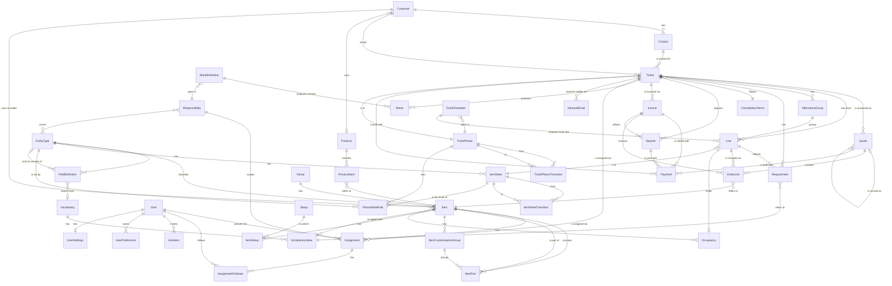

# Domain model

Entities for a booking system for conferences + food & drink. Phasing: **MVP**, **Phase 2**, **Phase 3**. ★ = differentiator against Lega and the others.

Interactive view: [artifacts/domain-model.html](artifacts/domain-model.html).

The model is configurable (see [ADR 0021](decisions/0021-configurable-items.md)). The code contains no domain words such as dish, allergen, room or kitchen order. Each organization sets up its own types, fields, vocabularies, setups, ticket phases, item states, sheets and responsibilities. The code only owns generic capabilities and flags.

## Core flow

Ticket (moves through the organization's phases) → Lines with states (prebooked → booked …) → Quote → Signing (later) → Requirements → Sheets → Delivery → Invoice → Fortnox / Visma

## Target model: single source of truth (ADR 0051–0057)

*Accepted, not built yet.* The entity sections below describe the model as built; a **Target** note on an entity says how it changes. Every attribute is one of four kinds ([ADR 0051](decisions/0051-single-source-of-truth.md)):

| Kind | Meaning | Examples in the target model |
|---|---|---|
| Owned | The fact itself, in one place | `Line` price overrides, `TicketPhaseChange`, manual `Occupancy` blocks, explicit `Assignment` |
| Derived | Computed on read, never stored | a draft quote, balances, which responsibilities apply, effective price and VAT |
| Projection | Stored for a constraint or index, written only by the database | line holds in `Occupancy` (ADR 0053), `Ticket.phaseId` and `Line.stateId` (ADR 0054) |
| Snapshot | Frozen copy at a moment that matters | sent quote lines, invoices, sent sheets and their recipients |

**Ownership line.** Once the ticket for an entity lands, its section gets one line right under the heading, in this format (a projection names its reconciliation check in `packages/core/src/seed/demo/reconcile-checks.ts`):

> **Ownership:** owned `name`, `startsAt`; derived `effectiveVatPercent`; projection `holdKind` (check `line-holds`); snapshot `unitPrice` (from the item, taken at send).

What changes:
- **The line is the booking** ([ADR 0052](decisions/0052-the-line-is-the-booking.md)). `Line` (formerly the program item, renamed in the first slice) may be untimed and carries price, discount and VAT overrides (`null` = inherit). Lines can form an `AlternativeGroup` (fourth slice, done). A draft quote is a live view of the lines; `quote.send` snapshots them as `OrderLine` with `lineId`; an accepted quote shows how the ticket's lines differ from it (third slice, done). `Ticket.quantity` is gone; lines inherit the headcount (second slice, done).
- **Holds are a projection** ([ADR 0053](decisions/0053-holds-are-a-projection.md)), written by triggers through `sync_line_occupancy`. Only lines that have not ended are re-derived.
- **History is owned data** ([ADR 0054](decisions/0054-domain-history-and-facts-vs-workflow.md), done): `TicketPhaseChange` and `LineStateChange`, append-only. `Ticket.phaseId` and `Line.stateId` are projections, set by the trigger on insert (`domain_history.sql`); `phaseChangedAt`, `phaseReason` and `heldAt` are gone and read from the newest change. Phases may require facts (`requiresAcceptedQuote`) but never store them; a phase that contradicts a fact is a derived warning (`ticket.phaseHistory`).
- **Assignments store only choices** ([ADR 0055](decisions/0055-assignments-store-only-choices.md)); the rest is derived from responsibilities and lines.
- **One `Record` table** ([ADR 0056](decisions/0056-records-and-relations.md)) for every entity with a type and fields, with `fields` JSON behind a GIN index. *Done:* `Record` (`id`, `entityTypeId`, `base`, `fields`, `status`) is the supertable of `Item`, `Customer`, `Contact`, `Ticket`, `TicketTemplate`, `Line` and `Requirement`, which share its id (composite foreign key with `organizationId`); core writes both rows in one transaction (`packages/core/src/records/`). `base` is the entity base, or `TICKET_TEMPLATE` for a predefined ticket. *Done:* `LINK` values are `RecordLink` rows (`recordId`, `fieldId`, `targetRecordId`, `position`; composite foreign keys, several rows for several targets), never ids in `fields` JSON; core merges them into `fields` on read. Id lists are join tables. *Target:* polymorphic pairs point at `Record`.
- **Money is derived** ([ADR 0057](decisions/0057-money-balance-is-derived.md)): a payment settles one receivable (sent quote, deposit or invoice); no balance is stored. External calls run after commit (ADR 0058).
- **Capabilities, demands and buffers** ([ADR 0059](decisions/0059-capabilities-demands-and-buffers.md), accepted, partly built): the keys are renamed end to end (`capabilities`, `BUNDLE`, `CUSTOMISATIONS`, `ItemPart`, `ItemCustomisationGroup`); setup and teardown minutes on type, item and line are built (soft and hard buffers, `TEARDOWN`, the larger-of rule); still to come are capability sections in the type editor, bundles expanded into linked part lines with per-rate VAT, `ItemDemand` and `LineAllocation` for pooled equipment and staff, working hours, and `item:write` for managers.

## ER diagram (MVP)

## Configuration

*MVP* · What the organization sets up itself. Everything is data per organization and is created through regular operations ([ADR 0021](decisions/0021-configurable-items.md)).

A new organization starts with the fixed access roles (`member`, `manager`, `admin`; [ADR 0034](decisions/0034-fixed-access-roles-and-responsibilities.md)) and no responsibilities. Nothing else is preinstalled, except the default ticket phases, item states and grid so that tickets work right away (ADR 0044). Templates can be imported, for example the vocabulary "EU's 14 allergens" or the starter pack "Conference venue" (`configuration.importTemplate`: lists, setups, and types with capabilities and fields; idempotent, existing names are skipped). A template is only data and can be changed freely afterwards. The AI assistant can propose a configuration, and the user approves.

### EntityType (`EntityType`)

*MVP* · The organization's own type for a base entity: item, customer, contact, ticket, requirement or line.

> **Target (ADR 0059):** customisations no longer need a bundle. An item type is Equipment or Person.

> **Done (ADR 0059):** item types have nullable `setupMinutes` and `teardownMinutes` (owned): the default buffers of their items, null = none (`VALIDATION` on other bases). Changing them re-derives the holds of lines that have not ended (by trigger; a collision is `CONFLICT`).

**Attributes**
- base entity (`ITEM | CUSTOMER | CONTACT | TICKET | REQUIREMENT | LINE`)
- name (e.g. Conference room, Dish, Boat, Bundle, Company, Conference) — unique per base entity
- capabilities (`ITEM` only): `PRICED`, `BUNDLE`, `CUSTOMISATIONS`, `BOOKABLE`, `SETUPS` — `CUSTOMISATIONS` requires `BUNDLE`, `SETUPS` requires `BOOKABLE` (otherwise `VALIDATION`)

**Relations**
- `1:N` has → FieldDefinition
- `1:N` classifies → Item (and customer, ticket, etc.)

> Archiving is denied (`CONFLICT`) as long as active items of the type exist. A capability cannot be turned off as long as any active item of the type has data for it (`CONFLICT`).

### FieldDefinition (`FieldDefinition`)

*MVP* · A custom field on a type.

> **Stored (ADR 0056):** values are mirrored on the `Record` supertable (`Record.fields`, GIN index), so every "in use" rule is one indexed query (`fields ? key`, `fields @> {key: value}`) and each `CONFLICT` lists the blocking records in `issues` (`records.<id>`; records the caller may not read are only counted). `LINK` values are `RecordLink` rows with foreign keys (source record, field, target record), replaced on every write of the record's fields and merged into `fields` on read; "has a value" and "linked from" rules for links are indexed `EXISTS` queries on it.

**Attributes**
- name
- key (`key`) — generated from the name (e.g. "Area m²" → `area_m2`), never changes, unique per type even among archived
- field type (`TEXT | NUMBER | BOOLEAN | DATE | CHOICE | MULTI_CHOICE | LINK`)
- required
- vocabulary OR own options (`options`) for choice/multi-choice — exactly one source
- target type (`linkTypeId`) for LINK — an item, customer, contact or ticket type; the value is the id of an active record of that type in the same organization
- order (`position`)

**Relations**
- `N:1` EntityType has this
- `N:0..1` selects from → Vocabulary
- `N:0..1` links to records of → EntityType (LINK fields)

> Scalar and choice values are stored as JSON on the row (and its `Record` row); `LINK` values as `RecordLink` rows. Rules (`CONFLICT` when data exists): the field type or vocabulary cannot be changed, options in use cannot be removed, the field cannot become required as long as records (items, customers, contacts) lack a value, the field cannot be archived as long as records have a value. The same holds for list values in use and for archiving the type. A LINK field's target type cannot change while records have a value, and a linked record (or a type a LINK field targets) cannot be archived while a LINK points to it.

### Vocabulary (`Vocabulary`) and VocabularyValue (`VocabularyValue`)

*MVP* · The organization's own word lists, e.g. Allergens, Diet, Accessibility or Dress code. The template "EU's 14 allergens" can be imported via `vocabulary.importTemplate`.

**Attributes**
- vocabulary: name — unique
- value: name, order, archived

**Relations**
- `1:N` Vocabulary has → VocabularyValue
- `N:M` Item is tagged with → VocabularyValue (via fields that select from the vocabulary)
- `1:N` Requirement refers to ← VocabularyValue

> Tags = values in fields that select from a vocabulary (no separate tag rows). A value cannot be archived as long as an item carries it or a requirement counts it. A vocabulary cannot be archived as long as a field uses it or a requirement counts one of its values.

### Setup (`Setup`)

*MVP* · The organization's own setups, e.g. Cinema, U-shape and Mingle.

**Attributes**
- name — unique
- changeover time (`changeoverMinutes`)

**Relations**
- `1:N` is used in → ItemSetup

> Cannot be archived as long as an active item has capacity for it.

### ItemSetup (`ItemSetup`)

*MVP* · Capacity per bookable item and setup, unique per pair.

**Attributes**
- item
- setup
- capacity

**Relations**
- `N:1` Item has this
- `N:1` Setup is used in this

> Replaced as a set by `item.create/update` (`setups`).

### SheetDefinition (`SheetDefinition`)

*MVP* · What a sheet looks like, e.g. "Kitchen order" or "Brewing order".

> Stored (ADR 0056) as join rows with composite foreign keys (`SheetDefinitionEntityType`, `SheetDefinitionField`, `SheetDefinitionVocabulary`, in the given order) and `responsibilityId` with a foreign key; the API keeps the id lists. Archiving an included type, field or list, or the receiving responsibility, is refused (`CONFLICT`, naming the sheets) while an active definition uses it.

**Attributes**
- name (unique)
- item types (`entityTypeIds`, types of base `ITEM`) and fields of those types (`fieldIds`) that are included
- vocabularies whose requirements are included (`vocabularyIds`)
- receiving responsibility (`responsibilityId`)
- status (active / archived)

**Relations**
- `N:1` goes to → Responsibility
- `N:M` includes → EntityType, FieldDefinition, Vocabulary
- `1:N` produces → Sheet

> Operations: `sheetDefinition.*` under the resource `configuration`. Core checks that every id is an active row of the organization (`VALIDATION`). Archiving a type, field, vocabulary or responsibility that an active sheet definition uses is refused with `CONFLICT` (ADR 0026, ADR 0034).

### TicketPhase (`TicketPhase`) with flags and transitions

*MVP* · The organization's own pipeline column for a ticket ([ADR 0043](decisions/0043-ticket-and-configurable-phases.md)). Nothing about phases is fixed in code: not their number, names or order.

**Attributes**
- name (unique among the organization's active phases), color, order (`position`)
- flags: `entry` (new tickets start here, exactly one default), `terminal` (nothing leaves it; all lines are released on entry), `requiresReason`, `requiresAssignee`, `requiresAcceptedQuote` (the ticket must have an accepted quote to enter; a phase guards the fact, the quote owns it, [ADR 0054](decisions/0054-domain-history-and-facts-vs-workflow.md)), `invoiceable` (only after the last line has ended), `event` (`QUOTE_SENT` / `QUOTE_ACCEPTED`, at most one phase per event; such a phase is entered by the quote event, not by hand)
- archived (a phase that holds tickets is archived only with a chosen target phase)

**Relations**
- `1:N` Ticket is in this
- `1:N` is from/to in → TicketPhaseChange
- `1:N` is from/to in → Transition (`TicketPhaseTransition`, from → to)
- `1:N` sets states in → PhaseStateRule

> Minimum configuration, checked on every change (`CONFLICT`): one `entry` and one `terminal` phase. The default transitions are every forward move and a move to any terminal phase. Reports group by flag, never by phase name.

> Operations (`pipeline:write|delete` to change, `pipeline:read` to read): `ticketPhase.list|get|create|update|archive|reorder|setTransitions|importTemplate`. Settings page `/settings/pipeline`; first-time setup is the assistant onboarding at `/onboarding` ([ADR 0045](decisions/0045-soft-landing-onboarding.md), building on [ADR 0044](decisions/0044-line-states-and-the-phase-grid.md)).

### ItemState (`ItemState`) with flags and transitions

*MVP* · The organization's own states for the lines of one item type, e.g. Prebooked, Booked and Released for a room, or Estimated, Ordered, Locked for food ([ADR 0044](decisions/0044-line-states-and-the-phase-grid.md)).

**Attributes**
- type (`entityTypeId`, an item type), name, color, order
- initial (exactly one initial state per type; every type has at least one state)
- flags: `hold` (`NONE` / `SOFT` / `HARD`, only for `BOOKABLE` types), `inSheets`, `released` (final, drops the hold), `expires` (lines in this state fall to the type's `expiryStateId` when the ticket's `holdsUntil` passes)

**Relations**
- `N:1` EntityType has this
- `1:N` Line is in this
- `1:N` is from/to in → LineStateChange
- `1:N` is from/to in → Transition (`ItemStateTransition`)
- `1:N` is the result of → PhaseStateRule

> A new item type starts with one initial state, "Active" (`HARD` for a `BOOKABLE` type, in sheets), which the organization renames or replaces. A state in use is archived only with a chosen target state of the same type; the type's expiry state follows it. Changing `hold` or `released` re-derives the holds of every line in the state that has not ended (by trigger, ADR 0053), all or nothing. `hold = SOFT` reserves the item without blocking others, with no queue: overlapping soft holds are listed by held since (the newest `LineStateChange`) and staff decide who gets the item; `HARD` blocks the item. Operations (`pipeline:read|write|delete`): `itemState.list|get|create|update|archive|reorder|setTransitions`; settings page `/settings/item-states`.

### PhaseStateRule (`PhaseStateRule`) – the phase grid

*MVP* · One cell of the grid phases × item types: when a ticket enters the phase, its lines of that type move to the state ([ADR 0044](decisions/0044-line-states-and-the-phase-grid.md)).

**Attributes**
- phase (`phaseId`), item type (`entityTypeId`), state (`stateId`, of that type)

**Relations**
- `N:1` TicketPhase sets this; `N:1` EntityType is set by this; `N:1` ItemState is the result

> Cells are optional: no cell means "keep the state". A new line gets the cell for the ticket's current phase, else the type's initial state. Terminal phases ignore the grid and release every line. Entering a phase is atomic: any blocker (a hard-hold collision, a disallowed state transition, a missing assignee) refuses the move and lists every blocking line. A line set by hand (`stateOverridden`) is skipped by phase moves until `line.followPhase`. A phase move never changes `holdsUntil`. Terminal phases have no cells (`setCell` refuses them). Archiving a state moves its cells to the target state (or clears them); archiving a phase clears its cells. Operations (`pipeline:read|write`): `phaseGrid.get` (the set cells with names, optionally of one phase) and `phaseGrid.setCell({ phaseId, entityTypeId, stateId | null })` (null clears the cell), audited per cell; `phaseGrid.importTemplate({ template })` (`default`, `conference-estate`) fills the empty cells by state name and keeps cells that are set. The first setup (the assistant onboarding at `/onboarding`, ADR 0045, started from a preset in `@okazi/core/setup-presets`) works on a draft by name (item types with their states, phases in order, grid cells): `pipelineSetup.presetDraft({ key })` (`pipeline:read`, no writes) returns a whole draft from a preset, keeping the organization's active item types by id (only for a caller with `configuration:read`) and adding the preset's missing ones; `pipelineSetup.preview` (`pipeline:read`, no writes) lists the configuration problems (errors: no or several entry phases, no terminal phase, a type without exactly one initial state, contradicting flags, unknown cells, a line the grid cannot move; warning: a state nothing can leave) and steps a simulated ticket with one line per type through every phase; `pipelineSetup.activate` (`pipeline:write`, plus the edit permission on every part it changes) refuses a draft with errors and otherwise runs the normal `entityType.*`, `itemState.*`, `ticketPhase.*` and `phaseGrid.setCell` commands in one transaction, all audited under `pipelineSetup.activate`: states and phases are matched by name, the types' other states and the other phases are archived (lines move to the initial state, tickets to the entry phase), and the default transitions are set.

### TicketTemplate (`TicketTemplate`) – predefined ticket

*MVP* · A ticket the organization has prepared, so a small repeatable request is created in one step ([ADR 0043](decisions/0043-ticket-and-configurable-phases.md)).

**Attributes**
- name (unique among the organization's active templates), ticket type, start phase (`phaseId`), default own-field values
- lines (`TicketTemplateLine`, replaced as a set): line type (base `LINE`), name, optional general item and setup, offset and duration in minutes from the ticket start, quantity (null = the ticket's headcount, ADR 0052)
- status (active / archived)

**Relations**
- `N:1` TicketType (EntityType), `N:1` TicketPhase; `N:M` Item through its lines

> Operations (`template:write|delete` to change, `template:read` to read): `ticketTemplate.list|get|create|update|archive` and `ticket.createFromTemplate({ templateId, customerId, startsAt, headcount, assigneeId? })` (`ticket:write`; the caller also needs `template:read` and `customer:read`). The start phase cannot be terminal, the name is unique among the active templates, and an item, a phase or a type that an active template uses cannot be archived. The ticket gets its estimated headcount from `headcount` and a desired period from `startsAt` to the end of the last line; the assignee is required when the start phase requires one. The new ticket's lines get their states from the grid for the template's phase; a hard-hold collision refuses the whole creation and lists the blocking lines.

### Responsibility (`Responsibility`)

*MVP* · Decided in [ADR 0034](decisions/0034-fixed-access-roles-and-responsibilities.md). What someone answers for, e.g. "Head of kitchen" or "Head of exhibits". Organization data managed by admins. It carries no permissions: access comes from the fixed member roles (see User).

> Stored (ADR 0056) as join rows (`ResponsibilityEntityType` with a composite foreign key to the type, `ResponsibilityDefaultFollower` by user id, in the given order); the API keeps the id lists.

**Attributes**
- name (unique among the organization's active responsibilities)
- covered item entity types (`entityTypeIds`: the item types it covers, e.g. "Food & drink")
- default assignee (`defaultAssigneeId`: a member, by user id)
- default followers (`defaultFollowerIds`: members by user id, optional)
- status (active / archived)

**Relations**
- `N:M` covers → EntityType
- `1:N` scopes → Assignment
- `1:N` receives → SheetDefinition, Sheet
- `1:N` SheetDefinition goes to this

> Operations: `responsibility.list|get|create|update|archive` under the resource `configuration` (`responsibility:write|delete`, held by `admin`, to change). The covered types and people are stored as id lists and checked by core: every covered type must be an active item type of the organization and the default assignee and followers must be members (`VALIDATION`); the assignee is not repeated among the followers. Names are unique among active responsibilities (`CONFLICT`). Settings page: `/settings/responsibilities`. The "Conference venue" template ships Sales (Bundle), Coordinator (Conference room, Equipment) and Head of kitchen (Dish, Drink, Meal) as optional data; `configuration.importTemplate` makes the importing member their default assignee and creates none when the caller is not a member (e.g. SYSTEM). Archiving is refused with `CONFLICT` while an active sheet definition uses the responsibility, once sheets go to a responsibility.

### Assignment (`Assignment`)

*MVP* · [ADR 0034](decisions/0034-fixed-access-roles-and-responsibilities.md). Says who answers for a subject: one assignee plus followers.

> **Derived (ADR 0055):** a row means someone chose it, written only by `assignment.assign|follow|unfollow`. Which responsibilities apply to a ticket comes from its active lines' item types (never stored; nothing is created or archived when lines change). The assignee is the explicit one, else the responsibility's default assignee. Followers are the default followers plus explicit follows (`effect` `FOLLOW`) minus explicit unfollows (`effect` `UNFOLLOW`). `assignment.list` and `listMine` return the derived result with `assigneeSource` and each follower's `source` (`EXPLICIT` or `DEFAULT`); a slot with nothing stored has `id` null. Columns: `assigneeId` and `AssignmentFollower` are owned (a choice); the rest is derived on read.

**Attributes**
- subject (`recordId`, a composite foreign key to the subject's `Record`, ADR 0056; core checks that its base is `TICKET` or `ITEM`. The API keeps `subjectType` / `subjectId`, read from the record)
- responsibility (`responsibilityId`, optional; none = the subject's main assignment)
- assignee (`assigneeId`, one member; null while the subject only has followers, or for a responsibility: no explicit choice, so its default applies)
- followers (`AssignmentFollower`: a member's explicit follow or unfollow with `effect`; need-to-know: they see the subject under "Following" and are included where the assignee is, e.g. sheets)

**Relations**
- `N:1` Ticket or Item is answered for by this
- `N:0..1` is scoped by → Responsibility
- `N:1` User is the assignee
- `1:N` has → AssignmentFollower

> Unique on (record, responsibility); a partial index keeps the main assignment unique per record. `assignment.listMine` and the `ticket.list` filters also cover what a member gets from the defaults of the responsibilities that apply to a ticket, unless the ticket has an explicit assignee or the member's explicit unfollow for it; they are computed over the lines and measured before any projection is added. Operations (resource `assignment`, written by `member` and up), all audited, AI needs approval, on every surface: `assignment.assign` (null removes the explicit choice: the main assignee is then empty, a responsibility falls back to its default; refused for the main assignee while the ticket is in a phase with `requiresAssignee`), `assignment.follow`, `assignment.unfollow`, `assignment.list({ subjectType, subjectId })` and `assignment.listMine({ kind: ASSIGNED | FOLLOWING })`. Assignee and followers must be members (`VALIDATION`); a subject of another organization is `NOT_FOUND`. `ticket.list` filters by `assigneeId` and `followerId`; the web list shows All, Assigned to me and Following. `ticket.create` and `ticket.createFromTemplate` take an optional `assigneeId`, which defaults to the creating member.

## Sales & customer

### Customer (`Customer`)

*MVP* · The company, agency, association or private person that buys. Has a type (base `CUSTOMER`) with custom fields, e.g. Company or Government agency.

**Attributes**
- type and custom fields (`fields` as JSON, e.g. org number, Peppol ID, framework agreement)
- name
- email, phone
- invoice address (`invoiceStreetAddress`, `invoicePostalCode`, `invoiceCity`, `invoiceCountry`, default `SE`)
- price lists (`PriceList.customerId`; archiving the customer is denied while it has an active price list)
- payment terms in days (`paymentTermsDays`, null = the organization's default)
- credit limit (`creditLimitMinor` in minor units, null = no limit set)
- ticket count (`ticketCount`, derived: the customer's tickets that are not archived)

**Relations**
- `1:N` has → Contact
- `1:N` sends → Ticket
- `N:0..1` uses → PriceList
- - `1:N` owns bundles → Item (customer-specific items, "Save as bundle")

### Contact (`Contact`)

*MVP* · Orderer, invoice recipient or organizer at a customer.

**Attributes**
- type (base `CONTACT`) and custom fields (`fields` as JSON), e.g. the person's role (orderer / invoice recipient) as a choice field
- name
- email
- phone
- GDPR consent (not built yet)

**Relations**
- `N:1` Customer (organization) has this
- `1:N` is contact for → Ticket

> `customer.*` and `contact.*` (list, get, create, update, archive; resources `customer` and `contact`). The type and, for a contact, the customer are set on create and cannot be changed. A customer cannot be archived while it has active contacts or active price lists (`CONFLICT`; archive the price lists first), and a contact can only be created at an active customer. Every ticket of the customer that is not archived also blocks archiving it, whatever its phase, terminal phases included (`CONFLICT` naming the number of tickets, issue path `archiveTickets`). With `archiveTickets: true` (needs `ticket:write` as well) `customer.archive` archives those tickets and the customer in one transaction, with one audit row per ticket plus the customer; the approval text names the number of tickets. That number is bound to the input as `expectedTicketCount`: for an assistant proposal the MCP server reads it from the database before signing (replacing any value the assistant sent, and refusing the proposal if the customer cannot be read), and the web dialog sends the count it shows. Unless exactly that many tickets are archived, `customer.archive` is refused with `CONFLICT` (issue path `expectedTicketCount`) and nothing is archived (#144). Archiving a ticket this way goes through one shared `archiveTicket`: its lines are archived and the occupancy they hold is released, so no room stays blocked. The customer's own bundles (items with its `customerId`) are archived with it (needs `item:write`). `item.archive` and `setup.archive` are refused (`CONFLICT`) while an active line uses them.

### Ticket ★

*MVP* · One customer request from first contact to the delivered event ([ADR 0043](decisions/0043-ticket-and-configurable-phases.md)). It lives in the organization's phases and never turns into another record. Lines, quotes, requirements, sheets, payments and mail attach to it.

> **Ownership (ADR 0054, done):** projection `phaseId` (from the newest `TicketPhaseChange`, by trigger; check `ticket phases`); derived `phaseChangedAt` and `phaseReason` (read from the newest change, not stored).

**Attributes**
- reference number (`reference`, sequential per organization)
- type (the organization's own, base `TICKET`) and custom fields
- customer and contact person (optional; must work at the customer)
- desired period (`desiredStartsAt`, `desiredEndsAt`, optional) – what the customer asked for; each line has its own time
- holds until (`holdsUntil`, optional): one date for the whole ticket ("we hold this until 28 Feb"). When it passes, every line in an `expires` state falls to its type's expiry state; other lines and the phase are unchanged ([ADR 0044](decisions/0044-line-states-and-the-phase-grid.md))
- estimated and guaranteed headcount (`estimatedHeadcount`, `guaranteedHeadcount`): the ticket's one headcount; a line without its own quantity counts the guaranteed one if set, else the estimate ([ADR 0052](decisions/0052-the-line-is-the-booking.md)); budget (`budgetMinor`, minor units)
- phase (`phaseId`, projected from the phase history), when it entered the phase (`phaseChangedAt`) and the reason of the last phase change (`phaseReason`, required by phases with `requiresReason`), both read from the newest `TicketPhaseChange`
- main assignment and responsibility assignments (see Assignment; the main assignee is required by phases with `requiresAssignee`)
- inbound address (`inboundAddress`, derived: `ticket-<id>@<MAIL_INBOUND_DOMAIN>`, null when inbound mail is not configured)
- channel (form, email, phone, Venuu) – *later*

**Relations**
- `N:1` Customer (organization) sends this
- `N:1` Contact is contact for this
- `N:1` is in → TicketPhase
- `1:N` has → TicketPhaseChange (its phase history)
- `1:N` has → Quote, Line, Requirement, Sheet, Payment, Deposit, Invoice
- `1:N` InboundEmail is a reply on this
- `1:N` is answered for by → Assignment
- `N:1` follows → CancellationTerms
- `0..1:N` Communication & log concerns this

> ★ A pipeline the organization draws itself, with line states that follow it. Phase changes only through `ticket.changePhase({ ticketId, phaseId, reason? })`, never through `update`; `quote.send` and `quote.accept` move the ticket into the phase with the matching `event`; payments and invoices never move a ticket.

> Operations (`ticket:write` to change, `ticket:read` to read): `ticket.list|get|create|createFromTemplate|update|changePhase|export|expireHolds|phaseHistory`. `ticket.expireHolds` runs every 15 minutes in the worker (and by hand from the ticket list): lines in an `expires` state on tickets whose `holdsUntil` has passed move to their type's expiry state, each audited. `create` gives the next reference number and puts the ticket in the default `entry` phase; `createFromTemplate` creates it in the predefined ticket's phase with its lines in one step (the customer pays through a Swish or card link or against invoice; the customer never uses the app). `ticket.export` gives json, pdf or csv ([ADR 0024](decisions/0024-ticket-export-instead-of-partner.md)); today it gives a versioned json document with the ticket and its phase, the full schema and csv follow (#63). Every change is audited. Phase history comes from `TicketPhaseChange`, never from `AuditLog`: `ticket.phaseHistory({ ticketId })` (`ticket:read`) lists it oldest first with the derived `warnings` (an accepted quote while the ticket is in an open phase before the acceptance phase, shown only to callers with `quote:read`), on the ticket page and in the assistant.

### TicketPhaseChange (`TicketPhaseChange`) – phase history

*MVP* · One entry of a ticket's phase history ([ADR 0054](decisions/0054-domain-history-and-facts-vs-workflow.md)). Append-only, owned by core; no feature reads phase history from `AuditLog`, so pseudonymising the audit log never changes it.

**Attributes**
- ticket, from phase (`fromPhaseId`, null for the first entry), to phase (`toPhaseId`)
- reason (free text; covered by the organization's data retention, not by audit pseudonymisation)
- trigger (`MANUAL`, `QUOTE_EVENT`, `TEMPLATE`, `SYSTEM`), changed at, changed by (user id, null for the system), insertion order (`seq`)

**Relations**
- `N:1` Ticket has this
- `N:0..1` is from → TicketPhase; `N:1` is to → TicketPhase

> Inserting a row sets `Ticket.phaseId` by trigger (`packages/db/sql/domain_history.sql`), which in turn re-derives the ticket's holds (ADR 0053) in the same transaction. A row written against a phase the ticket has already left fails (`CONFLICT`); any other write of `phaseId` is refused by the database. Every ticket has a first entry from its creation (`MANUAL`, or `TEMPLATE` from a predefined ticket). Checked by the `ticket phases` reconciliation.

### Quote ★

*MVP* · A versioned proposal with lines and terms. Fixed state machine; `quote.send` and `quote.accept` fire phase events on the ticket (ADR 0043).

> **ADR 0052:** a `DRAFT` stores no lines; it is a live view of the ticket's priced lines (lines with an effective unit price) with derived totals. `quote.send` freezes them as `OrderLine` rows and stores the totals; a sent quote never changes. Change markers pair by `lineId`. An `ACCEPTED` quote carries `differsFromTicket` and the differences (`ticketChanges`, `ticketRemovedLines`): the ticket's lines now against the accepted snapshot, derived and never stored (GraphQL also gives `Ticket.differsFromAcceptedQuote`). Target (ADR 0054) still open.

**Attributes**
- version number (`version`, 1 for the ticket's first quote, then +1) and the version it was made from (`previousId`)
- valid until (`validUntil`, required to send)
- status (`quoteStatus`): `DRAFT → SENT → ACCEPTED`, `DECLINED` or `EXPIRED`; only a `DRAFT` can be edited
- lines (a `DRAFT`: the ticket's priced lines, live; sent: the frozen order lines)
- total excl. and incl. VAT (`totalExclVatMinor`, `totalInclVatMinor`, the sums of the lines that count; stored when sent). Of an alternative group only the chosen option counts, or until then the cheapest; `totalIsFrom` (derived from the lines) then marks the totals as "from" prices (ADR 0052)
- differs from the ticket (`differsFromTicket`, `ACCEPTED` only, derived) with the changed and removed lines
- terms text
- assignment (the ticket's; the quote has none of its own)
- statusChangedAt
- acceptedBy, acceptedAt, acceptanceMethod (`MANUAL` now, later `BANKID` and `LINK`) – set by `quote.accept`

**Relations**
- `N:1` Ticket is answered by this
- `N:0..1` is a new version of → Quote
- fires on accept → the `QUOTE_ACCEPTED` phase event (no second record is created)
- `1:N` contains → OrderLine

> ★ Versions with change markers against the previous one: each line is `ADDED`, `CHANGED` (with the changed properties) or `UNCHANGED`, paired with the previous version's lines by the ticket line they price (`lineId`), and the lines the version dropped are listed as removed. `quote.update` changes validity and terms only; prices and quantities are changed on the lines (`line.update`). `quote.accept` stores the acceptance and fires the `QUOTE_ACCEPTED` phase event. A quote can also be built directly from items, and "Save as bundle" then creates a customer-specific item.

> Operations (`quote:write` to change, `quote:read` to read): `quote.list|get`, `quote.create` (version 1 of an open ticket that has no quote), `quote.update` (validity, terms and lines of a `DRAFT`; lines replace the set, `lineId` keeps a line's snapshot), `quote.revise` (a new `DRAFT` version of the latest, non-draft, non-accepted version), `quote.send` (needs lines and a future validity; the ticket moves into the phase with the `QUOTE_SENT` event, and older `SENT` versions expire), `quote.accept` (from `SENT`; stores `acceptedBy`, `acceptedAt` and `acceptanceMethod` `MANUAL`, creates no other record; `chosenLineIds` records the customer's pick per alternative group first, as `alternativeGroup.choose` does; the ticket moves into the phase with the `QUOTE_ACCEPTED` event), `quote.decline` and `quote.expire` (from `SENT`). The transition table lives in `features/quote/transitions.ts`; a disallowed move is `CONFLICT`. A quote event moves the ticket as the acting user (`ticket:write` is needed), only when the organization has an active phase with that `event` and allows the move from the ticket's phase; a blocked move (reason, assignee, line collision) fails the send or accept without any change. A phase with an `event` cannot be entered by `ticket.changePhase` or as the target of a phase archive. Archiving a phase clears its `event`; importing a template never takes an event from a phase that has it.

### Agreement & signing

*Phase 2* · Binding acceptance of the quote with BankID or a signing link. Signing is postponed. Until then the quote only stores `acceptedBy`, `acceptedAt` and `acceptanceMethod`.

**Attributes**
- method (BankID / signing link)
- signed by
- time
- document hash
- attached terms

**Relations**
- `0..1:1` Quote is signed via this

## Lines & program

### Line (the ticket's line)

*MVP* · A line on a ticket: a room, a meal, an activity or a break, with its own time and state ([ADR 0044](decisions/0044-line-states-and-the-phase-grid.md)). Created, among other cases, when a composite item is added to the ticket.

> **Target (ADR 0059):** `parentLineId` links a part line to its bundle line (part lines do not count in the total) and `LineAllocation` rows (which unit of a pool the line got). Derived: `warnings`.

> **Done (ADR 0059):** nullable `setupMinutes` and `teardownMinutes` overrides (owned, null = the item's, else its type's). Derived on every read: `effectiveSetupMinutes` (the inherited minutes or the setup's changeover time, whichever is larger, never the sum) and `effectiveTeardownMinutes`, each with its source (`LINE`, `ITEM`, `TYPE`, or `SETUP` when the changeover wins; null = no buffer).

> **Ownership:** owned `name`, `startsAt`, `endsAt`, `quantity`, `unitPriceMinor`, `discountPercent`, `vatRatePercent`, `alternativeGroupId`; derived `effectiveQuantity`, `effectiveUnitPriceMinor`, `effectiveDiscountPercent`, `effectiveVatRatePercent` and their sources; projection `holdKind` (check `line-holds`).

> **Done:** holds are written by triggers (ADR 0053); `stateId` is a projection of `LineStateChange` (ADR 0054; check `line states`) and "held since" is read from the newest change. Alternative groups: `alternativeGroupId` (ADR 0052).

**Attributes**
- name and type (the organization's own, base `LINE`) and custom fields
- start – end (`startsAt`, `endsAt`; `[start, end)`; both or neither: an untimed line, e.g. a fee, never holds and is not on the calendar, [ADR 0052](decisions/0052-the-line-is-the-booking.md))
- item (`itemId`, optional; any active item, e.g. a venue space or a dish; only a `BOOKABLE` item on a timed line is held)
- setup (`setupId`, optional; one of the item's setups, requires the item)
- buffers (`setupMinutes`, `teardownMinutes`; null = the item's, else its type's; ADR 0059)
- quantity (`quantity`; null = the ticket's headcount, guaranteed if set, else estimated)
- commercial overrides (`unitPriceMinor`, `discountPercent`, `vatRatePercent`; null = inherit). Derived on every read, never stored: the unit price is the line's own, else the customer's price list valid on the line's day (else the ticket's desired start, else today; the newest start wins) with an agreed price for the item, else the item's price; the discount is the line's own, else that price list's general discount on the item's price, else 0; VAT is the line's own, else the item's, else the item's venue default. Each effective value comes with its source (`LINE` = own, anything else = inherited), so a changed price list or headcount shows on the line at once
- state (`stateId`, an `ItemState` of the item's type; null for a line without an item), `stateOverridden` (set by hand, skipped by phase moves)
- held since (`heldAt`, derived: when the line entered its current state, its newest `LineStateChange`; shown oldest first where soft holds overlap, no queue or rank); the line has no expiry of its own, see Ticket `holdsUntil`
- alternative group (`alternativeGroupId`, optional): the line is one option of an `AlternativeGroup`
- internal note

**Relations**
- `N:1` Ticket has this
- `N:1` is in → ItemState
- `1:N` has → LineStateChange (its state history)
- `N:0..1` is held in → Item (bookable)
- `N:0..1` is set up as → Setup
- `1:N` adjusts → Requirement
- `1:N` is charged via → OrderLine
- `N:0..1` is an option of → AlternativeGroup
- `1:0..1` holds → Occupancy (derived from the state's `hold`)
- `1:N` requires → Task
- `1:N` AccessCode opens for this

> Operations (resource `line`): `line.list|get|create|update|archive` and `line.changeState({ lineId, stateId })` (an allowed transition of the type; marks the line `stateOverridden`) and `line.followPhase({ lineId })` (clears the override and applies the current phase's grid cell). A new line starts in the grid cell of the ticket's phase for its item type, else in the type's initial state; a line moved to an item of another type starts over the same way. `ticket.changePhase` moves the lines that are not overridden to the target phase's cells, atomically: a disallowed transition or a hard-hold collision refuses the whole move with `CONFLICT` and one issue per blocking line (`path` `lines.<id>`). A terminal phase moves every line to its type's released state. Who answers for a line comes from the ticket's assignment of the responsibility that covers its item type ([ADR 0034](decisions/0034-fixed-access-roles-and-responsibilities.md)). With a bookable item the line holds an occupancy for its period (soft or hard, from its state; none in a `NONE` or released state), and with a setup and a hard hold also a `SETUP` occupancy for the setup's changeover time right before (both with the line's `lineId`, written by trigger, ADR 0053). An overlap with a hard hold, setup time or block is refused (`CONFLICT`, issue `lines.<id>`) and nothing is saved; soft holds may overlap. `update` moves the occupancy when item, setup or time change (clearing both times releases it); `archive` releases it; a ticket that is archived or enters a terminal phase holds nothing. Every change is audited. Every line read on every surface carries the effective quantity, price, discount and VAT with their sources. A second option of an alternative group going into a hard-hold state (by `line.changeState`, `line.update` or a phase move) is `CONFLICT`.

> State history ([ADR 0054](decisions/0054-domain-history-and-facts-vs-workflow.md)): `LineStateChange` (line, from state, to state (null when the line lost its item), trigger `MANUAL` / `PHASE` / `EXPIRY` / `SYSTEM`, changed at, changed by, `seq`), append-only. Inserting a row sets `Line.stateId` by trigger (`domain_history.sql`), which re-derives the line's hold; a stale row fails with `CONFLICT` and any other write of `stateId` is refused by the database. A new line with a state gets a first row (`SYSTEM`); `line.changeState` writes `MANUAL`, phase moves, terminal releases and `line.followPhase` `PHASE`, `ticket.expireHolds` `EXPIRY`.

### AlternativeGroup (`AlternativeGroup`)

*MVP* · Lines of one ticket the customer picks exactly one of, e.g. "Room A or Room B" ([ADR 0052](decisions/0052-the-line-is-the-booking.md)). Same idea as `ItemCustomisationGroup`, applied to a ticket's lines.

> **Ownership:** owned `ticketId`, `name`, `chosenLineId` (set once by the choice); the options are owned by the lines (`Line.alternativeGroupId`); `optionLineIds` is derived.

**Attributes**
- ticket (`ticketId`)
- name
- options (`optionLineIds`, derived: the active lines with this `alternativeGroupId`, in time order)
- chosen option (`chosenLineId`, null until chosen)
- archived (`status`)

**Relations**
- `N:1` Ticket has this
- `1:N` groups → Line
- `0..1:1` chosen → Line
- `1:N` OrderLine snapshots this

> Operations (feature `program`: `program:read` to read, `program:write` to change): `alternativeGroup.list|get`, `alternativeGroup.create` (two or more active lines of the ticket, none in another group), `alternativeGroup.update` (name; the options replace the set until one is chosen), `alternativeGroup.archive` (dissolve: the options become ordinary lines and keep their states) and `alternativeGroup.choose({ id, lineId })`. Soft holds on every option are the normal case; at most one option may be in a hard-hold state (`VALIDATION` when grouping, `CONFLICT` on a state change or phase move; the group row is locked so two options cannot go hard at once). Choosing happens once (`CONFLICT` after that) and moves every other option to its item type's released state in the same transaction (overridden, so phase moves skip it), which releases its hold by trigger (ADR 0053). `quote.accept` with `chosenLineIds` does the same per open group. Archiving the ticket archives its groups. Every change is audited on the group.

### Requirement ★ (`Requirement`)

*MVP* · A count per vocabulary value on a ticket or a line, e.g. Gluten × 3 or Wheelchair × 2. Never tied to a person. There is no personal data about individual guests ([ADR 0021](decisions/0021-configurable-items.md)).

**Attributes**
- ticket (`ticketId`) and optionally one of its lines (`lineId`; null = the whole ticket)
- vocabulary value (`vocabularyValueId`; an active value of an active list in the organization)
- count (`quantity`, 0 or more; 0 on a line means "none here")
- type (the organization's own, base `REQUIREMENT`) and custom fields (e.g. severity); a requirement type's LINK fields never point to a customer or contact type

**Relations**
- `N:1` Ticket has this
- `N:0..1` Line adjusts with this
- `N:1` refers to → VocabularyValue

> Operations (resource `requirement`): `requirement.list|get|create|update|archive` ([ADR 0021](decisions/0021-configurable-items.md)). One active count per vocabulary value and level (the ticket, or one line); a second is refused (`CONFLICT`). `update` changes only the count and fields. The line must belong to the ticket (`VALIDATION`). A vocabulary value, or a whole vocabulary, cannot be archived while a requirement counts it (`CONFLICT`). Every change is audited.

> ★ A row on the line replaces the ticket's count there, value by value; the core helper `effectiveRequirements` (`resolveEffective`) computes the effective count per line. Matching: the requirement is compared with the items on the ticket that are tagged with the same vocabulary value. A hit on a required part without an alternative is flagged and blocks the sheet. `item.resolve` computes inherited tags and is the only place for that.

### CancellationTerms

*MVP* · Rules for cancellation and reduced headcount.

**Attributes**
- time limits (e.g. 30 / 14 / 7 days)
- charge rate per limit
- allowed headcount reduction (%)
- applies to customer or venue

**Relations**
- `1:N` Ticket follows this

## Spaces & resources

### Venue

*MVP* · A building or site. Bookable items belong to a venue.

**Attributes**
- name
- address
- opening hours
- default VAT
- contact details

**Relations**
- `1:N` has → Item

> Archiving a venue archives its items.

### Occupancy ★

*MVP* · A time block on a bookable item. The basis for conflict checking.

> **Target (ADR 0059):** allocation windows (setup, booking, teardown) on other items, projected by the same trigger.

> **Ownership (ADR 0053, 0059):** manual blocks (`MAINTENANCE`, `INTERNAL`) are owned; line holds and their buffers (`HOLD`, `SETUP`, `TEARDOWN`) are a projection with `lineId` (FK), written only by the triggers in `packages/db/sql/sync_line_occupancy.sql` (check `line-holds`).

**Attributes**
- item (with the `BOOKABLE` capability)
- start – end (`startsAt`, `endsAt`; the period is `[start, end)`, so back-to-back blocks do not overlap)
- type (`HOLD`, `SETUP`, `TEARDOWN`, `MAINTENANCE`, `INTERNAL`); a line's rows have a kind, `SOFT` or `HARD`, derived from the line's state (ADR 0044); manual blocks have none
- line (`lineId`: the line whose hold or buffer this is; null for manual blocks; one row per line, item and type, so one `HOLD` and at most one `SETUP` and one `TEARDOWN` per line today)
- note
- status (active / archived = released; released rows no longer block)

**Relations**
- `1:1` Line reserves this
- `N:1` Item has this

> ★ Active rows of all types except soft ones (soft holds and their buffers) may not overlap on the same item. This is enforced with an exclusion constraint in Postgres (`btree_gist`), so it also holds for concurrent transactions; core maps a violation to `CONFLICT`. Staff block items by hand with `occupancy.list|get|create|update|archive` (resource `occupancy`), which only create and change the types `MAINTENANCE` and `INTERNAL`. `HOLD`, `SETUP` and `TEARDOWN` are written only by database triggers (ADR 0053), in the same transaction as the change to the line, its state, setup, item, item type, ticket or phase: a line holds while it and its ticket are active, the ticket's phase is not terminal, it is timed, its item's type is `BOOKABLE` and its state holds and is not released. A hold of either kind gets a `SETUP` right before and a `TEARDOWN` right after, of its own kind, when their effective minutes are above zero (ADR 0059): setup is the line's, else the item's, else the type's `setupMinutes`, or the setup's changeover time (`changeoverMinutes`) when that is larger; teardown is the line's, else the item's, else the type's `teardownMinutes`. Changing a state's `hold`/`released`, a setup's changeover time, an item's or a type's buffer minutes, a type's capabilities or a phase's `terminal` re-derives only lines that have not ended (the past calendar is frozen); an overlap refuses the change with `CONFLICT` and one issue per line (`lines.<id>`). Application code never writes line holds (a test enforces it).

## Items

### Item (`Item`)

*MVP* · Everything that can be sold or booked: dish, drink, venue space, equipment, guide, bundle.

> **Done (ADR 0059):** nullable `setupMinutes` and `teardownMinutes` (owned, an override of the type default, on any item); derived on read `effectiveSetupMinutes` and `effectiveTeardownMinutes` with their source (`ITEM` or `TYPE`). A line's effective setup is the larger of these and its setup's changeover.

> **Target (ADR 0059):** `ItemDemand` rows (what the item asks of a pool), and working hours for a bookable item. Customisations work on any item.

**Attributes**
- type (the organization's own) and custom fields (`fields` as JSON)
- name
- description
- capability columns (values only if the type has the capability, otherwise `VALIDATION`):
  - `PRICED`: `priceMinor` (minor units), `priceUnit` (`PER_PERSON`, `PER_UNIT`, `PER_HOUR`, `FLAT`), `vatRatePercent` (null = the venue's default)
  - `BUNDLE`: contains other items with count, `offsetMinutes`, `durationMinutes`
  - `CUSTOMISATIONS`: customisation groups among the parts (requires `BUNDLE`)
  - `BOOKABLE`: occupancy in time, conflict protection, `defaultDurationMinutes`
  - `SETUPS`: capacity per setup (requires `BOOKABLE`)
- buffers (`setupMinutes`, `teardownMinutes`; any item, null = the type's; ADR 0059)
- venue (optional)
- customerId (`null` = catalog item; set = a customer-specific bundle, created by `item.saveAsBundle` and listed by `item.list` only together with its customer)

**Relations**
- `N:1` is classified by → EntityType
- `N:0..1` belongs to → Venue
- `N:0..1` is a bundle of → Customer (a bundle's parts are catalog items or the same customer's bundles)
- `1:N` contains → ItemPart
- `1:N` is part of → ItemPart
- `1:N` has → ItemCustomisationGroup
- `1:N` has → Occupancy
- `1:N` has → ItemSetup
- Tagged via fields that select from a vocabulary
- `1:N` OrderLine refers to this
- `1:N` PriceListItem refers to this

> Room = item with `BOOKABLE` + `SETUPS` (often also `PRICED`). A capability cannot be turned off on the type as long as any active item of the type has data for it (`CONFLICT`). Inherited tags (`item.resolve`, the only place they are computed): the item and required parts at every level give "contains"; optional parts and customisation-group options give "may contain" per alternative. An option in a group that must pick all of its options has no alternative and counts as required. On expansion onto a ticket: core creates lines, occupancy and order lines, which copy name, price, VAT and tags (snapshot).

### ItemPart (`ItemPart`)

*MVP* · A part of a bundle.

> **Target (ADR 0059):** parts expand onto a ticket as part lines linked by `Line.parentLineId`; `offsetMinutes` and `durationMinutes` are defaults that an event's lines can change.

**Attributes**
- parent item
- item (the part), unique per parent
- quantity (default 1)
- offsetMinutes from the parent's start (default 0)
- durationMinutes (null = the parent's length)
- required (default) or optional
- customisation group (`customisationGroupId`, with `CUSTOMISATIONS`; null = not an option)
- position (order on the item, from the input order; sorts parts with the same offset)

**Relations**
- `N:1` Item contains this
- `N:1` refers to → Item
- `N:0..1` is part of → ItemCustomisationGroup

> Replaced as a set by `item.create`/`item.update` (`parts`), only for types with `BUNDLE` (otherwise `VALIDATION`). The graph is acyclic. Core rejects cycles and depth beyond 5 levels (the top item included, parents above counted) with `VALIDATION`. In a bundle, the bundle price is charged. VAT is distributed over the parts in proportion to the parts' list prices.

### ItemCustomisationGroup (`ItemCustomisationGroup`)

*MVP* · Selectable alternatives among the parts of an item.

> **Target (ADR 0059):** groups hang on any item and each option has a price effect (included, extra, replaces).

**Attributes**
- name, unique per item
- minPick
- maxPick
- position (order on the item)

**Relations**
- `N:1` Item has this
- `1:N` groups → ItemPart

> Replaced as a set by `item.create`/`item.update` (`customisationGroups`: name, `minPick`, `maxPick`, `itemIds`), only for types with `CUSTOMISATIONS` (otherwise `VALIDATION`). `0 ≤ minPick ≤ maxPick ≤ number of options`; every option is a part of the item and in at most one group (`VALIDATION`). When only `parts` change, the groups are kept and checked again. `CUSTOMISATIONS` cannot be turned off while an active item of the type has groups (`CONFLICT`).

### Sheet ★ (`Sheet`)

*MVP* · A compilation for a responsibility, e.g. kitchen order, brewing order or guide brief. Created from a sheet definition.

**Attributes**
- ticket
- sheet definition
- version (1, 2, 3, … per ticket and sheet definition)
- content: a snapshot of the ticket's rows (`TICKET`, `ITEM`, `REQUIREMENT`) as the definition includes them: the ticket itself, the lines that use an item of an included type with the included fields, and the counts of the included lists (never names)
- changes (★): the rows added, changed or removed since the last sent version (`baseVersion`)
- receiving responsibility (a copy of the definition's responsibility at generation; the sheet goes to that responsibility's assignee and followers on the ticket)
- sent (`sentAt`, `sentBy`)
- recipients (`SheetRecipient`, snapshot): the responsibility's derived assignee and followers on the ticket when the version was sent (ADR 0055, 0051); written once by `sheet.send`, which needs `ticket:read`; later changes of defaults or choices do not rewrite it
- matches: the counts that hit the ticket's items (lines whose item is of an included type): the count, the list value, the line, the carrying items and `CONTAINS` (carried by the item or a mandatory part) or `MAY_CONTAIN` (only optional parts or choice options)
- blocked (yes/no): true when a match is `CONTAINS`

**Relations**
- `N:1` Ticket produces this
- `N:1` SheetDefinition produces this version
- `N:1` goes to → Responsibility

> Operations (resource `sheet`): `sheet.list|get|generate|send`. `sheet.generate` snapshots the ticket for a definition; a changed ticket gives the next version with the changed rows marked ★ against the last *sent* version, an unchanged ticket returns the latest version. `sheet.send` marks a version as sent: only from the `CONFIRMED` phase (`CONFLICT` otherwise), only the latest version, and a version once. A `blocked` sheet is refused with `CONFLICT`. A version is never edited or removed. The core function `diffContent` is the only place the markers are computed; `matchRequirements` (over `item.resolve`) is the only place matches are computed. A change in matches gives a new version.

> ★ Versioned, with changes marked since the last dispatch. Cannot be sent in the `TENTATIVE` phase. `sheet.export` gives a single sheet as json, pdf or csv, always with the latest version and the version number. This is how a sheet is handed to someone outside the system.

## Finance

### PriceList

*MVP* · Customer prices ([ADR 0023](decisions/0023-customer-pricing.md)). Built: `priceList.list/get/create/update/setItems/archive` (resource `priceList`; admins manage price lists, members read).

**Attributes**
- name
- customer (optional, `customerId`; null = a general price list)
- validity (`validFrom`, `validTo`: inclusive dates, null = open-ended; `validTo` before `validFrom` is VALIDATION)
- general discount in percent (`discountPercent`, up to two decimals) **or** item prices, never both (VALIDATION)
- season / weekday (not built yet)

**Relations**
- `N:0..1` Customer (organization) uses this
- `1:N` contains → PriceListItem

### PriceListItem (`PriceListItem`)

*MVP* · Price per item in a price list.

**Attributes**
- price list
- item (active, with the `PRICED` capability; at most once per list)
- price (`priceMinor`, minor units, in the item's own price unit)

Replaced as a set by `priceList.setItems`; refused while the list has a general discount.

**Relations**
- `N:1` PriceList contains this
- `N:1` refers to → Item

> A draft quote shows the price list in effect now; sending freezes it. A changed price list never touches a sent quote.

### OrderLine

*MVP* · What is actually charged: a frozen snapshot of one priced line ([ADR 0052](decisions/0052-the-line-is-the-booking.md)), written only by `quote.send` and `invoice.create`, with a required `lineId`. It belongs to exactly one quote or invoice (check constraint). No editing path of its own.

**Attributes**
- line (`lineId`, required) and its item (`itemId`, optional)
- position
- name (the line's)
- count (`quantity`, the line's effective quantity)
- unit price (`unitPriceMinor`, the line's effective price) and price unit (the item's)
- discount (`discountPercent`, effective, two decimals)
- VAT (`vatRatePercent`, effective: line, else item, else the venue's default)
- tags (the list values the item contains per `item.resolve`, copied)
- total excl. VAT and VAT (`totalExclVatMinor`, `vatMinor`)
- alternative group (`alternativeGroupId`, `alternativeGroupName`, `alternativeGroupChosen`; null on an ordinary line) and whether the line counts in the totals (`inTotal`), all snapshots (ADR 0052)
- status (quoted / confirmed / delivered) – *later*
- invoiced (yes/no) – *later*

**Relations**
- `N:1` Quote contains this (or)
- `N:1` Invoice invoices this
- `N:1` Line is charged via this
- `N:1` refers to → Item

> Written once when the quote is sent and audited on the quote. A later change to the line, the item or the price list never touches it; an accepted quote shows the difference instead.

### Deposit (`Deposit`)

*MVP* · A deposit request: a fixed amount the customer pays in advance, with its own description ([ADR 0057](decisions/0057-money-balance-is-derived.md)). A payment for "something else" is a deposit request too.

> **Ownership:** owned `description`, `amountMinor`, `currency`, `dueDate`, `status` (`DRAFT`, `SENT`, `VOID`); derived `paidMinor`, `openMinor`, `progress` (`OPEN`, `PARTLY_PAID`, `PAID`, `OVERPAID`, from its payments; never stored).

**Attributes**
- description, amount (fixed, set once), currency, due date
- status: `DRAFT → SENT → VOID` (a DRAFT may be voided too; VOID is final)

**Relations**
- `N:1` Ticket requires this
- `1:N` is paid with → Payment
- `N:1` Invoice offsets this – *later*

> Operations (`payment:read` to read, `payment:write` to change): `deposit.list` (per ticket, newest first), `deposit.get`, `deposit.create({ ticketId, description, amountMinor, dueDate? })` (a DRAFT; the ticket must be chargeable: not in a `terminal` phase unless it is `invoiceable`), `deposit.send` (DRAFT → SENT; only a SENT deposit can be paid) and `deposit.void` (refused with `CONFLICT` while a payment against it is PENDING or anything paid has not been refunded). Every move claims the row on its current status, so a concurrent move or payment request gets `CONFLICT` instead of a lost update. On every surface; web on the ticket page (create at `/new/deposit?ticket=<id>`).

### Payment ★ (`Payment`)

*MVP* · A payment requested from the ticket's customer: a card checkout or a Stripe invoice ([ADR 0028](decisions/0028-payments-with-stripe.md), [ADR 0029](decisions/0029-invoicing-via-stripe.md)). Every payment is a direct charge on the organization's connected account (`PaymentAccount`), so the venue is the merchant and Okazi never holds its funds.

> **Ownership:** owned `method`, `amountMinor`, `currency`, `applicationFeeMinor` (agreed at charge time) and the receivable it settles; mirror of Stripe `status`, `paidAt`, `refundedMinor`, `providerReference`, `paymentUrl` (written only by `payment.applySignal` and the after-commit charge).

**Attributes**
- method: `CARD` (hosted checkout link) or `INVOICE` (Stripe invoice emailed to the customer); Swish comes later through Stripe
- status: `PENDING`, `SUCCEEDED`, `FAILED`, `CANCELLED` or `REFUNDED`
- amount and currency (`amountMinor` in minor units, ISO 4217)
- application fee (`applicationFeeMinor`, null = none; from `STRIPE_APPLICATION_FEE_BPS`), shown on each payment on the ticket page
- the receivable it settles: exactly one of `quoteId`, `depositId`, `invoiceId` (check constraint)
- PSP reference (`providerReference`: the Checkout Session or Invoice id, unique; null until Stripe has created it)
- payment link (`paymentUrl`) and, for a checkout, when it expires
- public token (`publicToken`, unique, 256 random bits): addresses the customer's payment page `/pay/<token>`; never in the DTO
- paid at
- refunded so far (`refundedMinor`)

**Relations**
- `N:1` Ticket is paid with this
- `N:1` Quote is paid with this (a SENT or ACCEPTED one)
- `N:1` Deposit is paid with this
- `N:1` Invoice is settled with this

> Operations: `payment.list` (per ticket, newest first) and `payment.get` (permission `payment:read`), and `payment.create({ quoteId | depositId | invoiceId, method, amountMinor?, description? })` (`payment:write`), on every surface (GraphQL also as `Ticket.payments`; web on the ticket page). `create` takes exactly one receivable (`VALIDATION` otherwise): a SENT or ACCEPTED quote (needs `quote:read`), a SENT deposit or a SENT invoice (`CONFLICT` otherwise); the ticket and currency are the receivable's. The amount defaults to the receivable's open balance and may be lower (partial payment), never higher (`VALIDATION`); nothing open is `CONFLICT`. A deposit or invoice row is claimed for the transaction, so a concurrent void waits and then sees the new payment. `create` needs an `ACTIVE` payment account (`CONFLICT` otherwise), a ticket that is not in a `terminal` phase unless that phase is `invoiceable`, and for `INVOICE` a customer email (due after the customer's payment terms, default 30 days). Stripe is reached through the `PaymentProvider` interface (`createCheckout`, `createInvoice`), like `MailProvider`; the Stripe adapter sends `Stripe-Account` on every call and uses the payment id as idempotency key. The row is inserted `PENDING` first and Stripe is called only after the commit (`external`, [ADR 0058](decisions/0058-external-effects-after-commit.md)), so an AI proposal never charges; a refused charge leaves the row `FAILED`. The status is updated by the Stripe webhook `POST /api/webhooks/stripe` (signature verified with `STRIPE_WEBHOOK_SECRET`), which runs the SYSTEM-only `payment.applySignal` (no user, AI or API surface): `paid` -> `SUCCEEDED` (a payment never moves a ticket's phase), expired -> `CANCELLED`, failed checkout -> `FAILED`, refunds update `refundedMinor` (`REFUNDED` when full). A payment never moves backwards. Events are deduplicated on the Stripe event id in the platform table `StripeWebhookEvent`. The customer's payment page `/pay/<token>` (no sign-in) is read through the SYSTEM-only `payment.getPublic`, which has no adapters and returns no personal data (organization name, ticket reference, amount, status, pay link); an unknown or malformed token is `NOT_FOUND`.

> **Balance (ADR 0057):** `payment.balance({ ticketId })` (`payment:read`) derives what the ticket owes in `packages/core/src/features/payment/settlement.ts` and `ticket-balance.ts`, the one module that computes money: paid per receivable = SUCCEEDED and REFUNDED payments minus `refundedMinor`; progress `OPEN`, `PARTLY_PAID`, `PAID` or `OVERPAID`; billed = the SENT invoices once invoiced, else the ACCEPTED quote; balance = billed minus everything paid on the ticket. Quotes are left out for a caller without `quote:read`. Nothing is stored. GraphQL `ticketBalance`, REST `GET /tickets/{ticketId}/balance`.

> ★ Swish and card directly in the ticket. Lega shows no online payment.

### Invoice (`Invoice`)

*MVP* · The invoice after delivery: a snapshot of the ticket's priced lines, like a sent quote ([ADR 0052](decisions/0052-the-line-is-the-booking.md), [ADR 0057](decisions/0057-money-balance-is-derived.md)). A ticket can be invoiced only in a phase with the `invoiceable` flag.

> **Ownership:** owned `number` (per organization, highest + 1), `dueDate`, `status` (`DRAFT`, `SENT`, `VOID`); snapshot its `OrderLine` rows and `totalExclVatMinor`, `totalInclVatMinor` (taken at create); derived `paidMinor`, `openMinor`, `progress` (from its payments).

**Attributes**
- invoice number, due date (given, else after the customer's payment terms, default 30 days)
- status: `DRAFT → SENT → VOID` (VOID is final)
- totals of the frozen lines
- offset deposit – *later*
- export status (Fortnox / Visma) – *later*
- e-invoice – *later*

**Relations**
- `N:1` Ticket is invoiced via this
- `1:N` is settled with → Payment
- `1:N` invoices → OrderLine
- `1:N` offsets → Deposit – *later*

> Operations (`payment:read` to read, `payment:write` to change): `invoice.list` (per ticket, newest first), `invoice.get`, `invoice.create({ ticketId, dueDate? })` (needs `program:read`, since it copies the lines; an `invoiceable` phase; at least one priced line with quantity and VAT; and no other invoice of the ticket that is not VOID, held by a partial unique index so a concurrent second create is `CONFLICT`), `invoice.send` and `invoice.void` (as for a deposit; voiding lets the ticket be invoiced again). On every surface; web on the ticket page.

## Operations & system

### User

*MVP* · A member of the organization. Access comes from one of the fixed roles, which are presets, plus the admin's per-member overrides ([ADR 0034](decisions/0034-fixed-access-roles-and-responsibilities.md), [ADR 0050](decisions/0050-permission-presets-and-overrides.md)).

**Attributes**
- name
- role (the preset: one of `member < manager < admin`, see the table below)
- venues
- platform role (`user` / `superadmin`): Okazi's own staff only, gives `/admin` ([ADR 0015](decisions/0015-platform-admin.md))

**Relations**
- `1:N` is assignee of → Assignment
- `1:N` follows → Assignment (`AssignmentFollower`)
- `1:N` is responsible for → Task
- `1:N` saves → UserPreference
- `1:1` has → UserSettings (optional)

| Preset | Can |
|---|---|
| `member` | view every feature except `audit`, `assistant` and `apiKey`; change only their own conversations, personal skills and connections (`self`, always on) |
| `manager` | everything a member can, plus every action on bookings and selling: `ticket`, `program` (lines), `customer`, `quote`, `payment`, `sheet` |
| `admin` | every action on every feature: also catalog, setup (configuration, pipeline, templates, responsibilities), members, API keys, the payment account, audit and the assistant's organization data. The organization always keeps at least one admin |

> Permissions (ADR 0050) are `<feature>:<action>`. Features are defined once in `FEATURE_SPECS` (core) and grouped as bookings (`ticket`, `program`), selling (`customer`, `quote`, `payment`, `sheet`), catalog (`item`, `venue`, `priceList`), setup (`configuration`, `pipeline`, `template`, `responsibility`) and organization (`member`, `apiKey`, `paymentAccount`, `audit`, `assistant`). Actions are `read`, `write` and `delete`: `write` covers creating, changing, sending, exporting and moving a ticket's phase, `delete` archives, and both imply `read`. `self` (own conversations, skills, preferences, settings, connected apps) and search are always on.

> The presets are constants in `packages/core` (`PRESET_PERMISSIONS`), not configurable per organization. Core does not look up permissions per role; it compares role ranks for anti-escalation (nobody gives a role above their own or changes or removes a member above them, the last admin stays). `packages/auth` resolves preset plus overrides to `permissions` once per call (`applyOverrides`). `member.assignRole` takes one of the fixed roles. Invitations and API keys can carry any fixed role up to the caller's own. The assistant only sees the commands the user may run.

> Members join only by invitation and leave with `member.remove`, which archives the member's overrides (API keys are not affected). The organization always keeps an admin: the last admin cannot be removed or demoted.

### Invitation

*MVP* · An emailed invitation to join the organization as staff (ADR 0004). Created with `member.invite`, revoked with `member.cancelInvitation`; the invitee accepts through the link (Better Auth) and becomes a member with the invited role.

**Attributes**
- email
- role (one of the fixed roles, up to the inviter's own)
- status (pending / accepted / rejected / canceled)
- inviter
- expires (48 hours after it was sent)

**Relations**
- `N:1` is sent by → User

> No one can invite with more access than they have themselves. An email that is already a member or has a pending invitation cannot be invited again.

### ApiKey

*MVP* · A key for the REST API, for another system such as a CRM ([ADR 0005](decisions/0005-authentication.md), [ADR 0050](decisions/0050-permission-presets-and-overrides.md)). Created, listed, updated and revoked in `/settings/integrations` and `/settings/api-keys` by admins (`apiKey:*`, admin preset only). Only a signed-in web session can create one, and the assistant never can. The secret is shown once; only its hash is stored.

**Attributes**
- name
- preset (one fixed role: `member`, `manager` or `admin`, stored as `metadata.role`)
- created by (`metadata.createdBy`: the admin who made it, for the record only)
- expiry (optional)
- last used

**Relations**
- `N:1` belongs to → Organization
- `1:N` has → PermissionOverride

> The key belongs to the organization, not to a user, and acts with its own preset plus its own overrides. It keeps working when its creator leaves the organization. A revoked or expired key is rejected at once. A request made with a key has the actor `{ type: "apiKey", userId: null, apiKeyId }` and is audited as `API_KEY`. A key cannot run `self:*` operations. `apiKey.update` changes its name and preset.

### PermissionOverride

*MVP* · Organization data ([ADR 0050](decisions/0050-permission-presets-and-overrides.md)). One `feature:action` that an admin adds to (`ALLOW`) or takes from (`DENY`) the preset of one member or API key. Only the differences are stored, so a change to a preset reaches everyone on it. Read with `permission.get` and changed with `permission.update` (permission `member:write`, admins), edited in `/settings/members/<id>/permissions` and `/settings/api-keys/<id>/permissions`.

**Attributes**
- subject type (`MEMBER` or `API_KEY`) and subject id (`Member.id` or the key id)
- feature and action (e.g. `item` and `write`)
- effect (`ALLOW` or `DENY`)
- status (resetting to the preset archives the row)

**Relations**
- `N:1` fine-tunes → User (as a member) or ApiKey

> Effective permissions = preset, plus `allow`, minus `deny`. `read` can be denied on any feature except shared vocabulary, which hides it (pages, navigation, tools, the assistant). Every action except `read` on `member`, `apiKey` and `paymentAccount` is locked to the `admin` preset: overrides on them are refused (`VALIDATION`) and stale rows are ignored. `permission.update` takes the complete list; anything left out goes back to the preset. Changes are audited.

### OauthGrant

*MVP* · An app (e.g. an MCP client) a user has connected to the organization with OAuth. Each user sees and disconnects only their own, on their profile page.

**Attributes**
- app (OAuth client)
- access (scopes)
- connected

**Relations**
- `N:1` User has connected this

> Disconnecting revokes the app's tokens at once; it has to ask for access again. A grant belongs to the organization the user approved it for.

### UserPreference (`UserPreference`)

*MVP* · One saved UI choice of one user, e.g. the column order of a data table ([ADR 0039](decisions/0039-user-preferences.md)). Generic key/value: the UI that owns a key gives it meaning. User-scoped, not organization data: it follows the user across organizations, and nobody else can read or change it.

**Attributes**
- key (`^[a-z0-9][a-z0-9._-]*$`, max 200 characters, e.g. `table.columns.<tableId>`), unique per user
- value (any JSON, max 10 KB, e.g. an array of column ids)
- updated

**Relations**
- `N:1` belongs to → User

> Operations (`self:read|write`, which every member has): `userPreference.list({ prefix? })` lists the caller's own preferences, `userPreference.set({ key, value })` saves one (upsert, audited). The data layer pins every row to the acting user (`USER_SCOPED_MODELS`).

### UserSettings (`UserSettings`)

*MVP* · The typed settings of one user ([ADR 0046](decisions/0046-user-settings.md)), separate from the free-form `UserPreference`. First one: where the user is in the first setup of an organization. User-scoped like `UserPreference`; no row means nothing is pending.

**Attributes**
- onboardingStatus (`PENDING`, `COMPLETED` or `SKIPPED`)
- updated

**Relations**
- `1:1` belongs to → User

> Operations (`self:read|write`): `userSettings.get` and `userSettings.update({ onboardingStatus })` (upsert, audited). Creating an organization sets `PENDING`; the app layout sends a pending user to `/onboarding`; skipping sets `SKIPPED`, approving the first setup `COMPLETED` ([ADR 0045](decisions/0045-soft-landing-onboarding.md)).

### Task

*Phase 2* · Set up room, AV test, cleaning.

**Attributes**
- linked line
- type
- responsible
- deadline
- status

**Relations**
- `N:1` User is responsible for this
- `N:1` Line requires this

### InboundEmail (`InboundEmail`)

*MVP* · A mail received on a ticket's own inbound address, `ticket-<ticketId>@<MAIL_INBOUND_DOMAIN>` (a customer reply, [ADR 0012](decisions/0012-email-provider.md)). Append-only. Stored only by the inbound webhook, as SYSTEM, in the ticket's organization.

**Attributes**
- provider email id (unique per organization: a redelivered webhook is stored once)
- Message-ID
- sender, recipients
- subject, text body, HTML body (stored, never rendered in the web app)
- attachments as metadata (id, file name, content type, size); the bytes stay at the provider
- received at

**Relations**
- `N:1` is a reply on → Ticket

> Operations: `inboundEmail.list` (per ticket, newest first) and `inboundEmail.get`, permission `ticket:read`, on every surface (GraphQL also as `Ticket.inboundEmails`). `inboundEmail.receive` is SYSTEM only and deliberately has no web, GraphQL, REST or MCP surface: no user or AI can fabricate a received mail.

### PaymentAccount (`PaymentAccount`)

*MVP* · The organization's Stripe Connect payout account ([ADR 0028](decisions/0028-payments-with-stripe.md)): one connected account per organization, created with Stripe's Accounts v2 API, so venues are paid directly and Okazi never holds their funds. No row means "not connected". Created by `paymentAccount.startOnboarding`, which also returns a short-lived Stripe onboarding link.

**Attributes**
- Stripe account id (unique; empty from the committed row until the Stripe call after the commit stored it, ADR 0058)
- status: onboarding, active or restricted (mirrors the card payments capability; shown as not connected when there is no row)

> Operations: `paymentAccount.get` (permission `paymentAccount:read`), `paymentAccount.startOnboarding` (`paymentAccount:write`) and `paymentAccount.sync` (`paymentAccount:write`, refreshes the status from Stripe), on every surface. The webhook also refreshes the status on `account.updated` through the SYSTEM-only `paymentAccount.applySignal`, which reads the status back from Stripe instead of trusting the payload. The web app offers them under Settings, Payments. The platform account id and secret key come from `@okazi/config` (`STRIPE_PLATFORM_ACCOUNT_ID`, `STRIPE_SECRET_KEY`).

### Communication & log

*Phase 2* · Email, notes and change history. Phase and line-state history come from `TicketPhaseChange` and `LineStateChange` (ADR 0054), never from `AuditLog`.

**Attributes**
- channel
- direction (in / out)
- subject
- linked ticket
- change log

**Relations**
- `N:0..1` concerns → Ticket

### AuditLog

*MVP* · Organization data. One row per change made by a command, written by core in the same transaction ([ADR 0006](decisions/0006-database-conventions.md), [ADR 0014](decisions/0014-system-logging.md)). Read with `auditLog.list|get` (permission `audit:read`) on every surface and shown as the history tab on detail pages. Changes to private entities (conversations, messages, skills) are only visible to the user who made them; `assistant:read` also sees conversation changes. After `AUDIT_LOG_PSEUDONYMISE_AFTER_DAYS` (default 365) a nightly worker job replaces personal values in the before and after images with `[redacted]`; rows are kept ([ADR 0032](decisions/0032-audit-log-retention.md)).

> **Target (ADR 0054):** evidence only; no feature reads domain history from it.

**Attributes**
- actor (user / AI / system / API key) and, for AI proposals, who approved
- assistant conversation the change was proposed in
- operation, entity type and entity id
- before and after image
- request id and surface (links to the system log)
- time
- pseudonymised at (when personal values in the images were redacted, ADR 0032)

> The same before and after images feed the approval card ([ADR 0049](decisions/0049-conversational-change-layer.md)): `previewChange` runs a command in a rolled-back transaction and shows its recorded changes field by field, with consequences and the feature group, before the user confirms. `changeSet.apply` runs several commands as one change; each audit row names the step's own operation.

**Relations**
- `N:0..1` made by → User
- shares request id with the system log (`SystemLog`)

### SystemLog

*MVP* · Platform data, not customer data. Every event in the system (operation, request, login, email, error), stored for superadmins ([ADR 0014](decisions/0014-system-logging.md), [ADR 0015](decisions/0015-platform-admin.md)).

**Attributes**
- time, level, event (`event`)
- service and surface (web, REST, GraphQL, MCP, AI, auth)
- request id (links rows and the audit log)
- organization, user, operation, status, duration, error code
- the whole row as JSON (never input or output)

**Relations**
- `N:0..1` concerns → User
- shares request id with the audit log (`AuditLog`)

### AiSetting

*MVP* · Platform data. Which model each AI function uses, chosen by a superadmin. No default models: without a choice the function does not work.

**Attributes**
- AI function (`assistant.chat`, `search.embedding`)
- model (from Vercel AI Gateway, must be possible for the function)
- changed by, changed

**Relations**
- `N:1` changed by → User

### Sign

*Phase 3* · A screen at a bookable item (e.g. a room) showing the day's program.

**Attributes**
- item (with the `BOOKABLE` capability)
- device
- displayed lines

**Relations**
- `N:1` is placed at → Item

### AccessCode

*Phase 3* · A digital lock tied to the booked time.

**Attributes**
- line / item
- code or mobile key
- valid from – to

**Relations**
- `N:1` opens for → Line

## Glossary

English is used everywhere in code and docs. Swedish appears only in UI translations (`packages/i18n/messages`, see [ADR 0009](decisions/0009-language-in-code-and-ui.md)). The table gives translators the Swedish UI term for each entity.

| English term | Swedish UI term |
|---|---|
| Venue | Anläggning |
| EntityType | Typ |
| FieldDefinition | Fältdefinition |
| Vocabulary | Lista |
| VocabularyValue | Listvärde |
| Setup | Uppställning |
| ItemSetup | Item-uppställning |
| Item | Artikel |
| ItemPart | Artikeldel |
| ItemCustomisationGroup | Anpassningsgrupp |
| Customer | Kund |
| Contact | Kontaktperson |
| Ticket | Ärende |
| TicketPhase | Fas |
| TicketPhaseTransition | Fasövergång |
| ItemState | Radstatus |
| ItemStateTransition | Radövergång |
| PhaseStateRule | Fasregel |
| TicketTemplate | Färdigt ärende |
| Quote | Offert |
| Agreement | Avtal |
| Line | Programpunkt |
| Requirement | Behov |
| Sheet | Blad |
| SheetDefinition | Blad-definition |
| Occupancy | Beläggning |
| Sign | Skylt |
| AccessCode | Passerkod |
| Task | Uppgift |
| Responsibility | Ansvar |
| Assignment | Tilldelning |
| AssignmentFollower | Följare |
| Invoice | Faktura |
| Deposit | Förskott |
| Payment | Betalning |
| PriceList | Prislista |
| PriceListItem | Prislisterad |
| CancellationTerms | Avbokningsvillkor |
| OrderLine | Orderrad |
| AlternativeGroup | Alternativgrupp |
| User | Användare |
| Invitation | Inbjudan |
| UserPreference | Användarinställning |
| UserSettings | Användarens inställningar |
| SystemLog | Systemlogg |
| AiSetting | AI-inställning |
