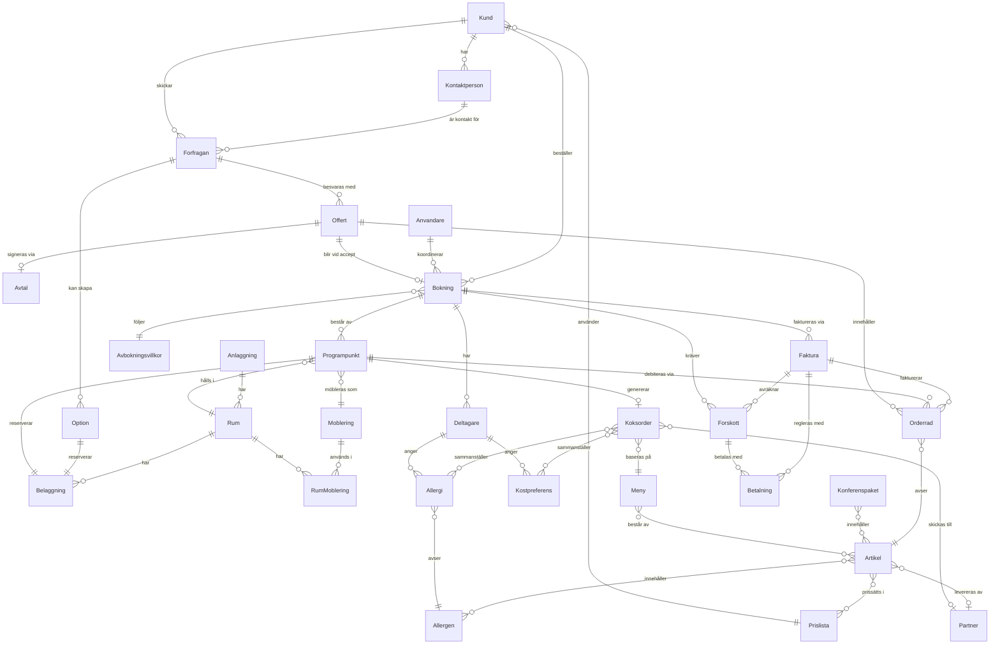

# Domänmodell

Entiteter för ett bokningssystem för konferens + mat & dryck. Fasning: **MVP**, **Fas 2**, **Fas 3**. ★ = differentierare mot Lega och övriga.

Interaktiv vy: [artefakter/domanmodell.html](artefakter/domanmodell.html).

## Kärnflöde

Förfrågan → Option → Offert → Signering → Bokning → Programpunkter → Deltagare & kost → Köksorder → Genomförande → Faktura → Fortnox / Visma

## ER-diagram (MVP)

## Sälj & kund

### Kund (organisation)

*MVP* · Företaget som köper konferensen.

**Attribut**
- namn
- orgnr
- fakturaadress
- Peppol-ID / e-fakturaadress
- prislista
- betalvillkor (dagar)
- kreditgräns

**Relationer**
- `1:N` har → Kontaktperson
- `1:N` skickar → Förfrågan
- `N:1` använder → Prislista
- `1:N` beställer → Bokning

### Kontaktperson

*MVP* · Beställare, fakturamottagare eller arrangör.

**Attribut**
- namn
- e-post
- telefon
- roll (beställare / fakturamottagare)
- GDPR-samtycke

**Relationer**
- `N:1` Kund (organisation) har denna
- `1:N` är kontakt för → Förfrågan

### Förfrågan ★

*MVP* · Inkommande intresse innan något är bokat.

**Attribut**
- kanal (formulär, mejl, telefon, Venuu)
- önskade datum (flera alternativ)
- ungefärligt antal
- budget
- status (ny → kvalificerad → offererad → vunnen / förlorad)
- förlustorsak
- ansvarig säljare

**Relationer**
- `N:1` Kund (organisation) skickar denna
- `N:1` Kontaktperson är kontakt för denna
- `1:N` besvaras med → Offert
- `1:N` kan skapa → Option
- `0..1:N` Kommunikation & logg gäller denna

> ★ Pipeline med förlustorsak saknas hos Lega.

### Option ★

*MVP* · Preliminärt hållet rum med förfallodatum.

**Attribut**
- rum
- datum och tid
- optionsdatum (förfaller)
- ordning (1:a / 2:a option)
- påminnelse före förfall

**Relationer**
- `N:1` Förfrågan kan skapa denna
- `1:1` reserverar → Beläggning

> ★ Kö av första- och andraoptioner på samma rum frigör tid automatiskt.

### Offert ★

*MVP* · Versionerat förslag med rader och villkor.

**Attribut**
- versionsnr
- giltig till
- status (utkast / skickad / accepterad / avböjd)
- rader (kopior av orderrader)
- summa exkl. och inkl. moms
- villkorstext

**Relationer**
- `N:1` Förfrågan besvaras med denna
- `1:0..1` signeras via → Avtal & signering
- `1:0..1` blir vid accept → Bokning
- `1:N` innehåller → Orderrad

> ★ Versioner med ändringsmarkering mot föregående.

### Avtal & signering

*MVP* · Bindande accept av offerten.

**Attribut**
- metod (BankID / signeringslänk)
- signerad av
- tidpunkt
- dokument-hash
- bifogade villkor

**Relationer**
- `0..1:1` Offert signeras via denna

## Bokning & program

### Bokning

*MVP* · Konferensen eller eventet som helhet.

**Attribut**
- referensnr
- status (preliminär / bekräftad / avbokad / genomförd)
- start – slut
- beräknat antal
- garanterat antal (låses X dagar före)
- koordinator
- avbokningsvillkor

**Relationer**
- `0..1:1` Offert blir vid accept denna
- `1:N` består av → Programpunkt
- `1:N` har → Deltagare
- `N:1` följer → Avbokningsvillkor
- `1:N` kräver → Förskott
- `1:N` faktureras via → Faktura
- `N:1` Användare koordinerar denna
- `N:1` Kund (organisation) beställer denna
- `0..1:N` Kommunikation & logg gäller denna

### Programpunkt

*MVP* · En rad i dagens körschema: möte, fika, lunch, aktivitet.

**Attribut**
- typ (möte, fika, lunch, middag, aktivitet, mingel)
- start – slut
- rum
- möblering
- antal
- ansvarig
- intern notering

**Relationer**
- `N:1` Bokning består av denna
- `N:1` hålls i → Rum
- `N:1` möbleras som → Möblering
- `1:N` debiteras via → Orderrad
- `1:0..1` genererar → Köksorder
- `1:1` reserverar → Beläggning
- `1:N` kräver → Uppgift
- `1:N` Passerkod öppnar för denna

### Deltagare ★

*MVP* · Person som kommer, registrerad via länk eller import.

**Attribut**
- namn
- e-post
- organisation
- allergier
- kostpreferenser
- närvarostatus
- källa (länk / import / manuellt)

**Relationer**
- `N:1` Bokning har denna
- `1:N` anger → Allergi
- `1:N` anger → Kostpreferens

> ★ Deltagarlista med kost per person: bara Venjue (DK) har det bekräftat.

### Allergi ★

*MVP* · Allergi eller överkänslighet hos en deltagare. Säkerhetskritisk: en krock med en artikels allergener är en blockerare.

**Attribut**
- allergen (obligatorisk)
- allvarlighetsgrad (intolerans / allergi / anafylaxi)
- anteckning

**Relationer**
- `N:1` Deltagare anger denna
- `N:1` avser → Allergen
- `M:N` Köksorder sammanställer denna

> ★ Slår igenom i köksordern per namn och per allergen. Matchas mot Artikel.allergener.

### Kostpreferens

*MVP* · Val av kost som inte är en säkerhetsfråga.

**Attribut**
- typ (vegetarisk / vegansk / halal / kosher / annat)
- fritext (för annat)

**Relationer**
- `N:1` Deltagare anger denna
- `M:N` Köksorder sammanställer denna

> Matchas mot Artikel.kostmärkning, inte mot allergener. I köksordern som antal och namn, efter allergierna.

### Avbokningsvillkor

*MVP* · Regler för avbokning och minskat antal.

**Attribut**
- tidsgränser (t.ex. 30 / 14 / 7 dagar)
- debiteringsgrad per gräns
- tillåten minskning av antal (%)
- gäller kund eller anläggning

**Relationer**
- `1:N` Bokning följer denna

## Lokaler & resurser

### Anläggning

*MVP* · Byggnad eller site med rum.

**Attribut**
- namn
- adress
- öppettider
- standardmoms
- kontaktuppgifter

**Relationer**
- `1:N` har → Rum

### Rum

*MVP* · Bokningsbar lokal.

**Attribut**
- namn
- våning
- yta (m²)
- takhöjd
- dagsljus (ja/nej)
- max kapacitet
- kombinerbar med (andra rum)
- pris per timme / halvdag / heldag
- bilder

**Relationer**
- `1:N` Programpunkt hålls i denna
- `N:1` Anläggning har denna
- `1:N` har → Rum × möblering
- `1:N` har → Beläggning
- `1:N` Rumsskylt sitter vid denna

### Möblering

*MVP* · Uppställningstyp.

**Attribut**
- typ (bio, klassrum, U-bord, styrelse, ö-sittning, bankett, mingel)
- ställtid (minuter)
- standardutrustning

**Relationer**
- `1:N` Programpunkt möbleras som denna
- `1:N` används i → Rum × möblering

### Rum × möblering

*MVP* · Kapacitet per rum och uppställning.

**Attribut**
- rum
- möblering
- kapacitet

**Relationer**
- `N:1` Rum har denna
- `N:1` Möblering används i denna

### Beläggning ★

*MVP* · Tidsblock på ett rum. Grunden för krockkontroll.

**Attribut**
- rum
- start – slut
- typ (bokning, option, ställtid, underhåll, internt)
- källa

**Relationer**
- `1:1` Programpunkt reserverar denna
- `1:1` Option reserverar denna
- `N:1` Rum har denna

> ★ Ställtid mellan grupper räknas in automatiskt.

### Utrustning

*Fas 2* · AV och lösa resurser.

**Attribut**
- namn
- antal i lager
- pris
- rumsbunden eller flyttbar

**Relationer**
- `0..1:N` Orderrad bokar denna

### Partner ★

*MVP* · Extern leverantör: restaurang, aktivitet, AV.

**Attribut**
- typ (restaurang / catering, aktivitet, AV, transport)
- kontaktuppgifter
- tar emot köksorder (ja/nej)
- avräkning (inköp / provision)

**Relationer**
- `0..1:N` Köksorder skickas till denna
- `0..1:N` Artikel levereras av denna

> ★ World of Volvo köper all konferensmat av en extern operatör. Köksordern måste kunna gå över bolagsgräns.

## Mat & dryck

### Artikel

*MVP* · Allt som kan säljas: rätt, dryck, lokalhyra, aktivitet.

**Attribut**
- namn
- kategori (fika, lunch, middag, dryck, lokal, utrustning, aktivitet)
- prisenhet (per person / st / timme)
- momssats
- kostnadsställe
- allergener
- kostmärkning (vegetarisk / vegansk / halal / kosher)
- leverantör (eget kök / partner)

**Relationer**
- `N:M` innehåller → Allergen
- `M:N` Meny består av denna
- `M:N` Konferenspaket innehåller denna
- `1:N` Orderrad avser denna
- `N:M` prissätts i → Prislista
- `N:0..1` levereras av → Partner

### Allergen

*MVP* · De 14 allergener som måste anges enligt EU:s förordning 1169/2011. Globalt, skrivskyddat referensdata (seedat, inte per organisation).

**Attribut**
- kod
- namn
- ikon

**Relationer**
- `1:N` Allergi avser denna
- `M:N` Artikel innehåller denna

### Meny

*MVP* · Uppsättning rätter med valbara alternativ.

**Attribut**
- namn
- rätter (artiklar)
- valbara alternativ
- säsong
- sista dag för menyval

**Relationer**
- `N:M` består av → Artikel
- `1:N` Köksorder baseras på denna

### Konferenspaket ★

*MVP* · Pris per person för rum, fika och mat ihop.

**Attribut**
- namn
- pris per person
- ingående artiklar och tider
- minsta antal
- momsfördelning per ingående del

**Relationer**
- `N:M` innehåller → Artikel

> ★ World of Volvo säljer paket från 590 till 1 016 kr per person.

### Köksorder ★

*MVP* · Function sheet till kök eller partner.

**Attribut**
- programpunkt
- serveringstid
- antal kuvert
- menyval
- allergier per allergen och per namn
- kostpreferenser (antal och namn)
- mottagare (eget kök / partner)
- version och ändringsmarkering

**Relationer**
- `0..1:1` Programpunkt genererar denna
- `N:1` baseras på → Meny
- `N:M` sammanställer → Allergi
- `N:M` sammanställer → Kostpreferens
- `N:0..1` skickas till → Partner

> ★ Versionerad, med ändringar markerade sedan senaste utskick.

## Ekonomi

### Prislista

*MVP* · Pris per säsong, veckodag eller kund.

**Attribut**
- namn
- giltighet
- säsong / veckodag
- kundspecifik
- rabatt (%)

**Relationer**
- `1:N` Kund (organisation) använder denna
- `M:N` Artikel prissätts i denna

### Orderrad

*MVP* · Det som faktiskt debiteras.

**Attribut**
- artikel
- antal
- á-pris
- rabatt
- moms
- programpunkt
- status (offererad / bekräftad / levererad)
- faktureras (ja/nej)

**Relationer**
- `N:1` Offert innehåller denna
- `N:1` Programpunkt debiteras via denna
- `N:1` avser → Artikel
- `N:0..1` bokar → Utrustning
- `N:1` Faktura fakturerar denna

### Förskott

*MVP* · Delbetalning vid bekräftelse.

**Attribut**
- belopp
- förfallodatum
- status
- kopplat avtal

**Relationer**
- `N:1` Bokning kräver denna
- `1:N` betalas med → Betalning
- `N:1` Faktura avräknar denna

### Betalning ★

*MVP* · Inbetalning via Swish, kort eller faktura.

**Attribut**
- metod (Swish / kort / faktura)
- PSP-referens
- belopp
- tidpunkt
- återbetalning

**Relationer**
- `N:1` Förskott betalas med denna
- `N:1` Faktura regleras med denna

> ★ Swish och kort direkt i bokningen. Lega visar ingen onlinebetalning.

### Faktura

*MVP* · Slutfaktura efter genomförande.

**Attribut**
- fakturanr
- förfallodatum
- status
- avräknat förskott
- exportstatus (Fortnox / Visma)
- e-faktura

**Relationer**
- `N:1` Bokning faktureras via denna
- `1:N` regleras med → Betalning
- `1:N` fakturerar → Orderrad
- `1:N` avräknar → Förskott

## Drift & system

### Användare

*MVP* · Personal med roll och behörighet.

**Attribut**
- namn
- roll (säljare, koordinator, kök, vaktmästare, ekonomi, admin)
- behörigheter
- anläggningar

**Relationer**
- `1:N` koordinerar → Bokning
- `1:N` ansvarar för → Uppgift

### Uppgift

*Fas 2* · Ställ rum, AV-test, städ.

**Attribut**
- kopplad programpunkt
- typ
- ansvarig
- deadline
- status

**Relationer**
- `N:1` Användare ansvarar för denna
- `N:1` Programpunkt kräver denna

### Kommunikation & logg

*Fas 2* · Mejl, anteckningar och ändringshistorik.

**Attribut**
- kanal
- riktning (in / ut)
- ämne
- kopplad förfrågan / bokning
- ändringslogg

**Relationer**
- `N:0..1` gäller → Bokning
- `N:0..1` gäller → Förfrågan

### Rumsskylt

*Fas 3* · Skärm vid rummet med dagens program.

**Attribut**
- rum
- enhet
- visade programpunkter

**Relationer**
- `N:1` sitter vid → Rum

### Passerkod

*Fas 3* · Digitalt lås kopplat till bokad tid.

**Attribut**
- programpunkt / rum
- kod eller mobilnyckel
- giltig från – till

**Relationer**
- `N:1` öppnar för → Programpunkt

## Ordlista sv↔en

Svenska termer används i dokumentation och UI. Engelska namn används i kod, API:er och MCP-verktyg (se [ADR 0009](beslut/0009-sprak-i-kod-och-ui.md)).

| Svenska | Engelska (kod) |
|---|---|
| Anläggning | Venue |
| Rum | Room |
| Kund | Customer |
| Kontaktperson | Contact |
| Förfrågan | Inquiry |
| Option | Option |
| Offert | Quote |
| Avtal | Agreement |
| Bokning | Booking |
| Programpunkt | AgendaItem |
| Deltagare | Attendee |
| Allergi | Allergy |
| Kostpreferens | DietaryPreference |
| Allergen | Allergen |
| Köksorder | KitchenOrder |
| Faktura | Invoice |
| Förskott | Deposit |
| Betalning | Payment |
| Prislista | PriceList |
| Artikel | Article |
| Meny | Menu |
| Konferenspaket | ConferencePackage |
| Möblering | Layout |
| Beläggning | Occupancy |
| Partner | Partner |
| Avbokningsvillkor | CancellationTerms |
| Orderrad | OrderLine |
| Användare | User |
