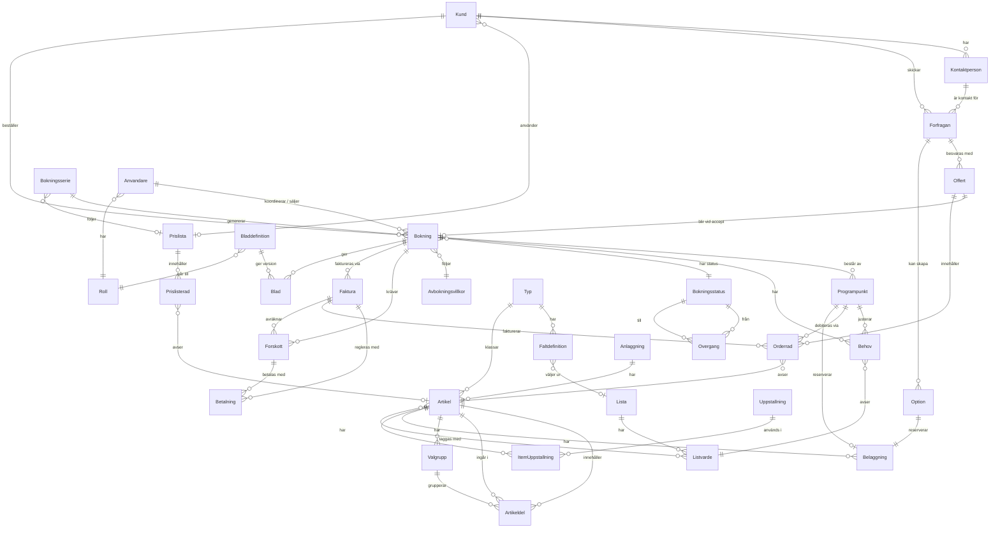

# Domänmodell

Entiteter för ett bokningssystem för konferens + mat & dryck. Fasning: **MVP**, **Fas 2**, **Fas 3**. ★ = differentierare mot Lega och övriga.

Interaktiv vy: [artefakter/domanmodell.html](artefakter/domanmodell.html).

Modellen är konfigurerbar (se [ADR 0021](beslut/0021-configurable-items.md)). Koden innehåller inga domänord som rätt, allergen, rum eller köksorder. Varje organisation sätter upp sina egna typer, fält, listor, uppställningar, statusar, blad och roller. Koden äger bara generella beteenden och fasta faser. Se avsnittet Konfiguration.

## Kärnflöde

Förfrågan → Option → Offert → Signering (senare) → Bokning → Programpunkter → Behov → Blad → Genomförande → Faktura → Fortnox / Visma

## ER-diagram (MVP)

## Konfiguration

*MVP* · Det organisationen sätter upp själv. Allt är data per organisation och skapas via vanliga operationer ([ADR 0021](beslut/0021-configurable-items.md)).

En ny organisation börjar tom. Inget är förinstallerat, förutom rollen `owner` och en bokningsstatus per fas så att bokningar fungerar direkt. Mallar kan importeras, till exempel listan "EU:s 14 allergener" eller startpaketet "Konferensgård". En mall är bara data och kan ändras fritt efteråt. AI-assistenten kan föreslå en konfiguration, och användaren godkänner.

### Typ (`EntityType`)

*MVP* · Organisationens egen typ för en grundentitet: artikel, kund, kontaktperson, förfrågan, bokning eller behov.

**Attribut**
- grundentitet (artikel / kund / kontaktperson / förfrågan / bokning / behov)
- namn (t.ex. Konferensrum, Rätt, Båt, Paket, Företag, Konferens)
- beteenden (endast för artikel, se Artikel)

**Relationer**
- `1:N` har → Fältdefinition
- `1:N` klassar → Artikel (och kund, bokning m.fl.)

> Ett beteende kan inte stängas av på en typ så länge någon artikel av typen har data för det (`CONFLICT`).

### Fältdefinition (`FieldDefinition`)

*MVP* · Ett eget fält på en typ.

**Attribut**
- namn
- fälttyp (text, tal, ja/nej, datum, val, flerval ur en lista, länk till annan typ)
- obligatoriskt
- lista (för val och flerval)

**Relationer**
- `N:1` Typ har denna
- `N:0..1` väljer ur → Lista

> Värdena lagras som JSON på raden. Ett Zod-schema byggs från definitionerna och validerar dem.

### Lista (`Vocabulary`) och listvärde (`VocabularyValue`)

*MVP* · Organisationens egna ordlistor, t.ex. Allergener, Kost, Tillgänglighet eller Dresscode.

**Attribut**
- lista: namn
- värde: namn, ordning, arkiverad

**Relationer**
- `1:N` Lista har → Listvärde
- `N:M` Artikel taggas med → Listvärde
- `1:N` Behov avser ← Listvärde

### Uppställning (`Setup`)

*MVP* · Organisationens egna uppställningar, t.ex. Bio, U-bord och Mingel.

**Attribut**
- namn
- ställtid (minuter)

**Relationer**
- `1:N` används i → Item-uppställning

### Item-uppställning (`ItemSetup`)

*MVP* · Kapacitet per bokningsbar artikel och uppställning. Kräver beteendet `SETUPS`.

**Attribut**
- artikel
- uppställning
- kapacitet

**Relationer**
- `N:1` Artikel har denna
- `N:1` Uppställning används i denna

### Blad-definition (`SheetDefinition`)

*MVP* · Hur ett blad ser ut, t.ex. "Köksorder" eller "Bryggorder".

**Attribut**
- namn
- artikeltyper och fält som ingår
- listor vars behov tas med
- mottagande roll

**Relationer**
- `N:1` går till → Roll
- `1:N` ger → Blad

### Bokningsstatus (`BookingStatus`) med fas och övergångar

*MVP* · Organisationens egna statusar för bokning. Varje status hör till en fast fas som styr systemets regler ([ADR 0022](beslut/0022-sales-pipeline-and-booking-states.md)).

**Attribut**
- namn
- färg
- ordning
- fas (`TENTATIVE` / `CONFIRMED` / `COMPLETED` / `CANCELLED`)
- arkiverad (en status som används kan arkiveras men inte tas bort)

**Relationer**
- `1:N` Bokning har denna
- `1:N` är från/till i → Övergång (`BookingStatusTransition`, från → till)

| Fas | Systemets regler |
|---|---|
| `TENTATIVE` | Bokningsbara artiklar är belagda. Blad kan inte skickas. |
| `CONFIRMED` | Kräver koordinator. Blad och förskott kan skickas. |
| `COMPLETED` | Tillåts först efter bokningens slut. Bokningen kan faktureras. |
| `CANCELLED` | Kräver orsak. Beläggningen frigörs och avbokningsvillkoren tillämpas. |

> Organisationen definierar tillåtna övergångar. Fasreglerna kan inte stängas av. Rapporter grupperar på fas, inte på status.

### Roll (`organizationRole`)

*MVP* · Namngiven uppsättning behörigheter per organisation ([ADR 0020](beslut/0020-custom-roles-per-organization.md)).

**Attribut**
- namn
- behörigheter (`<resurs>:read|write|admin`, högre åtgärd innefattar lägre)
- system (`owner` är fast och kan inte ändras eller tas bort)
- status (aktiv / arkiverad; kan bara arkiveras när ingen medlem har rollen)

**Relationer**
- `1:N` Användare har denna
- `1:N` Blad-definition går till denna

## Sälj & kund

### Kund (organisation)

*MVP* · Företaget som köper konferensen. Har en typ med egna fält, t.ex. Företag eller Myndighet.

**Attribut**
- typ och egna fält (t.ex. orgnr, Peppol-ID, ramavtal)
- namn
- fakturaadress
- prislista
- betalvillkor (dagar)
- kreditgräns

**Relationer**
- `1:N` har → Kontaktperson
- `1:N` skickar → Förfrågan
- `N:0..1` använder → Prislista
- `1:N` beställer → Bokning

### Kontaktperson

*MVP* · Beställare, fakturamottagare eller arrangör.

**Attribut**
- typ och egna fält
- namn
- e-post
- telefon
- roll (beställare / fakturamottagare)
- GDPR-samtycke

**Relationer**
- `N:1` Kund (organisation) har denna
- `1:N` är kontakt för → Förfrågan

### Förfrågan ★

*MVP* · Inkommande intresse innan något är bokat. Fast statusmaskin, egna kommandon per övergång.

**Attribut**
- typ och egna fält
- kanal (formulär, mejl, telefon, Venuu)
- önskade datum (flera alternativ)
- ungefärligt antal
- budget
- status: `NEW → QUALIFIED → QUOTED → WON`, eller `LOST`
- förlustorsak (krävs vid `LOST`)
- ansvarig säljare (`salesOwnerId`, krävs från `QUALIFIED`)
- statusChangedAt

**Relationer**
- `N:1` Kund (organisation) skickar denna
- `N:1` Kontaktperson är kontakt för denna
- `1:N` besvaras med → Offert
- `1:N` kan skapa → Option
- `0..1:N` Kommunikation & logg gäller denna

> ★ Pipeline med förlustorsak saknas hos Lega. Status ändras bara via kommandon (`inquiry.qualify`, `inquiry.markLost`), aldrig via `update`.

### Option ★

*MVP* · Preliminärt hållen bokningsbar artikel med förfallodatum.

**Attribut**
- artikel (med beteendet `BOOKABLE`)
- start – slut
- förfaller (datum)
- rang (1:a / 2:a option, sätts automatiskt)
- påminnelse före förfall
- status: `ACTIVE → CONVERTED`, `EXPIRED` eller `RELEASED`

**Relationer**
- `N:1` Förfrågan kan skapa denna
- `1:1` reserverar → Beläggning

> ★ Optioner står i kö per bokningsbar artikel och tid. Rangen är antal aktiva överlappande optioner + 1. När en option släpps eller förfaller flyttas de bakomliggande upp. `option.expireDue` förfaller optioner vars datum passerat.

### Offert ★

*MVP* · Versionerat förslag med rader och villkor. Fast statusmaskin.

**Attribut**
- versionsnr
- giltig till
- status: `DRAFT → SENT → ACCEPTED`, `DECLINED` eller `EXPIRED`
- rader (kopior av orderrader)
- summa exkl. och inkl. moms
- villkorstext
- säljare (ärvs från förfrågan)
- acceptedBy, acceptedAt, acceptanceMethod (`MANUAL` nu, senare `BANKID` och `LINK`)

**Relationer**
- `N:1` Förfrågan besvaras med denna
- `1:0..1` blir vid accept → Bokning
- `1:N` innehåller → Orderrad

> ★ Versioner med ändringsmarkering mot föregående. `quote.accept` gör förfrågan `WON`, omvandlar optionerna (`CONVERTED`) och skapar bokningen. En offert kan gälla en hel serie. En offert kan också byggas direkt av artiklar, och "Spara som paket" skapar då en kundspecifik artikel.

### Avtal & signering

*Fas 2* · Bindande accept av offerten med BankID eller signeringslänk. Signering skjuts upp. Tills dess sparar offerten bara `acceptedBy`, `acceptedAt` och `acceptanceMethod`.

**Attribut**
- metod (BankID / signeringslänk)
- signerad av
- tidpunkt
- dokument-hash
- bifogade villkor

**Relationer**
- `0..1:1` Offert signeras via denna

## Bokning & program

### Bokning

*MVP* · Konferensen eller eventet som helhet. Varje tillfälle i en serie är en vanlig bokning.

**Attribut**
- referensnr
- bokningstyp (organisationens egen typ, t.ex. Konferens eller Event) och egna fält
- status (organisationens egen `BookingStatus`, med fast fas)
- start – slut
- beräknat antal
- garanterat antal (låses X dagar före)
- säljare (`salesOwnerId`)
- koordinator (`coordinatorId`, krävs från fasen `CONFIRMED`)
- avbokningsvillkor
- seriesId och occurrenceIndex (om bokningen hör till en serie)
- statusChangedAt

**Relationer**
- `0..1:1` Offert blir vid accept denna
- `N:0..1` Bokningsserie genererar denna
- `1:N` består av → Programpunkt
- `1:N` har → Behov
- `N:1` har status → Bokningsstatus
- `N:1` följer → Avbokningsvillkor
- `1:N` kräver → Förskott
- `1:N` faktureras via → Faktura
- `1:N` ger → Blad
- `N:1` Användare koordinerar och säljer denna
- `N:1` Kund (organisation) beställer denna
- `0..1:N` Kommunikation & logg gäller denna

> Status ändras bara med `booking.changeStatus`. En snabbokning skapas av personalen i en `TENTATIVE`-status. Kunden betalar via Swish- eller kortlänk (då bekräftas bokningen när betalningen är klar) eller mot faktura. `booking.export` ger bokningen som json, pdf eller csv ([ADR 0024](beslut/0024-booking-export-instead-of-partner.md)).

### Bokningsserie

*MVP* · Återkommande bokning, t.ex. ett mötesrum första tisdagen varje månad ([ADR 0023](beslut/0023-recurring-bookings-and-customer-pricing.md)).

**Attribut**
- kund
- mall (artiklar inkl. bokningsbar artikel, uppställning och tider)
- regel (delmängd av RFC 5545 RRULE: `FREQ`, `INTERVAL`, `BYDAY`, `BYMONTHDAY`, `COUNT` eller `UNTIL`)
- prislista

**Relationer**
- `1:N` genererar → Bokning
- `N:0..1` följer → Prislista

> Tillfällen skapas när serien skapas, högst 12 månader eller 52 tillfällen fram. Krockande tillfällen markeras och returneras så att användaren kan välja annan artikel eller tid. Ändringar görs för "bara detta tillfälle" eller "detta och följande". Att avboka serien avbokar alla kommande tillfällen.

### Programpunkt

*MVP* · En rad i dagens körschema: möte, fika, lunch, aktivitet. Skapas bland annat när en sammansatt artikel läggs på bokningen.

**Attribut**
- namn och typ (organisationens egen)
- start – slut
- bokningsbar artikel (t.ex. lokal)
- uppställning
- antal
- ansvarig (`responsibleId`, valfri)
- intern notering

**Relationer**
- `N:1` Bokning består av denna
- `N:0..1` hålls i → Artikel (bokningsbar)
- `N:0..1` ställs upp som → Uppställning
- `1:N` justerar → Behov
- `1:N` debiteras via → Orderrad
- `1:0..1` reserverar → Beläggning
- `1:N` kräver → Uppgift
- `1:N` Passerkod öppnar för denna

### Behov ★ (`Requirement`)

*MVP* · Antal per listvärde på en bokning eller en programpunkt, t.ex. Gluten × 3 eller Rullstol × 2. Aldrig kopplat till en person. Det finns inga personuppgifter om enskilda gäster ([ADR 0021](beslut/0021-configurable-items.md)).

**Attribut**
- bokning eller programpunkt
- listvärde
- antal
- typ och egna fält (t.ex. allvarlighetsgrad)

**Relationer**
- `N:1` Bokning har denna
- `N:0..1` Programpunkt justerar med denna
- `N:1` avser → Listvärde

> ★ En rad på programpunkten ersätter bokningens antal där. Matchning: behovet jämförs med artiklarna på bokningen som är taggade med samma listvärde. En träff på en obligatorisk del utan alternativ flaggas och blockerar bladet. `item.resolve` räknar fram ärvda taggar och är enda platsen för det.

### Avbokningsvillkor

*MVP* · Regler för avbokning och minskat antal.

**Attribut**
- tidsgränser (t.ex. 30 / 14 / 7 dagar)
- debiteringsgrad per gräns
- tillåten minskning av antal (%)
- gäller kund eller anläggning

**Relationer**
- `1:N` Bokning följer denna

## Lokaler & resurser

### Anläggning

*MVP* · Byggnad eller site. Bokningsbara artiklar hör till en anläggning.

**Attribut**
- namn
- adress
- öppettider
- standardmoms
- kontaktuppgifter

**Relationer**
- `1:N` har → Artikel

### Beläggning ★

*MVP* · Tidsblock på en bokningsbar artikel. Grunden för krockkontroll.

**Attribut**
- artikel (med beteendet `BOOKABLE`)
- start – slut
- typ (`BOOKING`, `OPTION`, `SETUP`, `MAINTENANCE`, `INTERNAL`)
- källa

**Relationer**
- `1:1` Programpunkt reserverar denna
- `1:1` Option reserverar denna
- `N:1` Artikel har denna

> ★ Alla typer utom `OPTION` får inte överlappa på samma artikel. Det säkras med en exclusion constraint i Postgres. Ställtid läggs in som `SETUP` utifrån uppställningens ställtid.

## Artiklar

### Artikel (`Item`)

*MVP* · Allt som kan säljas eller bokas: rätt, dryck, lokal, utrustning, guide, paket. Ersätter de gamla Artikel, Meny, Konferenspaket, Rum, Möblering och Utrustning.

**Attribut**
- typ (organisationens egen) och egna fält
- namn
- beteenden som typen slår på:
  - `PRICED`: pris, prisenhet (`PER_PERSON`, `PER_UNIT`, `PER_HOUR`, `FLAT`), moms och orderrader
  - `COMPOSABLE`: innehåller andra artiklar med antal, `offsetMinutes` och `durationMinutes`
  - `CHOICES`: valgrupper bland delarna. Kräver `COMPOSABLE`.
  - `BOOKABLE`: beläggning i tid, krockskydd och standardlängd
  - `SETUPS`: kapacitet per uppställning och ställtid. Kräver `BOOKABLE`.
- taggar (listvärden)
- kundId (`null` = katalogartikel, satt = kundspecifikt paket)
- anläggning

**Relationer**
- `N:1` klassas av → Typ
- `N:0..1` hör till → Anläggning
- `1:N` innehåller → Artikeldel
- `1:N` ingår i → Artikeldel
- `1:N` har → Valgrupp
- `1:N` har → Beläggning
- `1:N` har → Item-uppställning
- `N:M` taggas med → Listvärde
- `1:N` Orderrad avser denna
- `1:N` Prislisterad avser denna

> Ett rum är en artikel med `BOOKABLE` + `SETUPS`. Ett konferenspaket är en artikel med `COMPOSABLE` + `CHOICES`. Ärvda taggar: obligatoriska delar ger "innehåller", valbara delar ger "kan innehålla" per alternativ. När en artikel läggs på en bokning expanderar core den till programpunkter, beläggning och orderrader. Raderna kopierar namn, pris, moms och taggar (snapshot).

### Artikeldel (`ItemComponent`)

*MVP* · En del i en sammansatt artikel.

**Attribut**
- överordnad artikel
- artikel (delen)
- antal
- offsetMinutes
- durationMinutes
- obligatorisk eller valbar
- valgrupp

**Relationer**
- `N:1` Artikel innehåller denna
- `N:1` avser → Artikel
- `N:0..1` ingår i → Valgrupp

> Grafen är acyklisk. Core avvisar cykler och mer än 5 nivåers djup med `VALIDATION`. I ett paket debiteras paketets pris. Momsen fördelas på delarna i proportion till delarnas listpris.

### Valgrupp (`ItemChoiceGroup`)

*MVP* · Valbara alternativ bland delarna i en sammansatt artikel.

**Attribut**
- namn
- minPick
- maxPick

**Relationer**
- `N:1` Artikel har denna
- `1:N` grupperar → Artikeldel

### Blad ★ (`Sheet`)

*MVP* · Sammanställning till en roll, t.ex. köksorder, bryggorder eller guidebrief. Skapas utifrån en blad-definition. Ersätter Köksorder.

**Attribut**
- bokning
- blad-definition
- artiklar och fält enligt definitionen
- behov per listvärde (antal, aldrig namn)
- blockerad (ja/nej) och träffar
- mottagande roll
- version och ändringsmarkering

**Relationer**
- `N:1` Bokning ger denna
- `N:1` Blad-definition ger denna version

> ★ Versionerat, med ändringar markerade sedan senaste utskick. Kan inte skickas i fasen `TENTATIVE`. `sheet.export` ger ett enskilt blad som json, pdf eller csv, alltid med senaste version och versionsnummer. Det är så ett blad lämnas till någon utanför systemet.

## Ekonomi

### Prislista

*MVP* · Pris per säsong, veckodag eller kund ([ADR 0023](beslut/0023-recurring-bookings-and-customer-pricing.md)).

**Attribut**
- namn
- giltighet
- säsong / veckodag
- kund (valfri, för kundpris)
- generell rabatt (%)

**Relationer**
- `N:0..1` Kund (organisation) använder denna
- `N:0..1` Bokningsserie följer denna
- `1:N` innehåller → Prislisterad

### Prislisterad (`PriceListItem`)

*MVP* · Pris per artikel i en prislista.

**Attribut**
- prislista
- artikel
- pris

**Relationer**
- `N:1` Prislista innehåller denna
- `N:1` avser → Artikel

> Orderrader kopierar priset när de skapas. En ändrad prislista påverkar bara nya rader.

### Orderrad

*MVP* · Det som faktiskt debiteras. Kopior (snapshot) av artikelns namn, pris, moms och taggar.

**Attribut**
- artikel
- antal
- á-pris
- rabatt
- moms
- programpunkt
- status (offererad / bekräftad / levererad)
- faktureras (ja/nej)

**Relationer**
- `N:1` Offert innehåller denna
- `N:1` Programpunkt debiteras via denna
- `N:1` avser → Artikel
- `N:1` Faktura fakturerar denna

### Förskott

*MVP* · Delbetalning vid bekräftelse. Kan skickas först i fasen `CONFIRMED`.

**Attribut**
- belopp
- förfallodatum
- status
- kopplat avtal

**Relationer**
- `N:1` Bokning kräver denna
- `1:N` betalas med → Betalning
- `N:1` Faktura avräknar denna

### Betalning ★

*MVP* · Inbetalning via Swish, kort eller faktura.

**Attribut**
- metod (Swish / kort / faktura)
- PSP-referens
- belopp
- tidpunkt
- återbetalning

**Relationer**
- `N:1` Förskott betalas med denna
- `N:1` Faktura regleras med denna

> ★ Swish och kort direkt i bokningen. Lega visar ingen onlinebetalning.

### Faktura

*MVP* · Slutfaktura efter genomförande. Bokningen kan faktureras först i fasen `COMPLETED`.

**Attribut**
- fakturanr
- förfallodatum
- status
- avräknat förskott
- exportstatus (Fortnox / Visma)
- e-faktura

**Relationer**
- `N:1` Bokning faktureras via denna
- `1:N` regleras med → Betalning
- `1:N` fakturerar → Orderrad
- `1:N` avräknar → Förskott

## Drift & system

### Användare

*MVP* · Medlem i organisationen. Rollerna är organisationens egna (ADR 0020).

**Attribut**
- namn
- roller (ur organisationens roller)
- anläggningar
- plattformsroll (`user` / `admin`): bara Okazis egen personal, ger `/admin` ([ADR 0015](beslut/0015-platform-admin.md))

**Relationer**
- `N:1` har → Roll
- `1:N` koordinerar och säljer → Bokning
- `1:N` ansvarar för → Uppgift

> Core slår inte upp roller. `packages/auth` löser medlemmens roller till behörigheter en gång per anrop. API-nycklar utfärdas med ett rollnamn (aldrig `owner`) och får aldrig mer än medlemmens egna behörigheter. Ingen kan ge en roll mer än hen själv har.

### Uppgift

*Fas 2* · Ställ rum, AV-test, städ.

**Attribut**
- kopplad programpunkt
- typ
- ansvarig
- deadline
- status

**Relationer**
- `N:1` Användare ansvarar för denna
- `N:1` Programpunkt kräver denna

### Kommunikation & logg

*Fas 2* · Mejl, anteckningar och ändringshistorik. Statushistorik kommer från `AuditLog`.

**Attribut**
- kanal
- riktning (in / ut)
- ämne
- kopplad förfrågan / bokning
- ändringslogg

**Relationer**
- `N:0..1` gäller → Bokning
- `N:0..1` gäller → Förfrågan

### Systemlogg

*MVP* · Plattformsdata, inte kunddata. Varje händelse i systemet (operation, anrop, inloggning, mejl, fel), sparad för plattformsadmins ([ADR 0014](beslut/0014-system-logging.md), [ADR 0015](beslut/0015-platform-admin.md)).

**Attribut**
- tid, nivå, händelse (`event`)
- tjänst och yta (webb, REST, GraphQL, MCP, AI, auth)
- request-id (kopplar ihop rader och granskningslogg)
- organisation, användare, operation, status, varaktighet, felkod
- hela raden som JSON (aldrig in- eller utdata)

**Relationer**
- `N:0..1` gäller → Användare
- delar request-id med granskningsloggen (`AuditLog`)

### AI-inställning

*MVP* · Plattformsdata. Vilken modell varje AI-funktion använder, vald av en plattformsadmin. Inga standardmodeller: utan val fungerar funktionen inte.

**Attribut**
- AI-funktion (`assistant.chat`, `search.embedding`)
- modell (från Vercel AI Gateway, måste vara möjlig för funktionen)
- ändrad av, ändrad

**Relationer**
- `N:1` ändrad av → Användare

### Skylt

*Fas 3* · Skärm vid en bokningsbar artikel (t.ex. ett rum) med dagens program.

**Attribut**
- artikel (med beteendet `BOOKABLE`)
- enhet
- visade programpunkter

**Relationer**
- `N:1` sitter vid → Artikel

### Passerkod

*Fas 3* · Digitalt lås kopplat till bokad tid.

**Attribut**
- programpunkt / artikel
- kod eller mobilnyckel
- giltig från – till

**Relationer**
- `N:1` öppnar för → Programpunkt

## Ordlista sv↔en

Svenska termer används i dokumentation och UI. Engelska namn används i kod, API:er och MCP-verktyg (se [ADR 0009](beslut/0009-sprak-i-kod-och-ui.md)).

| Svenska | Engelska (kod) |
|---|---|
| Anläggning | Venue |
| Typ | EntityType |
| Fältdefinition | FieldDefinition |
| Lista | Vocabulary |
| Listvärde | VocabularyValue |
| Uppställning | Setup |
| Item-uppställning | ItemSetup |
| Artikel | Item |
| Artikeldel | ItemComponent |
| Valgrupp | ItemChoiceGroup |
| Kund | Customer |
| Kontaktperson | Contact |
| Förfrågan | Inquiry |
| Option | Option |
| Offert | Quote |
| Avtal | Agreement |
| Bokning | Booking |
| Bokningsstatus | BookingStatus |
| Övergång | BookingStatusTransition |
| Bokningsserie | BookingSeries |
| Programpunkt | ProgramItem |
| Behov | Requirement |
| Blad | Sheet |
| Blad-definition | SheetDefinition |
| Beläggning | Occupancy |
| Skylt | Sign |
| Roll | organizationRole |
| Faktura | Invoice |
| Förskott | Deposit |
| Betalning | Payment |
| Prislista | PriceList |
| Prislisterad | PriceListItem |
| Avbokningsvillkor | CancellationTerms |
| Orderrad | OrderLine |
| Användare | User |
| Systemlogg | SystemLog |
| AI-inställning | AiSetting |
